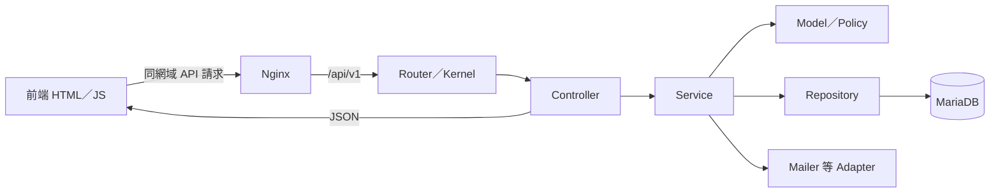

# API 與前端分離的架構設計

2026-10-24 階段八新增兩個運維入口：HTTP精確health在一般kernel的eager DB之前組裝，HealthController → ApplicationHealth → DatabaseHealthProbe／PdoDatabaseHealthProbe → HealthReport；一般API授權分層保留。readiness.php／recovery.php是CLI composition，RecoveryRepository管SQL、RecoveryMediaInspector管檔案完整性，PdoTransactions管撤銷交易。Python工具僅部署編排，不新增PHP View或繞過公開發布閘門。檔案導讀見 [運維指南](modules/operations.md)、[部署操作](P0-OPERATIONS.md)。33表／18migration不變，正式app／web／worker封裝同manifest。

2026-10-24 階段七（E-28）：SeoSettingsController → SeoSettings → 三個明確 Repository；DTO／enum／policy 限定文件、目標與 URL。Service 組織版本鎖、設定／覆寫／audit 交易；SeoPublication 將公開覆寫加入 ContentPublication，PublicSiteSettings 從成功快照取白名單。前端 resolver／head 共用 build／publish／預覽規則，Nginx gate 避免混版；管理／認證／私人 shell 固定 noindex 且可獨立修復，政策版本也納入 projection。沒有 PHP View、通用 key-value API、額外 ORM／快取服務；見 [SEO 指南](modules/seo-settings.md)／[本機驗收](PHASE-7-ACCEPTANCE.md)。

設計日期：2026-10-13；階段二分層改善：2026-10-17；階段三發布實作：2026-10-18；階段四電影／場次：2026-10-20；階段五公開內容／首頁：2026-10-22。

使用者指定 PHP 對網站只提供 API，前端使用原生 JavaScript／jQuery。採 MVC 的責任分工，另外拆出 Service 與 Repository，使業務流程和 SQL 能重用。這是本專案的工程選擇，Excel 並未指定 MVC、框架或 design pattern。

2026-10-23 階段六實作補充（E-27）：`config/member-routes.php` 由 Composition 註冊七個會員資源 API，沿用 Kernel 的會員 session／CSRF。FavoriteController／CurrentItineraryController → MemberFavorites／CurrentItinerary → 本人 Repository；MemberAccess 共用有效身分重查，MemberAttractions 共用成功公開投影。每次修改的交易由 Service 組織，不使用公開發布鎖或重新發布會員資料。私人 HTML 只有頁面殼，登入後向 no-store API 取資料，不把收藏或行程寫入公開 generation。完整檔案及資料流見 [會員指南](modules/member-resources.md)；整階段驗收進行中。

階段二已依以下分工從零建立 PHP API 與前端，不存在後端遷移。原始 website/ 始終保留。網站互動使用原生 JavaScript；jQuery 仍是可選工具，本階段沒有需要而未引入。

2026-10-17 依 U-02 參考 Spring Boot 改善服務責任、回應 DTO 與資料存取例外邊界；具體類別與完整資料流見 [PHP 分層閱讀指南](modules/backend-layering.md)。此為 E-01 工程設計，不新增規格功能或 API。

## 1. 責任怎麼分

| 部分 | 白話用途 | 做什麼 | 邊界 |
| --- | --- | --- | --- |
| View：frontend/ | 使用者看到、點到的畫面 | HTML、CSS、表單、列表、錯誤提示、呼叫 API | 顯示權限只是介面提示；正式授權在後端 |
| Controller | API 的接待窗口 | 讀取請求、驗證格式、建立輸入 DTO、呼叫 Service、回 JSON | 不直接寫 SQL、不輸出網頁 |
| Service | 完成一件事情的流程 | 登入、註冊、建立管理員、保存權限、交易、稽核 | 不依賴 DOM、HTTP Cookie 或 HTML；回傳結果供 Controller 使用 |
| Model／Policy | 這個網站的規則 | 帳號狀態、root 保護、有效權限、發布條件 | 不依賴 HTTP 或 PDO；簡單規則不硬拆成大量類別 |
| Repository | 資料庫窗口 | 用 PDO 查帳號、寫入 session、保存矩陣、取得安全資料 | 不寄信、不做 HTTP 回應；不自行提交 Service 的交易 |
| HTTP 共用管線（Kernel） | 每個 API 共用的檢查 | requestId、錯誤轉換、登入身分、CSRF、限速、module/action | 通過後才進 Controller；業務內的重要不變條件仍由 Service／Policy 保護 |
| Adapter | 隔離外部套件 | PHPMailer SMTP、LocalImageStorage、CurlGoogleHttp、NodeContentRenderer | Service 依賴明確介面，套件細節集中在實作 |

MVC 的 Model 在此包含資料與業務規則，並非單指一張資料表。API 用 JSON 傳結果；網頁 View 在 PHP 外。



## 2. 預計目錄

以下是目標目錄，不代表檔案已存在。規劃使用 Yinghua 命名空間與清楚分層，功能多時在每層按 Auth、Admins、Members、Attractions 分子目錄。

```text
project/
├─ website/                         原始交付，只作參考
├─ frontend/
│  ├─ pages/                        獨立頁面來源，如 register.html、admin/admins.html
│  ├─ templates/                    共用 header/footer/layout，建置時組合
│  ├─ assets/
│  │  ├─ css/                       版型與必要調整
│  │  └─ js/
│  │     ├─ core/                   api-client、session、form-errors、notifications
│  │     ├─ api/                    auth-api、admin-api 等端點封裝
│  │     ├─ components/             共用導覽、分頁、管理員表單
│  │     └─ pages/                  各頁的互動入口
│  ├─ scripts/                     共用版型建置；後續公開內容預先產生
│  └─ dist/                        產生的 HTML／資產，由 Nginx 提供
├─ backend/
│  ├─ public/index.php             唯一 HTTP PHP 入口，只處理 API
│  ├─ config/                      路由清單、明確的依賴組裝
│  ├─ src/
│  │  ├─ Controllers/              HTTP → DTO → Service → JSON
│  │  ├─ Services/                 使用案例與交易協調
│  │  ├─ Models/                   帳號、狀態與簡單業務資料
│  │  ├─ Policies/                 共用授權及 root 保護規則
│  │  ├─ DTO/                      輸入、結果及安全 API 輸出
│  │  ├─ Repositories/             PDO 查詢與資料映射
│  │  ├─ Contracts/                有替換／隔離需要的介面
│  │  ├─ Adapters/                 PHPMailer 等實作
│  │  └─ Http/                     Request、Response、Kernel、CSRF、錯誤轉換
│  ├─ database/migrations/         可追溯的資料結構升級
│  ├─ bin/                         migration、初始化、排程等 CLI
│  └─ tests/                       業務、API、資料庫與架構驗證
├─ docker/                         容器與 Nginx 配置
└─ docs/                           計畫、來源對照、閱讀指南與驗收
```

每頁仍保有獨立 HTML 網址，不改成 SPA。新增／編輯管理員的頁面各自存在，共用 admin-form.js，透過明確的 create／edit 模式使用同一表單元件。頁面只載入需要的模組，避免新的單一巨大 app.js。

frontend/dist/ 為忽略的產物，由 Docker Node 24 建置；HTML 來源、共用模板及建置腳本納入 Git。Node 用於固定頁建置、內容 HTML 產生與測試，網站互動仍是原生 JS／jQuery，不因此引入 React 或 Vue。

## 3. 採用哪些成熟做法，解決什麼問題

| 做法 | 本案範例 | 重用的原因 | 參考 |
| --- | --- | --- | --- |
| Service Layer | Authentication、AdminManagement | Controller 與 CLI 可使用同一業務流程；交易集中管理 | [Fowler：Service Layer](https://martinfowler.com/eaaCatalog/serviceLayer.html) |
| Repository | AccountRepository、SessionRepository | SQL 集中，Email 查詢與安全資料映射不在各端點重複 | [Fowler：Repository](https://martinfowler.com/eaaCatalog/repository.html) |
| DTO | RegisterInput、AccountSummary、PermissionMatrixInput | 明確列出資料欄位；避免把 password_hash 等內部欄位直接序列化 | [Fowler：DTO](https://martinfowler.com/eaaCatalog/dataTransferObject.html) |
| 建構子依賴注入 | 把 Repository、PasswordHasher、Mailer 傳給 Service | 看建構子就知道依賴；可替換寄信與時間來源來測試 | [PHP-FIG：PSR-11 的使用建議](https://www.php-fig.org/psr/psr-11/#13-recommended-usage) |
| Adapter | Mailer 介面與 PhpMailerAdapter | 業務不綁死 SMTP 套件；本機與正式環境使用同一寄信契約 | [PHPMailer 官方專案](https://github.com/PHPMailer/PHPMailer)；介面切分是本案提案 |
| Middleware 管線 | Kernel、Csrf、Authentication、Authorization | 共用 HTTP 檢查集中；各 API 不複製整段認證碼 | [PHP-FIG：PSR-15](https://www.php-fig.org/psr/psr-15/)、[Slim 4 的實際用法](https://www.slimframework.com/docs/v4/concepts/middleware.html) |

上述是參考後的本案取捨，不表示來源要求我們採用所有層，也不表示已安裝 Slim。Repository 初期直接包裝 PDO，簡單查詢按需要建立方法，不引入 ORM 或通用查詢語言。DI 先在單一組裝位置明確 new，業務類別不接整個容器；有必要採 DI 容器時才選套件。

Composer 使用 [PSR-4](https://www.php-fig.org/psr/psr-4/) 自動載入；PER-CS 用於格式。HTTP 管線參考 PSR-15 的分工，本階段使用小型自製 Request／Response／Kernel，沒有引入 PSR-7／PSR-15 套件，也不宣稱實作這兩項介面。共同步驟集中在 Kernel；業務規則再次於 Service／Policy 檢查。

不預設每個類別都需要 interface、每件事都需要繼承 BaseService。共用程式以具體重複與規則為依據：PasswordHasher、PermissionPolicy、Pagination、ApiClient、FormErrors 可以共用；景點發布和會員註冊各自保有清楚流程。Singleton、微服務、CQRS、事件匯流排與萬用 CRUD 基底目前沒有必要。

## 4. 一個流程如何讀

以「新增一般管理員」為例；實際檔案與資料流見 [管理員閱讀指南](modules/admin-permissions.md)。

| 次序 | 檔案／物件示例 | 白話解釋 |
| --- | --- | --- |
| 1 | frontend/pages/admin/admin-add.html | 顯示表單 |
| 2 | admin.js → pages/admin-form.js | 收集資料、顯示送出中狀態 |
| 3 | api/admin-api.js → core/api-client.js | POST /api/v1/admin/admins；共用 Cookie、CSRF 與錯誤處理 |
| 4 | config/routes.php → Http/Kernel → Authentication／Authorization | 查真實 session，要求 admins.create |
| 5 | Controllers/AdminController::create | 檢查 JSON 欄位與格式，建立 AdminWriteInput |
| 6 | Services/AdminManagement::create | 驗證可授予權限、禁止建立 root、雜湊密碼，協調 transaction |
| 7 | AccountRepository／PermissionRepository／EventRepository | 同一 PDO transaction 寫入帳號、完整初始矩陣與安全稽核 |
| 8 | AccountSummary.toArray() → JSON 201 | 只回安全欄位；前端成功後顯示通知與導向列表 |

Controller 的示意只有三件事：

```text
input = 把已驗證的請求轉成 AdminWriteInput
result = adminManagement.create(當前管理員身分, input, clientContext)
return JSON(result 的安全摘要, HTTP 201)
```

Service 的示意則表達業務次序：

```text
先準備合法欄位與密碼雜湊
開始資料庫交易
    重新檢查操作者狀態與授權，必要時鎖定相關資料
    確認所選角色／權限不能越級，也不能建立 root
    新增管理員；唯一索引處理並行的重複 account／email
    保存個人起始矩陣
    保存遮罩後的稽核
提交；任何一步失敗就回滾
回傳安全摘要
```

沒有成功提交就不顯示「已保存」。Cookie 的建立／移除留在 HTTP 邊界，Repository 只處理 token hash。單一 Service 的資料操作共用同一連線，不能各 Repository 自己建立連線、各自提交。SMTP 不放在持有資料庫鎖的交易內；寄送失敗與 token 有效性要有明確可重試流程。

## 5. 讓後續程式看得懂

1. 類別與方法說明用途，如 revokeAllForAdmin、findActiveByEmail；避免 handleData、doProcess 等不明名稱。每個方法只表達一個主要目的。
2. PHP 使用 strict_types、具體參數／回傳型別。DTO 的欄位清楚；有限狀態用 enum；readonly 僅用於適合不可變的資料。資料庫與外部 JSON 的值要先驗證。
3. 業務規則旁用繁體中文解釋「為什麼」，附來源 ID；一般變數指定不逐行加註。例：`[S-026] 固定 admin 不可由管理員 CRUD 修改，避免繞過 UI 保護。`
4. `[E-07] 本人改密碼` 等工程補充不能標成規格原文；首登強制已依 U-13 取消。來源 ID 定義見 [DESIGN-TRACEABILITY.md](DESIGN-TRACEABILITY.md)。
5. 每個完成模組在 docs/modules/ 增加簡短閱讀指南：功能 → 頁面 → API → Controller → Service → Repository → 資料表，列出主要錯誤與一次操作例子。只列實際存在的檔案。
6. 前端同樣按用途拆分：頁面入口、API 封裝、共用元件。資料顯示預設 textContent／jQuery .text()；需 HTML 的內容走既定清理策略。
7. 分層規則由 PHPat 檢查：Service 不依賴 Controller／Http；Repository 不依賴 Controller／Service；Model／Policy 不依賴 PDO／Http；Controller 不直接依賴 PDO／Repository。組裝位置是明確例外。四條規則已在 backend/tests/ArchitectureTest.php 與 phpstan.neon 建立並驗證。
8. 測試驗證真實行為：root 保護、越權、交易回滾、唯一性競爭、session 撤銷；不只寫與實作逐行對應的測試。

## 6. API-only 的路由與後台

Nginx 提供前端 HTML／CSS／JS／公開圖片，只有 /api/v1/* 轉給 PHP 入口。不存在的 API 回 JSON 404，錯誤方法回 JSON 405；不存在的頁面回 HTML 404。保留 .html URL，/ 首頁別名與舊詳情轉址由前端產物／Nginx 規則處理。PHP 仍可透過 CLI 執行 migration 與初始化；「API-only」指網站 HTTP 責任，不限制必要的維運命令。

後台靜態 HTML 是空殼，不包含會員、管理員、session、密鑰或權限資料。畫面先呼叫 /admin/auth/me：401 導向後台登入，403／缺少頁面權限顯示拒絕存取；通過後才載入功能資料。前端 guard 可重用，returnTo 僅接受站內白名單路徑。關閉 JS 不會看到管理資料；偽造 API 請求仍由伺服器拒絕。

因此，匿名請求後台 HTML 外殼可能是 HTTP 200，授權資料 API 必須是 401／403。驗收檢查實際資料與功能有無洩漏，不把靜態外殼的 200 誤判為授權成功。開始實作時依上述行為建立測試。

## 7. SEO 怎麼保留

**[S-SEO-17]** Excel「SEO規格」C17／F17 要求正式 head 不只靠瀏覽器 JS，不執行 JS 仍讀到正確 title／meta／canonical。使用者 **[U-02]** 指定 PHP 只作 API，因此正式 HTML 由前端建置／內容產生工具提供。

**[E-12] 工程方案：前端預先產生公開 HTML。** 階段三已由 ContentPublication 建立和公開 API 相同的資料投影，經 NodeContentRenderer 傳入 frontend/scripts/publish.mjs，組合共用模板及列表／詳情／SEO head，交給 Nginx。PHP 只提供 JSON 與呼叫前端產生器，HTML View 不進 PHP。頁面中的互動與個人資料再呼叫 API。Google 說明伺服器渲染或預先渲染仍有益，且不是所有機器人都會執行 JS，見 [Google JavaScript SEO](https://developers.google.com/search/docs/crawling-indexing/javascript/javascript-seo-basics)。這是本案根據來源所選的方案，Node 並非 Excel 要求。

依 2026-10-17 重排：階段二已建立固定頁面建置；P0 階段三景點發布即串接公開 HTML／SEO，P0 階段七完成 SEO 設定、頁面覆寫與已交付公開頁 head。P1 階段十二才擴展 JSON-LD、動態 robots／sitemap 及索引驗收；後續新增頁沿用 P0 SEO 規則。

公開內容發布／下架、排程與 SEO 設定變更都觸發受影響頁面與列表更新；P1 加入 sitemap 後，同一流程也必須同步 sitemap。產生使用一致的內容版本，輸出先寫暫存再原子切換；流程要有可觀察的完成／失敗狀態與重試。前端只有在發布版本可讀時才顯示發布完成，不把 API 寫入成功等同 HTML 已同步。

下架須使公開 API 和靜態頁都停止提供該內容，且驗收失敗／重試／並行發布／容器重啟情境。階段三已採 content_publications、不可變 generation 目錄、current symlink 原子切換、全域發布鎖與 publisher 每 10 秒檢查排程。失敗保存回 202，API／HTML 版本不一致回 503，授權者可重試；必要資料是新 migration，不改階段二成果。詳見 modules/attractions.md。

只產生公開可索引的內容；後台、重設 token、個人行程不進靜態資料。真實新增內容自動產生 /places/{slug}.html 等網址；原型陣列索引不能直接當新 ID。分享預覽讀同一份 HTML，不依 User-Agent 回傳不同內容。

## 8. 實作次序與驗收

1. 階段二 2A0：從零建立 PHP API 入口、路由、PDO、Composer autoload、前端來源／共用版型與正式 Nginx 路由。保留原型外觀、57 個既有網址與必要公共互動；新功能頁只載入新模組。
2. 階段二 2A–2E：依 DTO／Controller／Service／Repository 完成認證、管理員與權限，加入架構檢查和閱讀指南。
3. 階段三起：公開資料、發布與 HTML 產生同步；再重用到其他內容模組，避免各模組發明不同權限、錯誤或發布機制。
4. 每次交付核對規格／使用者指定／工程補充標記、API 契約、實際頁面及測試證據。原始 website 與第一筆提交保持完整。

參考來源查閱於 2026-10-13。引用目的是交代設計依據；具體目錄、類別命名、前端產生與實作步驟均為本案設計。工具已安裝不代表架構已完成，後續實作遵循 [DEVELOPMENT-WORKFLOW.md](DEVELOPMENT-WORKFLOW.md)。

## 階段四實際套用（2026-10-20）

電影沿用 Controller → Service → Repository 與 DTO／Policy：FilmController 處理 HTTP，FilmManagement 在共同發布鎖及單一交易內重查授權、驗證 version、檢查開始時間、保存電影／場次與稽核，再交 ContentPublication 同版發布。公開端 PublicFilms 讀成功快照；NodeContentRenderer 是 PHP 與前端 publish.mjs 間的 Adapter，HTML 仍屬 frontend。FilmPosterPolicy 與既有模組媒體服務重用圖片規則，不建立萬用 CRUD 基底或額外框架。

電影與場次構成同一保存單位，子列沿用父電影版本；只依 U-16 比較日期及開始時間，沒有結束／場地模型。具體檔案、來源與實際測試見 [電影指南](modules/films.md)、[全站導讀](PROJECT-GUIDE.md#階段四新增檔案與電影資料流) 及 [階段四驗收](PHASE-4-ACCEPTANCE.md)。

## 9. 階段五的公開內容分層

2026-10-22：公開消息／優惠與首頁沿用本架構，實際檔案逐一見 [公開內容閱讀指南](modules/public-content.md)。沒有加入 PHP View、框架或第二套發布程序。

- PublicNewsController／PublicOfferController／PublicHomeController 只處理 HTTP、查詢 DTO、JSON 與安全轉址。PublicNews／PublicOffers／PublicHome 只讀成功快照。
- 受信維運 CLI 由 PublicContentCommands 解析選項，ContentImporter 協調整批驗證、同 PDO 交易及提交後發布。NewsManagement／OfferManagement／MerchantManagement 共用 ContentImportService，維持各自主題規則；未提供完整管理 HTTP CRUD。
- DTO 負責輸入格式與型別，ContentCover／BodyImages／OfferValidity／ImportVersion 是可重用規則。安全正文以 RichTextSanitizer 介面注入 HTML Purifier Adapter，沒有自製正規表示式 sanitizer。
- NewsRepository／OfferRepository／MerchantRepository 集中 SQL 與公開欄位映射。merchants 是獨立 profile，可選填連結景點；沒有要求優惠店家一定上架成景點。
- ContentPublication 一次取時刻，將公開來源及 HomeSelection 的結果放入同一 generation。HomeContent 是首頁 DTO；WeeklyFilmSelection 同時供首頁與電影 API 使用。Node 使用相同 home 投影生成 HTML，原生 JS 的 news／offers 共用列表控制器與主題 view。

設計沿用 [Fowler Service Layer](https://martinfowler.com/eaaCatalog/serviceLayer.html)／[Repository](https://martinfowler.com/eaaCatalog/repository.html) 的責任區分，具體類別與發布快照為本案 E-26；Excel 的資料表／API 草案維持 D，不冒稱 Spring Boot 或 Excel 指定 PHP 目錄。
