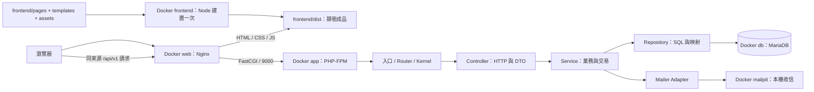
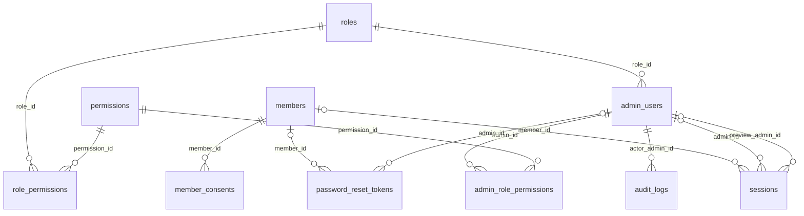

# 全站架構與檔案功能導讀

更新日期：2026-10-17。這份文件是目前專案的閱讀入口：先了解網站如何執行，再查每個檔案負責什麼、資料存在哪裡，以及修改功能時該從哪裡開始。

**目前完成階段二：會員認證、管理員帳號與權限、固定管理員唯讀模擬。** 公開內容使用交付時的展示快照；其餘業務後台有登入／權限檢查及待開放提示，尚未完成內容管理。頁面存在不代表該模組已串接資料庫。完整時程見 [實作計畫](IMPLEMENTATION-PLAN.md)，實際驗證見 [階段二驗收](PHASE-2-ACCEPTANCE.md)。

來源標記沿用 [設計來源表](DESIGN-TRACEABILITY.md)：S 是規格要求，D 是規格中的建議草案，U 是使用者指定，E 是工程補充。本案 PHP＋MariaDB＋Docker、原生 JS／可用 jQuery 來自 U-01；API-only、易讀分層及參考 Spring Boot 來自 U-02。以下目錄、類別、工具與容器拆法屬工程實作，不冒稱 Excel 指定。

## 目錄

1. [整體執行架構](#整體執行架構)
2. [根目錄與閱讀入口](#根目錄與閱讀入口)
3. [Backend：每個檔案做什麼](#backend每個檔案做什麼)
4. [Frontend：每個檔案做什麼](#frontend每個檔案做什麼)
5. [資料庫結構與資料生命週期](#資料庫結構與資料生命週期)
6. [Docker、環境變數與資料位置](#docker環境變數與資料位置)
7. [主要操作的完整資料流](#主要操作的完整資料流)
8. [啟動、驗證與排查](#啟動驗證與排查)
9. [要改某個功能時從哪裡看](#要改某個功能時從哪裡看)
10. [文件索引與維護方式](#文件索引與維護方式)

## 整體執行架構



這是多頁網站，每頁保留獨立 `.html` 網址。瀏覽器執行原生 JavaScript ES modules，以 `fetch` 呼叫同來源 API；目前沒有引入 jQuery。PHP 網站 HTTP 責任只提供 JSON API，沒有 PHP HTML View。Node 是建置與測試工具，不是另一個常駐網站後端。

PHP-FPM 是執行 PHP 程式的工作程序管理器；Nginx 收到 API 請求後以 FastCGI 交給它。它不是資料庫，也不是要直接在瀏覽器開啟的 HTTP 網站。業務邏輯仍在 `backend/src/`。

分層採 Controller → Service → Repository，搭配 DTO、Policy 與建構子依賴注入。與 Spring Boot 的角色對照、例外轉譯及取捨見 [PHP 分層閱讀指南](modules/backend-layering.md)。本案用明確組裝與 PDO，沒有引入 Spring、Laravel、Symfony 或 ORM。

| 區域 | 存什麼 | 修改原則 |
| --- | --- | --- |
| `website/` | 客戶原始交付的頁面、CSS、JS 與參考檔 | 保留原始內容，作為版型與行為對照 |
| `frontend/` | 正在開發的 HTML 來源、模板、JS、CSS、前端測試 | 修改來源後重新建置 |
| `backend/` | PHP API、資料庫結構、資源契約、CLI 與後端測試 | 業務依照分層處理 |
| `docker/`、`compose.yaml` | 容器與 Nginx／PHP 執行設定 | 與應用程式分開管理 |
| `scripts/` | 本機初始化的 PowerShell 入口 | 協調 Docker／CLI，不接替網站業務 |
| `tools/php/` | 與應用依賴分開鎖版的 PHP 品質工具 | PHP／Composer／工具在 Docker 內執行 |
| `docs/` | 計畫、契約對照、閱讀與驗收文件 | 新增工程文件統一放這裡 |
| `.agents/`、`AGENTS.md` | 代理開發約定與 skills | 開發流程資源，不是網站公開檔案 |
| `artifacts/` | 本機驗證輸出、截圖、歷史備份、隔離測試憑證 | 被 Git 忽略，不是正式來源或交付素材 |

## 根目錄與閱讀入口

| 檔案 | 用途與閱讀重點 |
| --- | --- |
| [README.md](../README.md) | 快速了解目前範圍、啟動方式與常用驗證命令。 |
| [compose.yaml](../compose.yaml) | 定義七個服務、網路內的服務名稱、對外 port、掛載、profiles、健康檢查與 volumes；詳見環境章節。 |
| [.env.example](../.env.example) | 可提交的環境變數範本，秘密欄位留空；實際值放在被忽略的 .env。 |
| [.gitignore](../.gitignore) | 排除 .env、vendor、dist、.build、artifacts 等秘密或產物，保留 .env.example。 |
| [.dockerignore](../.dockerignore) | 限制 Docker build context，排除 Git、秘密、原始 Excel、skills、依賴與驗證產物等。 |
| [.gitattributes](../.gitattributes) | 統一文字換行；PowerShell 使用 CRLF，Excel／圖片等視為二進位。 |
| [AGENTS.md](../AGENTS.md) | Git 提交、分支、分層、skill、來源註記及驗證約定。 |
| [skills-lock.json](../skills-lock.json) | 原安裝工具的 skill 鎖定資訊；完整技能來源另見 DEVELOPMENT-WORKFLOW.md，不能把它當 Composer lock。 |
| [映畫竹塹_後台工程串接功能規格.xlsx](../映畫竹塹_後台工程串接功能規格.xlsx) | 客戶原始規格。功能、驗收、安全底線與草案來源以此核對；不改寫原始交付。 |

`website/` 的原始 68 個檔案不由目前 Nginx 提供服務；主要參考入口是 `website/index.html`、`website/admin/`、`website/css/style.css` 與 `website/js/app.js`。全 57 個原始網址及原型差異見 [原始網站對照](WEBSITE-COMPARISON-REVIEW.md)。第三方 skill 參考檔、Composer vendor 及 Git 內部檔案不逐項當成網站程式解釋。

## Backend：每個檔案做什麼

以下各表的檔名相對於表上指定的目錄；連結指向實際檔案。閱讀一個 API 時，先看 `config/routes.php`，再追 Controller、Service、Repository；不要從所有類別的第一行依序讀到最後。

### 入口、契約與工具設定

| 檔案 | 用途與閱讀重點 |
| --- | --- |
| [public/index.php](../backend/public/index.php) | 唯一網站 PHP 入口：載入 Composer、擷取 Request、組裝 Kernel、處理並輸出 Response；入口本身的失敗也轉成安全 JSON。 |
| [config/routes.php](../backend/config/routes.php) | 登記 29 個 API 的 HTTP 方法、路徑、會員／管理員身分、module/action、首登與模擬例外旗標。 |
| [src/Composition.php](../backend/src/Composition.php) | 依賴組裝位置：建立共用連線、Repositories、Adapters、Services、Controllers，再接路由與 Kernel。 |
| [src/Config.php](../backend/src/Config.php) | 讀取容器環境變數，校驗數值、APP_KEY、APP_URL 與正式環境 HTTPS／Secure cookie 條件；不解析 .env 檔。 |
| [composer.json](../backend/composer.json) | 應用程式的 PHP／extension／PHPMailer 依賴及 Yinghua 命名空間的 PSR-4 載入設定。 |
| [composer.lock](../backend/composer.lock) | 應用依賴的確切版本；安裝時依鎖定版本還原。 |
| [resources/openapi.json](../backend/resources/openapi.json) | 29 個已實作 API 的請求、回應、狀態碼與安全契約。它描述 API，不會自行產生路由或程式。 |
| [resources/role-templates.json](../backend/resources/role-templates.json) | 原始 Excel 四種角色、十個模組、四個動作的起始權限；供 seed 使用，不是每次請求直接查閱的個人權限。 |
| [bin/console.php](../backend/bin/console.php) | CLI 入口：db:migrate、db:seed、admin:init、admin:recover。密碼由 stdin／互動輸入；不提供 HTTP 路由。 |
| [phpstan.neon](../backend/phpstan.neon) | PHPStan level 10 與 PHPat 架構規則的分析範圍、autoload 及快取設定。 |
| [phpunit.xml](../backend/phpunit.xml) | 單元測試的 bootstrap、tests/Unit 套件與快取位置。 |
| [.php-cs-fixer.dist.php](../backend/.php-cs-fixer.dist.php) | PER-CS 格式與未使用 import 檢查的範圍。 |
| [rector.php](../backend/rector.php) | PHP 語法現代化建議的路徑與版本規則；本專案只執行 dry-run，檢閱後另做有範圍的修改。 |

### HTTP 共用管線：`backend/src/Http/`

| 檔案 | 用途與閱讀重點 |
| --- | --- |
| [Request.php](../backend/src/Http/Request.php) | 從 PHP 請求資料建立不可變請求物件；校驗網址、JSON、query 與必要輸入，產生 requestId。 |
| [Response.php](../backend/src/Http/Response.php) | 保存 status、payload、cookies、headers 及送出後 callback；輸出 JSON／requestId，204 不輸出 body。 |
| [Route.php](../backend/src/Http/Route.php) | 一條路由的資料與路徑比對，包括 {id}、身分、授權及首登／模擬控制旗標。 |
| [Router.php](../backend/src/Http/Router.php) | 依路徑與方法找 Route；支援 GET 的 HEAD，區分 404 與 405／Allow。 |
| [Kernel.php](../backend/src/Http/Kernel.php) | 整合路由、身分、CSRF、首登限制、唯讀模擬與授權，再呼叫 Controller；統一應用例外與非預期錯誤。 |
| [ApiContext.php](../backend/src/Http/ApiContext.php) | 本次請求交給 Controller 的上下文：Request、ClientContext、身分、路由參數；區分 actor 與 owner。 |
| [Csrf.php](../backend/src/Http/Csrf.php) | 會員／後台分開的簽章匿名 Cookie、CSRF token、Origin 檢查與登入 Cookie 建立／清除。 |
| [CsrfContext.php](../backend/src/Http/CsrfContext.php) | 攜帶匿名識別、簽章 Cookie 值與是否需重發 Cookie，供同一請求共用。 |
| [Cookie.php](../backend/src/Http/Cookie.php) | 定義並輸出 Cookie 及其期限、Secure、HttpOnly、SameSite 等屬性。 |

### Controller：`backend/src/Controllers/`

| 檔案 | 用途與閱讀重點 |
| --- | --- |
| [AuthController.php](../backend/src/Controllers/AuthController.php) | 會員／管理員的 CSRF、挑戰、註冊、登入、me、登出、密碼及唯讀模擬 HTTP 入口；組合安全 DTO、Cookie 與 CSRF。 |
| [AdminController.php](../backend/src/Controllers/AdminController.php) | 管理員列表、單筆、新增、編輯與刪除；把輸入轉成 DTO，將 Service 輸出轉回既有 JSON。 |
| [PermissionController.php](../backend/src/Controllers/PermissionController.php) | 角色範本清單、權限 catalog、個人矩陣讀寫；分別呼叫 RoleTemplates 與 PermissionManagement。 |

### Service：`backend/src/Services/`

| 檔案 | 用途與閱讀重點 |
| --- | --- |
| [Authentication.php](../backend/src/Services/Authentication.php) | 登入／註冊／登出、session 輪替、重新校驗帳號與認證事件；current 回真正操作者及有效身分。 |
| [Authorization.php](../backend/src/Services/Authorization.php) | 重新取得目前管理員及個人矩陣，委派 Policy 驗證 module/action；寫入可在同交易鎖定操作者。 |
| [AdminManagement.php](../backend/src/Services/AdminManagement.php) | 管理員 CRUD、角色更換、版本衝突、停用／刪除撤銷 session／reset token，協調同交易稽核。 |
| [PermissionManagement.php](../backend/src/Services/PermissionManagement.php) | 權限 catalog 與逐人矩陣：完整性、版本、root 保護、防越級、本人管理權及交易稽核。 |
| [RoleTemplates.php](../backend/src/Services/RoleTemplates.php) | 角色查閱授權及合法指派模板；帳號建立／換角色共用，禁止指派 root 角色。 |
| [AdminPreview.php](../backend/src/Services/AdminPreview.php) | 固定 root 的唯讀模擬目標清單、切換與退出；鎖定 session、輪替 token，稽核真正操作者。 |
| [PasswordReset.php](../backend/src/Services/PasswordReset.php) | 準備重設 token、送信及失敗撤銷；重設／本人改密碼與所有舊 session 的撤銷。 |
| [PasswordHasher.php](../backend/src/Services/PasswordHasher.php) | 集中 Argon2id 雜湊、驗證、rehash 判斷，以及未知帳號的 dummy 驗證成本。 |
| [Captcha.php](../backend/src/Services/Captcha.php) | 建立短效註冊挑戰、產生 PNG 或寄送 Email；綁定匿名 session／收件人，檢查答案、次數及一次性消耗。 |
| [RateLimiter.php](../backend/src/Services/RateLimiter.php) | 以用途、識別與時間窗使用資料庫共享限速，回傳限速應用錯誤與重試秒數。 |
| [RootInitializer.php](../backend/src/Services/RootInitializer.php) | CLI 用的固定 admin 建立與密碼復原；重跑初始化不覆蓋既有帳號，復原撤銷舊憑證。 |

### Repository：`backend/src/Repositories/`

| 檔案 | 用途與閱讀重點 |
| --- | --- |
| [Database.php](../backend/src/Repositories/Database.php) | 建立 PDO、prepared statements、型別綁定、單筆／多筆讀取；同請求共享同連線並設定 DB session 時區為 UTC。 |
| [Row.php](../backend/src/Repositories/Row.php) | 驗證 PDO 原始列的 string／nullable string／int 值，避免未確認的資料庫回傳型別直接滲入模型。 |
| [AccountRepository.php](../backend/src/Repositories/AccountRepository.php) | 會員／管理員查找、建立、更新、列表與模擬選單摘要；只將帳號寫入的 duplicate key 轉成 AccountConflict。 |
| [SessionRepository.php](../backend/src/Repositories/SessionRepository.php) | session token 雜湊、有效／閒置期限、存取刷新、撤銷，以及模擬目標與 token 切換。 |
| [PermissionRepository.php](../backend/src/Repositories/PermissionRepository.php) | 權限定義、角色模板、有效個人矩陣與保存；缺值拒絕，root 的有效矩陣固定全允許。 |
| [ChallengeRepository.php](../backend/src/Repositories/ChallengeRepository.php) | 註冊挑戰的建立、鎖定、失敗次數、消耗與撤銷。 |
| [ResetRepository.php](../backend/src/Repositories/ResetRepository.php) | 密碼重設 token 的保存、鎖定、一次使用、過期與撤銷查詢。 |
| [ConsentRepository.php](../backend/src/Repositories/ConsentRepository.php) | 保存會員對文件版本的同意紀錄。 |
| [RateLimitRepository.php](../backend/src/Repositories/RateLimitRepository.php) | 資料庫限速桶的原子計數與清除，供多個 PHP 請求共享。 |
| [EventRepository.php](../backend/src/Repositories/EventRepository.php) | 認證事件與管理稽核的寫入；欄位白名單與個資 HMAC 遮罩，避免保存明文憑證。 |

### 輸入／輸出／內部 DTO：`backend/src/DTO/`

不是每個 DTO 都能回傳給前端；下表明確區分用途。

| 檔案 | 用途與閱讀重點 |
| --- | --- |
| [Input.php](../backend/src/DTO/Input.php) | 輸入驗證共用工具：允許欄位、文字、Email、正整數、布林與物件列表；不是資料庫模型。 |
| [RegisterInput.php](../backend/src/DTO/RegisterInput.php) | 輸入：註冊 Email／名稱／密碼、挑戰 token／答案及條款版本；驗證確認密碼與同意。 |
| [LoginInput.php](../backend/src/DTO/LoginInput.php) | 輸入：會員 Email 或管理員 account 與密碼；依 IdentityKind 選擇格式。 |
| [PasswordInput.php](../backend/src/DTO/PasswordInput.php) | 輸入：新密碼、確認密碼及 credential；重設時是 token，本人更改時是目前密碼。 |
| [AdminWriteInput.php](../backend/src/DTO/AdminWriteInput.php) | 輸入：一般管理員可寫欄位、建立時初始密碼、編輯時 version；拒絕 isRoot 等額外欄位。 |
| [PermissionMatrixInput.php](../backend/src/DTO/PermissionMatrixInput.php) | 輸入：個人權限版本與 module/action/allowed 清單。 |
| [AccountSummary.php](../backend/src/DTO/AccountSummary.php) | 對外：明確的安全帳號欄位；不持有 passwordHash、deletedAt 或完整 Account。 |
| [AdminPage.php](../backend/src/DTO/AdminPage.php) | 對外：AccountSummary 列表、total、page、pageSize。 |
| [IdentityResponse.php](../backend/src/DTO/IdentityResponse.php) | 對外：member 或 admin、有效權限與可選的模擬資訊，維持不同身分的 JSON 邊界。 |
| [PreviewStatus.php](../backend/src/DTO/PreviewStatus.php) | 對外：active、readOnly、目標可用性及真正操作者最小摘要。 |
| [CaptchaResponse.php](../backend/src/DTO/CaptchaResponse.php) | 對外：挑戰 token、期限與 PNG／寄送提示；沒有文字答案。 |
| [PermissionCatalog.php](../backend/src/DTO/PermissionCatalog.php) | 對外：權限欄位清單與管理員最小選單摘要。 |
| [PermissionMatrix.php](../backend/src/DTO/PermissionMatrix.php) | 對外：目標 adminId、權限版本、root 旗標與有效矩陣。 |
| [RoleTemplate.php](../backend/src/DTO/RoleTemplate.php) | 對外：角色 id／name 與起始矩陣；不是帳號的即時個人權限。 |
| [AuthGrant.php](../backend/src/DTO/AuthGrant.php) | 內部：登入成功的 Account 與原始 session token，只供 HTTP 邊界設定 Cookie；不可整個回 JSON。 |
| [AuthenticatedIdentity.php](../backend/src/DTO/AuthenticatedIdentity.php) | 內部：owner、preview 與有效身分的判斷，維持真正登入者與模擬者分離。 |
| [SessionIdentity.php](../backend/src/DTO/SessionIdentity.php) | 內部：讀取 session 後的 session id、owner id、可選的模擬管理員 id。 |
| [ClientContext.php](../backend/src/DTO/ClientContext.php) | 內部：匿名識別、IP／user-agent 雜湊與 requestId，讓 Service 不依賴 HTTP Request。 |
| [PendingReset.php](../backend/src/DTO/PendingReset.php) | 內部：待寄送重設申請的 id、Account 與原始 token；不作 API 回應。 |

### Model、Policy、例外與共用工具

| 檔案 | 用途與閱讀重點 |
| --- | --- |
| [Models/Account.php](../backend/src/Models/Account.php) | 內部帳號資料與有效狀態判斷；含密碼雜湊，不能直接序列化回前端。 |
| [Models/IdentityKind.php](../backend/src/Models/IdentityKind.php) | 會員／管理員 backed enum；集中身分值及對應帳號表／外鍵慣例。 |
| [Models/Challenge.php](../backend/src/Models/Challenge.php) | 從 DB 讀出的註冊挑戰：HMAC、綁定、次數、期限與不可用狀態。 |
| [Models/ResetToken.php](../backend/src/Models/ResetToken.php) | 從 DB 讀出的重設 token 摘要：id、owner、期限與不可用狀態；不攜帶原始 token。 |
| [Policies/PermissionPolicy.php](../backend/src/Policies/PermissionPolicy.php) | 純業務授權：精確 module/action、禁止寫 root、禁止自我停用／刪除、防越級及管理權保護。 |
| [Exceptions/ApplicationError.php](../backend/src/Exceptions/ApplicationError.php) | 可預期的應用錯誤：錯誤代碼、訊息、欄位錯誤與 Retry-After；HTTP 狀態由 Kernel 決定。 |
| [Exceptions/AccountConflict.php](../backend/src/Exceptions/AccountConflict.php) | 帳號唯一值衝突的應用例外，隔離 PDO／SQLSTATE；保留原始例外供內部診斷，不直接回應用戶。 |
| [Support/Secrets.php](../backend/src/Support/Secrets.php) | 安全隨機 token、UUID 及用途分離 HMAC；密鑰取自 Config。 |

### Contracts 與外部實作

介面描述服務需要的能力，Adapter 負責具體工具，Composition 負責把兩者接起來。

| 檔案 | 用途與閱讀重點 |
| --- | --- |
| [Contracts/Clock.php](../backend/src/Contracts/Clock.php) | 時間來源介面，回傳目前 Unix timestamp。 |
| [Contracts/Mailer.php](../backend/src/Contracts/Mailer.php) | 寄信介面，隔離 PHPMailer 的 SMTP 細節。 |
| [Contracts/Transactions.php](../backend/src/Contracts/Transactions.php) | 交易執行介面，以 callback 表達一個需一起提交／回滾的流程。 |
| [Adapters/SystemClock.php](../backend/src/Adapters/SystemClock.php) | 實際系統時間的 Clock 實作。 |
| [Adapters/PhpMailerAdapter.php](../backend/src/Adapters/PhpMailerAdapter.php) | 以環境設定組裝 PHPMailer／SMTP；本機預設連 Mailpit。 |
| [Adapters/PdoTransactions.php](../backend/src/Adapters/PdoTransactions.php) | PDO begin／commit／rollback；SQLSTATE 40001 死鎖最多執行三次，不在交易內寄信。 |
| [Adapters/SchemaMigrator.php](../backend/src/Adapters/SchemaMigrator.php) | 執行 SQL migrations、checksum 與逐 statement 進度記錄、DB migration lock；支援中斷後重跑。 |
| [Adapters/IdentitySeeder.php](../backend/src/Adapters/IdentitySeeder.php) | 載入 role-templates.json，補缺四角色、40 個權限與角色起始值；不覆蓋已有模板。 |

### 資料結構與後端測試

| 檔案 | 用途與閱讀重點 |
| --- | --- |
| [database/migrations/001_identity.sql](../backend/database/migrations/001_identity.sql) | 建立階段二 13 張業務表、索引、外鍵、CHECK 與保護 trigger；確切表用途見資料庫章節。 |
| [database/migrations/002_admin_preview.sql](../backend/database/migrations/002_admin_preview.sql) | 加入 sessions.preview_admin_id、外鍵與身分約束，保留 admin_id 作真正登入者。 |
| [tests/ArchitectureTest.php](../backend/tests/ArchitectureTest.php) | PHPat 五條分層相依規則，由 PHPStan 執行，不是 PHPUnit 測試入口。 |
| [tests/Unit/PermissionPolicyTest.php](../backend/tests/Unit/PermissionPolicyTest.php) | 純規則測試：缺權限、root、自我保護、防越級與 mass assignment。 |
| [tests/Unit/ResponseBoundaryTest.php](../backend/tests/Unit/ResponseBoundaryTest.php) | 安全輸出測試：摘要不持有內部資料、會員不輸出管理權、模擬操作者與驗證碼可選欄位。 |
| [tests/integration-fixture.php](../backend/tests/integration-fixture.php) | CLI 測試 fixture；僅 APP_ENV=test 且 DB=yinghua_test 可初始化測試 root／執行測試 SQL。沒有 HTTP 測試後門。 |
| [tests/api_integration.py](../backend/tests/api_integration.py) | 真實 HTTP／MariaDB／Mailpit 的認證、密碼、CRUD、矩陣、並行、越權與回滾測試。 |
| [tests/admin_preview.py](../backend/tests/admin_preview.py) | 固定 root 唯讀模擬：雙身分、token 輪替、拒絕寫入、無效目標、並行與稽核回滾。 |
| [tests/account_persistence.php](../backend/tests/account_persistence.php) | 真實 MariaDB 的帳號衝突轉譯、外鍵失敗與交易回滾；測試寫入最後回滾。 |
| [tests/response_contract.py](../backend/tests/response_contract.py) | 真實 HTTP 的精確回應欄位、型別、安全摘要、衝突欄位及 204 空內容契約。 |
| [tests/mail_failure.py](../backend/tests/mail_failure.py) | 暫停／恢復本機 Mailpit，驗證寄信失敗、token 撤銷與可重試流程；最後恢復服務。 |
| [tests/origin_redirect.py](../backend/tests/origin_redirect.py) | 驗證 localhost／127.0.0.1 的網頁標準來源轉向、路徑 query 保留與 API Origin 邊界。 |

## Frontend：每個檔案做什麼

### 來源如何變成網頁

`pages/*.html` 的 `{{SITE_HEADER}}` 等標記由建置器替換成 templates，assets 複製到 dist；Nginx 的公開根目錄是 dist。修改 pages／templates／assets 後必須重新建置，單改 PHP 不會重建畫面。原型圖片多為外部網址，主要字型載入沿用 CSS；目前 assets 不是完整的離線素材庫。

| 檔案 | 用途與閱讀重點 |
| --- | --- |
| [package.json](../frontend/package.json) | 原生 ES module 專案設定，以及 build／test 命令；目前沒有第三方 npm 依賴或常駐 Node server。 |
| [scripts/build.mjs](../frontend/scripts/build.mjs) | 掃描全部 64 個 HTML 來源，組合模板與 active 導覽、表單屬性、複製資產，產出路由白名單及 robots.txt。 |
| [templates/site-header.html](../frontend/templates/site-header.html) | 公開頁共用品牌、主選單、手機導覽與會員導覽掛載位置。 |
| [templates/site-footer.html](../frontend/templates/site-footer.html) | 公開頁 footer 與共用連結／文字。 |
| [templates/admin-sidebar.html](../frontend/templates/admin-sidebar.html) | 後台模組導覽、登入者摘要與固定 root 唯讀模擬選單；權限顯示由 JS 決定。 |
| [templates/admin-topbar.html](../frontend/templates/admin-topbar.html) | 後台頂列、頁名、側欄開關與登出入口。 |
| [templates/dialog.html](../frontend/templates/dialog.html) | 共用確認對話框的 HTML 結構。 |
| [assets/css/style.css](../frontend/assets/css/style.css) | 原始 website 主樣式的保留副本；字型、色彩、排版、斷點與大部分元件。 |
| [assets/css/seo.css](../frontend/assets/css/seo.css) | 沿用原始交付的詳情／文章等補充樣式；檔名不是 SEO 後端功能。 |
| [assets/css/phase2.css](../frontend/assets/css/phase2.css) | 真實 API 表單、錯誤／成功、等待、對話框、模擬提示與必要新增狀態的補充樣式。 |
| [assets/favicon.svg](../frontend/assets/favicon.svg) | 沿用網站識別的圖示。 |

### JavaScript：入口、共用能力與頁面互動

以下檔名相對於 `frontend/assets/js/`。一頁的 HTML 載入入口模組，入口再 import 共用功能；不把所有頁面行為塞進單一 app.js。

| 檔案 | 用途與閱讀重點 |
| --- | --- |
| [public.js](../frontend/assets/js/public.js) | 公開頁入口：唯讀快照列表、分類／地區／搜尋、展示卡片、動畫、詳情與會員導覽；planner 要登入，收藏／行程保存尚未開放。 |
| [auth.js](../frontend/assets/js/auth.js) | 會員／管理員認證頁共用入口：依 data-auth-kind／mode 綁定登入、註冊、挑戰、忘記／重設／更改密碼與首登登出。 |
| [admin.js](../frontend/assets/js/admin.js) | 後台共用入口：me、首登／權限 guard、側欄與身分、登出／模擬，依 data-page 初始化 CRUD 或矩陣頁。 |
| [api/auth-api.js](../frontend/assets/js/api/auth-api.js) | 會員／後台 auth 路徑封裝，讓頁面以 login／me／forgot／change 等方法呼叫。 |
| [api/admin-api.js](../frontend/assets/js/api/admin-api.js) | 管理員列表／CRUD、角色／catalog／矩陣 API 封裝。 |
| [core/api-client.js](../frontend/assets/js/core/api-client.js) | 共用 fetch、15 秒逾時、同來源 Cookie、CSRF 記憶體快取與一次刷新重試、ApiError／Retry-After。 |
| [core/session.js](../frontend/assets/js/core/session.js) | me 驗證、已登入頁導向、首登限制、module/action 判斷、會員導覽、登入逾時及安全 returnTo。 |
| [core/ui.js](../frontend/assets/js/core/ui.js) | 共用 DOM 建立、文字／狀態、欄位錯誤與焦點、提交鎖與限速等待、未保存提示、選單操作。 |
| [core/password-policy.js](../frontend/assets/js/core/password-policy.js) | 前端共用密碼長度檢查；伺服器仍獨立驗證，不能只信前端。 |
| [components/dialog.js](../frontend/assets/js/components/dialog.js) | 共用非同步確認對話框：確認／取消、鍵盤與焦點返回。 |
| [components/admin-preview.js](../frontend/assets/js/components/admin-preview.js) | 固定 root 模擬選單、開始／退出 API、唯讀提示及切換後重新載入；不在 localStorage 假造身分。 |
| [components/content-cards.js](../frontend/assets/js/components/content-cards.js) | 景點、電影、消息、優惠、路線、搜尋與行程示意的 DOM 元件；重用原型 class 並用安全文字建立。 |
| [pages/admin-list.js](../frontend/assets/js/pages/admin-list.js) | 真實管理員清單：搜尋／狀態／分頁與網址、root 保護、版本刪除確認與錯誤。 |
| [pages/admin-form.js](../frontend/assets/js/pages/admin-form.js) | 新增／編輯共用：載入版本、角色模板、草稿確認、保存、衝突／欄位錯誤、重載清除舊錯誤與唯讀狀態。 |
| [pages/permissions.js](../frontend/assets/js/pages/permissions.js) | 對象選擇、40 格矩陣、範本套用、版本保存、換人／重載確認、拒絕越級與唯讀 UI。 |
| [pages/public-details.js](../frontend/assets/js/pages/public-details.js) | 公開快照的景點／電影／消息／優惠詳情、站內連結與前後篇；尚未接正式內容 API。 |
| [data/prototype.js](../frontend/assets/js/data/prototype.js) | 原始交付的 6 地點、4 電影、5 消息／活動、3 優惠、2 路線及 3 站行程快照與固定詳情網址。不是 MariaDB 匯出。 |

### 前端測試：`frontend/tests/`

| 檔案 | 用途與閱讀重點 |
| --- | --- |
| [admin-state.test.mjs](../frontend/tests/admin-state.test.mjs) | 以受控 DOM／API 回應驗證管理員與矩陣的重載、保存、草稿、舊回應、欄位錯誤與唯讀狀態。 |
| [auth-navigation.test.mjs](../frontend/tests/auth-navigation.test.mjs) | 認證頁登入狀態、返回導向、首登／登出、提交互斥、載入失敗與遲到回應。 |
| [menu-state.test.mjs](../frontend/tests/menu-state.test.mjs) | 共用選單的鍵盤操作、展開狀態及避免重複綁定。 |
| [password-policy.test.mjs](../frontend/tests/password-policy.test.mjs) | 共用 Unicode 密碼長度與允許字元的邊界。 |
| [return-to.test.mjs](../frontend/tests/return-to.test.mjs) | 站內路由白名單、會員／後台命名空間及不安全重新導向拒絕。 |

### 每個 HTML 的功能與目前狀態

來源在 `frontend/pages/`；建置後相同相對路徑出現在 dist，對應網址省略 `frontend/pages`。例如 `admin/admins.html` 對應 `/admin/admins.html`，`index.html` 另可用 `/` 開啟。

標示「API 已串接」表示本階段真實後端；「展示快照」表示讀取 prototype.js／靜態原型文案；「待開放」表示只有共用後台外框與授權，沒有該業務的新增／編輯／保存。圖片與卡片顯示不代表內容管理已完成。

#### 認證頁：9 頁

| HTML 來源 | 用途 | 入口 | 目前狀態 |
| --- | --- | --- | --- |
| [admin/change-password.html](../frontend/pages/admin/change-password.html) | 管理員本人／首登改密碼、登出切換帳號 | `auth.js` | API 已串接 |
| [admin/forgot-password.html](../frontend/pages/admin/forgot-password.html) | 一般管理員申請重設；固定 root 走 CLI 復原 | `auth.js` | API 已串接 |
| [admin/login.html](../frontend/pages/admin/login.html) | 管理員登入 | `auth.js` | API 已串接 |
| [admin/reset-password.html](../frontend/pages/admin/reset-password.html) | 一般管理員憑連結重設 | `auth.js` | API 已串接 |
| [change-password.html](../frontend/pages/change-password.html) | 已登入會員更改密碼 | `auth.js` | API 已串接 |
| [forgot-password.html](../frontend/pages/forgot-password.html) | 會員申請密碼重設 | `auth.js` | API 已串接 |
| [login.html](../frontend/pages/login.html) | 會員登入 | `auth.js` | API 已串接 |
| [register.html](../frontend/pages/register.html) | 會員註冊、挑戰與條款 | `auth.js` | API 已串接 |
| [reset-password.html](../frontend/pages/reset-password.html) | 會員憑連結 token 重設密碼 | `auth.js` | API 已串接 |

#### 管理員與權限：4 頁

| HTML 來源 | 用途 | 入口 | 目前狀態 |
| --- | --- | --- | --- |
| [admin/admin-add.html](../frontend/pages/admin/admin-add.html) | 新增一般管理員 | `admin.js` | API 已串接 |
| [admin/admin-edit.html](../frontend/pages/admin/admin-edit.html) | 編輯一般管理員 | `admin.js` | API 已串接 |
| [admin/admins.html](../frontend/pages/admin/admins.html) | 搜尋／分頁／刪除管理員 | `admin.js` | API 已串接 |
| [admin/permissions.html](../frontend/pages/admin/permissions.html) | 逐人權限矩陣與角色範本 | `admin.js` | API 已串接 |

#### 其餘後台：18 頁

| HTML 來源 | 用途 | 入口 | 目前狀態 |
| --- | --- | --- | --- |
| [admin/film-add.html](../frontend/pages/admin/film-add.html) | 新增映演場次；guard 要求 `films.create` | `admin.js` | 待開放 |
| [admin/film-edit.html](../frontend/pages/admin/film-edit.html) | 編輯映演場次；guard 要求 `films.edit` | `admin.js` | 待開放 |
| [admin/films.html](../frontend/pages/admin/films.html) | 本週映演；guard 要求 `films.view` | `admin.js` | 待開放 |
| [admin/index.html](../frontend/pages/admin/index.html) | 總覽儀表板；guard 要求 `dashboard.view` | `admin.js` | 待開放 |
| [admin/members.html](../frontend/pages/admin/members.html) | 會員管理；guard 要求 `members.view` | `admin.js` | 待開放 |
| [admin/news-add.html](../frontend/pages/admin/news-add.html) | 新增消息與活動；guard 要求 `news.create` | `admin.js` | 待開放 |
| [admin/news-edit.html](../frontend/pages/admin/news-edit.html) | 編輯消息與活動；guard 要求 `news.edit` | `admin.js` | 待開放 |
| [admin/news.html](../frontend/pages/admin/news.html) | 消息與活動；guard 要求 `news.view` | `admin.js` | 待開放 |
| [admin/offer-add.html](../frontend/pages/admin/offer-add.html) | 新增店家優惠；guard 要求 `offers.create` | `admin.js` | 待開放 |
| [admin/offer-edit.html](../frontend/pages/admin/offer-edit.html) | 編輯店家優惠；guard 要求 `offers.edit` | `admin.js` | 待開放 |
| [admin/offers.html](../frontend/pages/admin/offers.html) | 店家優惠；guard 要求 `offers.view` | `admin.js` | 待開放 |
| [admin/place-add.html](../frontend/pages/admin/place-add.html) | 新增景點；guard 要求 `attractions.create` | `admin.js` | 待開放 |
| [admin/place-edit.html](../frontend/pages/admin/place-edit.html) | 編輯景點；guard 要求 `attractions.edit` | `admin.js` | 待開放 |
| [admin/places.html](../frontend/pages/admin/places.html) | 景點與店家；guard 要求 `attractions.view` | `admin.js` | 待開放 |
| [admin/route-add.html](../frontend/pages/admin/route-add.html) | 建立推薦行程；guard 要求 `routes.create` | `admin.js` | 待開放 |
| [admin/route-edit.html](../frontend/pages/admin/route-edit.html) | 編輯推薦行程；guard 要求 `routes.edit` | `admin.js` | 待開放 |
| [admin/routes.html](../frontend/pages/admin/routes.html) | 推薦行程；guard 要求 `routes.view` | `admin.js` | 待開放 |
| [admin/settings.html](../frontend/pages/admin/settings.html) | 網站設定；guard 要求 `settings.view` | `admin.js` | 待開放 |

#### 公開內容與行程示意：33 頁

| HTML 來源 | 用途 | 入口 | 目前狀態 |
| --- | --- | --- | --- |
| [activities.html](../frontend/pages/activities.html) | 活動分類列表 | `public.js` | 展示快照 |
| [cinema.html](../frontend/pages/cinema.html) | 本週映演與示意場次 | `public.js` | 展示快照 |
| [city-news.html](../frontend/pages/city-news.html) | 城市消息分類列表 | `public.js` | 展示快照 |
| [events.html](../frontend/pages/events.html) | 消息與活動總覽 | `public.js` | 展示快照 |
| [explore.html](../frontend/pages/explore.html) | 景點與店家探索、分類／地區／關鍵字篩選 | `public.js` | 展示快照 |
| [film-detail.html](../frontend/pages/film-detail.html) | 依 query id 顯示快照的通用電影詳情 | `public.js` | 展示快照 |
| [films/island-slow.html](../frontend/pages/films/island-slow.html) | 島嶼的慢鏡頭的固定詳情／文章 | `public.js` | 展示快照 |
| [films/shape-of-light.html](../frontend/pages/films/shape-of-light.html) | 光的形狀的固定詳情／文章 | `public.js` | 展示快照 |
| [films/wind-city.html](../frontend/pages/films/wind-city.html) | 風從城裡來的固定詳情／文章 | `public.js` | 展示快照 |
| [films/window-sunday.html](../frontend/pages/films/window-sunday.html) | 窗邊的星期天的固定詳情／文章 | `public.js` | 展示快照 |
| [food.html](../frontend/pages/food.html) | 美食與在地店家分類 | `public.js` | 展示快照 |
| [index.html](../frontend/pages/index.html) | 首頁、推薦內容與映演摘要 | `public.js` | 展示快照 |
| [museum.html](../frontend/pages/museum.html) | 新竹市影像博物館的固定詳情 | `public.js` | 展示快照 |
| [news-detail.html](../frontend/pages/news-detail.html) | 依 query id 顯示快照的通用消息詳情 | `public.js` | 展示快照 |
| [news/coffee-walk.html](../frontend/pages/news/coffee-walk.html) | 秋日咖啡散步地圖上線的固定詳情／文章 | `public.js` | 展示快照 |
| [news/old-town-notice.html](../frontend/pages/news/old-town-notice.html) | 舊城街區步行環境改善公告的固定詳情／文章 | `public.js` | 展示快照 |
| [news/park-concert.html](../frontend/pages/news/park-concert.html) | 風的聲音的固定詳情／文章 | `public.js` | 展示快照 |
| [news/slow-market.html](../frontend/pages/news/slow-market.html) | 風城慢慢市集的固定詳情／文章 | `public.js` | 展示快照 |
| [news/street-photo.html](../frontend/pages/news/street-photo.html) | 在城市裡收集光的固定詳情／文章 | `public.js` | 展示快照 |
| [offer-detail.html](../frontend/pages/offer-detail.html) | 依 query id 顯示快照的通用優惠詳情 | `public.js` | 展示快照 |
| [offers.html](../frontend/pages/offers.html) | 優惠列表 | `public.js` | 展示快照 |
| [offers/autumn-coffee.html](../frontend/pages/offers/autumn-coffee.html) | 秋日咖啡散步地圖限定的固定詳情／文章 | `public.js` | 展示快照 |
| [offers/or-crafts.html](../frontend/pages/offers/or-crafts.html) | 或者工藝櫥窗的固定詳情／文章 | `public.js` | 展示快照 |
| [offers/shanfang.html](../frontend/pages/offers/shanfang.html) | 山房選物所的固定詳情／文章 | `public.js` | 展示快照 |
| [place-detail.html](../frontend/pages/place-detail.html) | 依 query id 顯示快照的通用景點詳情 | `public.js` | 展示快照 |
| [places/dongmen-market.html](../frontend/pages/places/dongmen-market.html) | 東門市場的固定詳情／文章 | `public.js` | 展示快照 |
| [places/hsinchu-park.html](../frontend/pages/places/hsinchu-park.html) | 新竹公園・麗池的固定詳情／文章 | `public.js` | 展示快照 |
| [places/or-arts.html](../frontend/pages/places/or-arts.html) | 或者工藝櫥窗的固定詳情／文章 | `public.js` | 展示快照 |
| [places/or-coffee.html](../frontend/pages/places/or-coffee.html) | 或者咖啡的固定詳情／文章 | `public.js` | 展示快照 |
| [places/shanfang.html](../frontend/pages/places/shanfang.html) | 山房選物所的固定詳情／文章 | `public.js` | 展示快照 |
| [planner.html](../frontend/pages/planner.html) | 需真實會員登入；只顯示三站行程示意，保存／排序／移除尚未開放 | `public.js` | 登入已串接；行程為示意 |
| [routes.html](../frontend/pages/routes.html) | 兩條推薦路線示意 | `public.js` | 展示快照 |
| [search.html](../frontend/pages/search.html) | 在展示快照中搜尋，不是全站搜尋 API | `public.js` | 展示快照 |

### 產生的檔案與本機依賴

| 位置 | 來源／用途 | 是否直接修改 |
| --- | --- | --- |
| `frontend/dist/*.html`、子目錄 HTML | 64 個 pages 組合共用模板後的成品 | 否，改 pages／templates 後建置 |
| `frontend/dist/assets/` | assets 的複製產物 | 否，改來源 assets |
| `frontend/dist/assets/js/core/routes.js` | build.mjs 產生的路由 Set，供 session.js 驗證 returnTo | 否；來源樹中沒有同名檔案，需先 build 才能整體執行 |
| `frontend/dist/robots.txt` | build.mjs 寫入的目前爬蟲限制 | 改建置來源；完整 SEO／sitemap 與內容發布同步仍待後續階段 |
| `backend/vendor/` | backend Composer 依賴與 autoload；容器內使用 named volume | 不手改套件檔案 |
| `tools/php/vendor/` | 品質工具依賴；與應用 vendor 分開 | 不手改套件檔案 |
| `backend/.build/`、`tools/php/.build/` | 工具快取與檢查產物 | 不是業務來源，不納入 Git |

## 資料庫結構與資料生命週期

### 連線、命名與資料位置

以 compose.yaml 的設定為準：MariaDB **12.3**，服務名稱 `db`、容器內 port **3306**；PHP 的 `DB_HOST=db`。開發庫預設 **yinghua**，技術資料庫使用者預設 **spl**，隔離測試庫固定 **yinghua_test**。網站固定管理員登入 account 是 **admin**，與 DB 使用者是不同概念。

MariaDB 沒有映射宿主機 port，Windows 上不能直接把 localhost:3306 當成目前容器的資料庫。資料存在 Docker volume `yinghua_db_data` 的 `/var/lib/mysql`；不是 backend/ 下的 SQL 或 JSON 檔。開發／測試使用同一個 MariaDB 容器中的不同 database，測試程式及 fixture 有指定庫名防護。

資料採 InnoDB、utf8mb4／utf8mb4_unicode_ci；帳號／session 等主鍵多為 UUID，權限定義與事件表另使用自增整數。PDO 連線的時間設為 UTC，API 期限以 UTC 表達；PHP 顯示時區設定為 Asia/Taipei。欄位與外鍵的確切定義以兩支 migration 為準。

### 13 張業務表＋1 張 migration 紀錄

| 資料表 | 保存內容與主要關聯 | 主要讀寫位置 |
| --- | --- | --- |
| `members` | 會員 Email、名稱、password_hash、狀態與登入時間 | AccountRepository |
| `admin_users` | 管理員 account、Email、角色、狀態、root／首登旗標；version 與 permissions_version 分開 | AccountRepository |
| `roles` | 四種角色名稱、系統角色標記 | IdentitySeeder、PermissionRepository |
| `permissions` | 十個模組 × view/create/edit/delete，共 40 個唯一定義 | IdentitySeeder、PermissionRepository |
| `role_permissions` | role_id＋permission_id 對應的起始 allowed | IdentitySeeder、PermissionRepository |
| `admin_role_permissions` | admin_id＋permission_id 的個人 allowed，updated_by 記操作者 | PermissionRepository |
| `sessions` | member_id 或 admin_id 擇一、token_hash、最長／閒置期限、撤銷、來源雜湊；preview_admin_id 指模擬目標 | SessionRepository |
| `audit_logs` | 真正管理員、動作、對象、遮罩 before／after、requestId | EventRepository |
| `captcha_challenges` | token_hash、答案 HMAC、匿名綁定、Email 模式綁定、次數、期限、消耗／撤銷 | ChallengeRepository |
| `password_reset_tokens` | member_id 或 admin_id 擇一、用途、token_hash、期限、使用／撤銷 | ResetRepository |
| `auth_events` | 登入／註冊／登出／拒絕等事件、結果、理由與用途分離識別雜湊 | EventRepository |
| `auth_rate_limits` | scope＋bucket_key＋window_start 的共享計數與期限 | RateLimitRepository |
| `member_consents` | 會員、文件版本、同意時間與來源 | ConsentRepository |
| `schema_migrations` | version、checksum、已套用 statement 數與完成時間；由 SchemaMigrator 建立 | SchemaMigrator |



上圖是主要關聯導讀，不列全部欄位與外鍵；sessions 與 reset tokens 的 owner 必須且只能屬於一種身分。模擬時 admin_id 仍是真正 root，preview_admin_id 只是有效驗收對象。

角色是起始值：建立或換角色時複製到個人矩陣，之後改個人矩陣不會回寫範本，也不影響別人。固定 root 由後端規則取得完整權限，不能透過一般 CRUD 或矩陣改寫。40 個權限中有後續業務的名稱，**權限定義存在不代表那個業務 API 已完成**。

### Migration、交易與敏感資料

`db:migrate` 按 SQL 檔執行；DDL 在 MariaDB 會自動提交，SchemaMigrator 用 checksum、具冪等性的 statement 與進度紀錄支援重跑。已有 migration 不改內容，新增結構另加新檔。`db:seed` 只補缺角色／權限定義與起始值，不重置已保存的權限。

一般業務交易由 Service 透過 Transactions 協調，多個 Repository 共用同一 PDO。管理員／矩陣異動和 audit 一起提交；稽核失敗則整筆回滾。帳號建立後 account 固定、軟刪除、本人管理權保護屬 E-09／E-10 工程政策；帳號固定不是原型原有的限制。root 的額外約束與 audit 的 UPDATE／DELETE 保護也由資料庫 CHECK／trigger 執行；完整規則見 migration 與管理員指南。

密碼只存 Argon2id；session／reset／challenge token 存雜湊，挑戰答案存用途分離 HMAC。audit 中帳號／Email／名稱轉為 HMAC，保留安全狀態與權限變更；原始 Cookie、密碼或 token 不寫入這些業務紀錄。原始 token 只在必要的 Cookie 或本機重設郵件流程傳遞。

公開的景點、電影、消息、優惠、路線、收藏與行程目前**沒有對應的正式業務資料表實作**，畫面資料主要在 prototype.js 與 HTML。後續表的規劃見 PHASE-2-PLAN.md／IMPLEMENTATION-PLAN.md，不把規劃表當現存 schema。

## Docker、環境變數與資料位置

### 七個服務

| Compose service | 職責／主要版本 | 容器內與宿主機位置 | 啟動方式 |
| --- | --- | --- | --- |
| `frontend` | Node 24，執行 build.mjs 一次 | `frontend/` → `/frontend` | 預設；完成後正常 Exit 0 |
| `web` | Nginx，靜態檔與 FastCGI 轉送 | dist → `/var/www/frontend`；127.0.0.1:8080 → 80 | 預設，等 app 健康及前端建置完成 |
| `app` | PHP 8.5-FPM、Composer、應用與品質工具 | backend → `/var/www/app`；內網 9000，未公開 port | 預設，等 db 健康 |
| `db` | MariaDB 12.3 | `/var/lib/mysql`；內網 3306，未公開 port | 預設 |
| `mailpit` | 本機 SMTP 收信器與閱信介面 | 內網 1025；127.0.0.1:8025 → 8025 | `--profile mail` |
| `app-test` | 與 app 相同責任，但 APP_ENV=test、DB=yinghua_test、APP_URL=localhost:8081 | 共用應用來源與套件 volume | `--profile test` |
| `web-test` | 轉送至 app-test、標準來源 localhost:8081 | 127.0.0.1:8081 → 80；共用前端產物 | `--profile test` |

Compose project 名稱是 `yinghua`。Nginx／MariaDB／Node／Mailpit 與 Dockerfile 的基底 image 皆在設定中鎖定 digest；此表描述專案設定，不是當前容器運行狀態或最新版本公告。

### 設定檔與初始化工具

| 檔案 | 用途與閱讀重點 |
| --- | --- |
| [docker/php/Dockerfile](../docker/php/Dockerfile) | 多階段 PHP image：Composer binary、PHP／extension 基底、品質工具與應用依賴、runtime、development；development 額外安裝品質工具 dev 依賴。 |
| [docker/php/php.ini](../docker/php/php.ini) | PHP 時區、錯誤輸出／log、128M 記憶體、上傳 8M／POST 10M 與 PHP 原生 session 安全預設。上傳限制存在不代表媒體上傳 API 已完成。 |
| [docker/php/www.conf](../docker/php/www.conf) | FPM pool 保留 Docker 環境變數、收集 worker 輸出並交由容器 log。 |
| [docker/nginx/default.conf](../docker/nginx/default.conf) | 靜態根目錄、固定入口的 /api/ FastCGI、標準 Host 轉向、私有副檔名／隱藏檔拒絕與回應 headers。 |
| [scripts/setup-env.ps1](../scripts/setup-env.ps1) | 根目錄沒有 .env 時從範本建立，產生 APP_KEY、DB 密碼與初始管理員隨機密碼；已有檔案則保留。 |
| [scripts/setup-admin.ps1](../scripts/setup-admin.ps1) | 讀本機 ADMIN_EMAIL／ADMIN_INITIAL_PASSWORD，經 stdin 呼叫 app 的 admin:init；不列印秘密。 |
| [scripts/setup-test-db.ps1](../scripts/setup-test-db.ps1) | 建立獨立 yinghua_test、授權測試庫、啟動 test／mail 服務並執行測試 migrations／seed；不清空 yinghua。 |
| [tools/php/composer.json](../tools/php/composer.json) | 獨立品質工具 manifest：PHPStan、PHPat、PHPUnit、PHP-CS-Fixer、Rector 等；不是網站應用骨架。 |
| [tools/php/composer.lock](../tools/php/composer.lock) | 品質工具及其依賴的確切安裝版本。 |

網站登入採自行管理的資料庫 sessions 與 Cookie；不是使用 PHP 原生 `session_start()` 的檔案 session。php.ini 的 session 預設不接替 SessionRepository 的期限與撤銷規則。

### 哪些資料會持久化

| Volume／掛載 | 保存內容 | 重建容器後 |
| --- | --- | --- |
| `db_data`，預設實際名 `yinghua_db_data` | MariaDB 的開發庫與測試庫資料 | 保留，除非另刪 volume |
| `mail_data` | Mailpit 本機攔截郵件 | 保留 |
| `backend_vendor_data` | 應用 Composer vendor | 保留；lock 變更後需重新安裝對應依賴 |
| `vendor_data` | 獨立品質工具 vendor | 保留；與應用 vendor 分開 |
| backend／frontend／tools 的 bind mounts | Windows 專案來源與前端產物 | 直接讀取本機檔案；Git 管來源，dist 被忽略 |

一般 `docker compose stop`／`down` 不等於清空資料；不要把刪除 volume 當作日常更新步驟。容器設定與持久化帳號是兩件事：改 DB_PASSWORD 不會自動修改已有 DB user 的密碼，改 ADMIN_INITIAL_PASSWORD 也不會重設已有網站 admin。

### 環境變數怎麼讀

根目錄 `.env` → Docker Compose 代入服務的 environment → PHP `Config`／Nginx 模板。PHP 沒有安裝 dotenv loader，也不把 `.env` 原文或秘密輸出到前端。下表列名稱與範本預設，不記錄本機秘密或管理員實際憑證。

| 變數 | 用途／範本預設 |
| --- | --- |
| `APP_ENV` | local；app-test 強制 test；正式環境需另外部署驗證 |
| `APP_URL` | http://localhost:8080；同來源與產生連結的依據，不含子路徑 |
| `HTTP_PORT` | web 宿主機 port，預設 8080；若修改，APP_URL 也要相符 |
| `APP_KEY` | HMAC／簽章用秘密，setup-env 隨機產生；不是資料庫密碼 |
| `DB_DATABASE`、`DB_USERNAME` | yinghua、spl |
| `DB_PASSWORD`、`DB_ROOT_PASSWORD` | 應用 DB user 與 DB root 的秘密，初始化時分別產生 |
| `SESSION_SECURE` | 本機 HTTP 為 false；production 設定校驗要求 HTTPS 與 true |
| `AUTH_SESSION_SECONDS`、`AUTH_IDLE_SECONDS` | 43200／1800 秒：登入最長 12 小時／閒置 30 分鐘 |
| `CSRF_SECONDS` | 3600 秒 |
| `CAPTCHA_SECONDS`、`CAPTCHA_ATTEMPTS` | 300 秒／最多 3 次錯誤 |
| `PASSWORD_RESET_SECONDS` | 1800 秒 |
| `TERMS_VERSION` | local-development-v1；註冊同意與版本驗證的依據 |
| `SMTP_HOST`、`SMTP_PORT`、`SMTP_ENCRYPTION` | mailpit／1025／none；本機郵件由 Mailpit 攔截 |
| `SMTP_USERNAME`、`SMTP_PASSWORD` | SMTP 驗證用，本機預設空白 |
| `MAIL_FROM_ADDRESS`、`MAIL_FROM_NAME` | 本機範本寄件位址與顯示名稱 |
| `MAILPIT_HTTP_PORT` | 本機閱信介面 port，預設 8025 |
| `ADMIN_EMAIL`、`ADMIN_INITIAL_PASSWORD` | 只供 setup-admin／admin:init 的初次建立輸入，不是每次登入時直接讀取的帳密 |

`DB_HOST=db`、`DB_PORT=3306`、`APP_TIMEZONE=Asia/Taipei` 目前由 compose.yaml 明確設定，不是 .env.example 的可填欄位。APP_TIMEZONE 目前未被 Config 用來動態切換 PHP 時區；實際 PHP 時區由 php.ini 設定。`API_UPSTREAM`、`CANONICAL_ORIGIN`、`NGINX_ENVSUBST_FILTER` 是 web 容器模板的組裝設定，並非瀏覽器可提供的信任資訊。

Compose 也把 `DB_DATABASE`／`DB_USERNAME`／`DB_PASSWORD` 分別映射為 db 容器的 `MARIADB_DATABASE`／`MARIADB_USER`／`MARIADB_PASSWORD`，把 `DB_ROOT_PASSWORD` 映射為 `MARIADB_ROOT_PASSWORD`；這些用於資料目錄首次初始化。Mailpit 的 `MP_DATABASE=/data/mailpit.db` 與 `MP_MAX_MESSAGES=500` 目前直接寫在 Compose，並非 .env 範本欄位。

## 主要操作的完整資料流

### 開啟頁面與登入

瀏覽器開 `/admin/admins.html` → Nginx 提供建置 HTML → admin.js 呼叫 me → Kernel 驗 session／帳號 → AuthController 回安全身分與有效權限 → 前端顯示名稱、過濾側欄，再呼叫管理員列表 API。未登入回 401 並導登入；靜態 HTML 外殼的 HTTP 200 不代表已取得後台資料。

登入時 auth.js → auth-api → api-client 取得該 namespace 的 CSRF，再 POST 帳密 → AuthController／LoginInput → Authentication → 限速、密碼驗證、交易重驗、session／事件 → HTTP 層寫 HttpOnly Cookie 並回新 CSRF。瀏覽器不把角色或 session token 當作 localStorage 身分來源。

會員與管理員各有 `spl_member_session`／`spl_admin_session`，另有各自的匿名 Cookie 與 CSRF。`localhost`／`127.0.0.1` 的網頁入口會依 APP_URL 轉為標準 Host；API 仍驗 Origin。8080 與 8081 是不同用途，但 Cookie 不按 port 隔離，因此不要把兩站的同類登入 session 視為彼此獨立。

### 註冊與密碼

註冊頁 → PNG 或本機 Email 挑戰 → RegisterInput 檢查欄位、確認密碼與同意 → Authentication 在同交易鎖挑戰、消耗、建會員、consent、session 與事件 → 安全摘要與 Cookie。挑戰錯誤次數可提交，建立會員失敗則回滾，不留下半套帳號。

忘記密碼一律給相同申請訊息；有效一般帳號才建 token。HTTP 回應後送本機 SMTP；送信失敗撤銷 token 並記安全事件。重設連結的 token 放 URL fragment，前端啟動後移除 fragment；重設／本人改密碼由 PasswordReset 在交易內更新雜湊、撤銷 token 與 session，之後重新登入。固定 admin 不使用公開忘記密碼，復原走 CLI。

### 管理員與矩陣

新增管理員：admin-add.html → admin-form.js → admin-api → Kernel 要求 admins.create → AdminController／AdminWriteInput → AdminManagement／RoleTemplates／Policy → 同交易寫 admin_users、40 格個人權限、audit → AccountSummary → 201。初次登入須改密碼屬 E-07。

保存矩陣：permissions.html → permissions.js → PermissionController／PermissionMatrixInput → PermissionManagement → 交易內鎖定與重驗、完整 40 格、版本、root／防越級／本人管理權 → PermissionRepository＋audit → 204。另一人已更新則回 409，前端保留草稿供重新載入。

### 固定 root 唯讀模擬

側欄選單 → admin-preview.js → 模擬控制 API → AdminPreview 鎖 root／目標／session、輪替 token 並寫真正操作者的 audit。me 回被模擬者有效身分及 owner 摘要，Kernel 統一拒絕業務寫入；退出／登出保留，即使目標停用、刪除或沒有權限也可恢復本人。

## 啟動、驗證與排查

### 初次建立與平常啟動

先備妥 Docker Desktop 的 Linux containers；網站執行不要求 Windows 安裝 PHP、Composer、Node 或 MariaDB。執行 Python HTTP 驗收另需主機 Python，這不是網站服務的運行依賴。

在專案根目錄執行：

```powershell
./scripts/setup-env.ps1
# 用編輯器設定 .env 的 ADMIN_EMAIL，確認已產生獨立初始密碼。
docker compose --profile mail up -d --build
docker compose exec -T app php bin/console.php db:migrate
docker compose exec -T app php bin/console.php db:seed
./scripts/setup-admin.ps1
```

平常再次開啟使用 `docker compose --profile mail up -d`。入口是 http://localhost:8080/、後台 http://localhost:8080/admin/login.html、本機閱信 http://localhost:8025/。Email 驗證／重設信不會由 Mailpit 寄到外部信箱。

修改 HTML／模板／JS／CSS 後建置：

```powershell
docker compose run --rm --no-deps frontend
```

固定 admin 失去密碼時，既有受控復原入口是 `docker compose exec app php bin/console.php admin:recover`，採互動隱藏輸入，會撤銷舊 session。僅調整 .env 不會完成網站密碼復原。

### 品質與功能驗證

```powershell
# 不會操作開發帳號資料的 PHP／前端檢查
docker compose exec -T app php /var/www/tools/vendor/bin/phpstan analyse --configuration=phpstan.neon --no-progress
docker compose exec -T app php /var/www/tools/vendor/bin/phpunit --configuration=phpunit.xml
docker compose exec -T app php /var/www/tools/vendor/bin/php-cs-fixer fix --config=.php-cs-fixer.dist.php --dry-run --diff
docker compose exec -T app php /var/www/tools/vendor/bin/rector process --config=rector.php --dry-run
docker compose run --rm --no-deps frontend npm test

# 真實 HTTP／MariaDB 檢查：先建立隔離庫與測試服務
./scripts/setup-test-db.ps1
python backend/tests/api_integration.py
python backend/tests/admin_preview.py
docker compose exec -T app-test php tests/account_persistence.php
python backend/tests/response_contract.py
python backend/tests/mail_failure.py
python backend/tests/origin_redirect.py
```

這些是操作命令，不代表讀到本文件時全部已執行。測試 root 密碼會由 fixture 重設，舊測試 session 也會撤銷；不要與 8081 的人工操作並行。mail_failure 會暫停／恢復本機 Mailpit。前端 Node 測試是受控 DOM／API 行為驗證，不等於真實瀏覽器或手機畫面通過。當次測試數與觀察請讀驗收紀錄，不在這裡固定為永久保證。

### 常見問題查哪裡

| 現象 | 優先確認 |
| --- | --- |
| Docker 無法連線／服務未啟動 | Docker Desktop Linux engine、`docker compose ps --all`；frontend 完成 Exit 0 是正常建置結果 |
| 8080 無法開啟 | web／app／db 健康狀態、HTTP_PORT、`docker compose logs --tail 100 web app` |
| 改頁面沒反應 | 是否改 frontend 來源、是否重建 dist、Nginx 是否掛載該 dist；website 是原始參考 |
| 登入後又回登入／CSRF 錯誤 | APP_URL／HTTP_PORT、標準 Host、是否混用 8080／8081、Cookie 期限及對應 namespace 的 me |
| ADMIN_INITIAL_PASSWORD 改了仍無法登入 | 該值只供初次建立；已有密碼由 DB hash 決定，查認證指南的本人更改／CLI 復原 |
| 管理員頁顯示尚未開放 | 本階段只完成認證／管理員／權限，不是 API 載入失敗；先看頁面狀態表 |
| 403／無法存取／唯讀 | 是否缺 module/action、首登未改密碼、正在 root 模擬，查 API code 與 requestId |
| Email 驗證／重設信沒到外部信箱 | 本機 SMTP 預設 Mailpit，先看 8025 與 mailpit 健康狀態；正式 SMTP 尚待另外設定與驗收 |
| migration checksum 不符 | 是否改了已套用 SQL；依新 migration 升級，不靠清庫掩蓋差異 |
| Composer／工具缺類別 | 應用／工具的 vendor volume 與各自 lock 是否一致；用 Docker Composer 安裝，不能把未安裝當通過 |

## 要改某個功能時從哪裡看

| 要處理的內容 | 起點與相應檔案 |
| --- | --- |
| 修改全站導覽／footer | templates/site-header.html、site-footer.html → build；登入名稱另看 core/session.js |
| 修改整站外觀 | 先比對原始 website；frontend/assets/css 與相關 HTML，依 U-05 維持原型 |
| 修改會員／管理員登入流程 | auth.js → api/auth-api.js → routes.php → AuthController → Authentication → Account／Session／Event repositories |
| 修改管理員表單 | admin-add／admin-edit HTML → pages/admin-form.js → AdminWriteInput → AdminManagement → AccountRepository；同步 OpenAPI 與測試 |
| 修改矩陣／角色起始規則 | permissions.js／PermissionMatrixInput／PermissionManagement／RoleTemplates／PermissionPolicy；seed 範本不等於既有個人矩陣 |
| 修改模擬規則 | components/admin-preview.js → AuthController → AdminPreview／Kernel → SessionRepository；保留 owner 與退出能力 |
| 修改密碼政策／期限 | PasswordHasher／相關 Input、前端 password-policy.js、.env.example／compose／Config 使用處；同步契約、文件與失敗測試 |
| 新增 API | OpenAPI＋routes＋Controller＋DTO＋Service＋必要 Repository；加真實授權／失敗驗證與中文指南 |
| 新增資料表／欄位 | 新 migration → Repository／Model／DTO → 對應 Service／測試；不修改已套用 migration |
| 修改公開景點／電影等正式資料 | 先依後續階段建立內容 API／schema／發布流程；目前 prototype.js 只是展示資料，不能冒充 CMS 保存 |
| 修改容器／環境 | compose.yaml、docker/、.env.example 與初始化 scripts；注意已有 named volumes 的資料生命週期 |
| 查驗收或原型差異 | PHASE-2-ACCEPTANCE.md、WEBSITE-COMPARISON-REVIEW.md；不要用檔案存在推定功能完成 |

上表的簡寫路徑分別以 backend/ 或 frontend/ 為根；完整可點選位置在前面的檔案清單。新業務必須同時考慮前端、API 契約、交易／權限、資料庫與驗證，不能只新增畫面或只新增一個 PHP endpoint。

## 文件索引與維護方式

| 檔案 | 用途與閱讀重點 |
| --- | --- |
| [PROJECT-GUIDE.md](../docs/PROJECT-GUIDE.md) | 本文件：全站執行架構、現有檔案用途、資料庫、環境及閱讀入口。 |
| [IMPLEMENTATION-PLAN.md](../docs/IMPLEMENTATION-PLAN.md) | 整體八階段的功能與交付條件；包含尚未開始的後續規劃。 |
| [REQUIREMENTS-MAP.md](../docs/REQUIREMENTS-MAP.md) | 原始規格功能來源與網站頁面需求對照。 |
| [PHASE-2-PLAN.md](../docs/PHASE-2-PLAN.md) | 階段二細設、API／表／頁面及工程補充對照。 |
| [ARCHITECTURE.md](../docs/ARCHITECTURE.md) | 設計原則、採用做法與參考、API-only／SEO 發布的目標架構；含後續規劃，實際檔案以本導讀為準。 |
| [DESIGN-TRACEABILITY.md](../docs/DESIGN-TRACEABILITY.md) | S／D／U／E 來源 ID 與工程政策，區分原始需求和新增選擇。 |
| [DEVELOPMENT-WORKFLOW.md](../docs/DEVELOPMENT-WORKFLOW.md) | 開發步驟、技能選用、品質／安全／UI 檢查及交付約定。 |
| [ENVIRONMENT-SETUP.md](../docs/ENVIRONMENT-SETUP.md) | 先前環境安裝時的版本與驗證紀錄，是有日期的歷史記錄；目前服務配置以 compose.yaml／Dockerfile 為準。 |
| [GIT-WORKFLOW.md](../docs/GIT-WORKFLOW.md) | 階段分支、功能提交、修正歸併與歷史備份原則。 |
| [PHASE-2-ACCEPTANCE.md](../docs/PHASE-2-ACCEPTANCE.md) | 階段二各次實際測試、UI 觀察、安全檢查與尚待外部條件。 |
| [WEBSITE-COMPARISON-REVIEW.md](../docs/WEBSITE-COMPARISON-REVIEW.md) | 原始網址、顯示／互動差異、工程政策與未開放業務分類。 |
| [modules/authentication.md](../docs/modules/authentication.md) | 認證程式、Cookie、密碼、管理員初始化與復原的操作細節。 |
| [modules/admin-permissions.md](../docs/modules/admin-permissions.md) | 管理員、角色／個人矩陣、版本、稽核與前端狀態閱讀。 |
| [modules/admin-preview.md](../docs/modules/admin-preview.md) | 固定 root 唯讀模擬的前後端、雙身分及 session 資料流。 |
| [modules/backend-layering.md](../docs/modules/backend-layering.md) | PHP 分層與 Spring Boot 對照、DTO、儲存例外及分層檢查。 |
| [modules/frontend.md](../docs/modules/frontend.md) | 原型版型如何沿用、前端模組與 UI 驗收方式。 |

`.agents/skills/php-modernization/`、`security-audit/`、`mariadb-query-optimization/`、`web-design-guidelines/` 分別是 PHP、安全、查詢與介面審查的開發資源；使用時讀各自 SKILL.md。第三方參考內容不是應用程式，也不因存在就代表工具或驗收已執行。

本文件清單涵蓋目前自行維護的 backend／frontend、環境、工具 manifest、初始化腳本與工程文件；原始 website、第三方資源及本機產物按用途說明。此次新增的是文件，沒有修改程式、schema 或執行初始化／密碼變更。

**每完成一個階段，必須在宣告完成及合併 main 前更新本文件。** 更新日期與該階段實際完成範圍，核對架構、檔案用途與清單、頁面／API 狀態、資料表／migration、Docker／環境設定及啟動／驗證命令，並檢查連結。即使沒有新增檔案，也要核對既有說明並更新階段摘要；後續未實作功能仍標為待開放。此要求同步記在 AGENTS.md 與 DEVELOPMENT-WORKFLOW.md。

功能開發期間新增、移動或刪除檔案，也應在同一功能提交同步維護本導讀；新增 API／表另更新 OpenAPI、來源表與模組指南。狀態只記實際完成，驗收結果放驗收文件，秘密仍只放本機被忽略的設定。


## 本功能歷史校正同步說明

U-13／U-15：八字密碼、確認必填且一致、無首登強制；一般管理員可改名，具權限時可自我停用／軟刪除／降權。固定 root、最後管理權與防越級仍保護。005 修正一般帳號字元集與 root trigger，007 清除相容首登旗標；已套用的舊 migration 不改。上述說明取代本快照舊段落中的相反政策。
