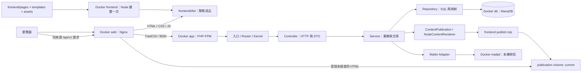
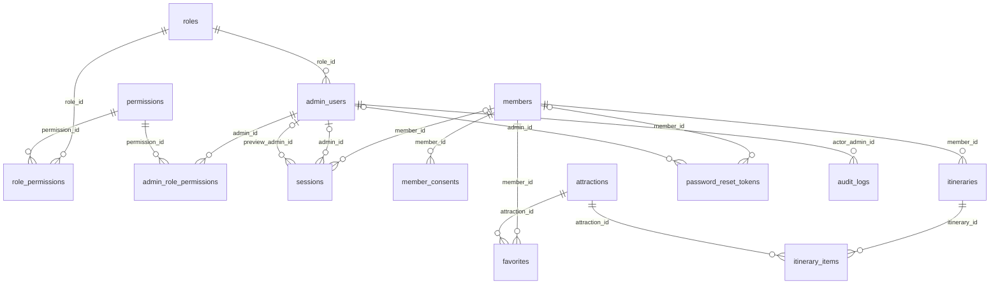

# 全站架構與檔案功能導讀

2026-10-24 階段八依使用者授權從最新 main 建立 `phase/08-p0-validation`，8A 診斷進行中。CSRF 增加有限五秒時鐘回撥預算與無秘密的拒絕原因日誌，12項受控邊界測試通過；100輪修正前觀察均為預期422，未將歷史不明註冊失敗宣稱已解決。檔案用途與命令見 [運維指南](modules/operations.md)。尚無新表／migration／HTML；整階段、部署與正式環境未驗收。以下較早段落為當時紀錄。

2026-10-24 階段八僅規劃：新增 [P0整合驗收與部署基線細節計畫](PHASE-8-PLAN.md)，列出16項P0儲存格對照、優先診斷的偶發問題、一個預計health操作、正式封裝／TLS、隔離備份還原／回退及24項固定驗收。尚未授權實作或建立分支；目前仍71 API／67固定頁／33表／18 migration，沒有變更程式、環境或資料庫。 未建立階段八模組閱讀指南或通過報告冒充成果；實作後仍須逐功能維護本導讀。

2026-10-24 階段七完成本機驗收：**71 API／67 固定頁／33 表／316 欄／18 migration**。SEO 全站／逐頁／範本／單筆設定、公開 head 同版、權限／版本／audit 與開發政策頁已交付；桌面／手機與失敗流程見 [階段七驗收](PHASE-7-ACCEPTANCE.md)。下方 7A–7D 與較早日期保留當時紀錄；最新功能及外部差項以本段和驗收為準，階段八未開始、P0 尚未完成。

2026-10-24 階段七 7D：新增公開開發條款／隱私說明與註冊連結，67 固定頁；仍為 71 API／33 表／18 migration。沿用註冊既有說明與 TERMS_VERSION，不修改歷史同意紀錄；正式文案待業主提供。policy-pages.mjs 處理版本文字輸出，policy.js 共用導覽，ContentPublication 保存同版 policyVersion，Compose frontend 轉傳既有 TERMS_VERSION。用途與驗證命令見 [政策說明指南](modules/seo-settings.md#7d-開發條款與隱私說明)。整階段與實際畫面驗收進行中。

2026-10-24 階段七 7C：公開 settings GET 與同版 SEO head 已建立，合計 71 個操作／33 表／18 migration／65 固定頁。PublicSiteSettings 只回成功 generation 的白名單，SeoPublication 過濾草稿覆寫，ContentPublication／NodeContentRenderer 納入設定與模板；build／publish／管理預覽共用 seo-resolver.js／seo-head.mjs。Nginx 保留公開 gate，管理／認證／私人 shell 不受發布故障阻擋；Compose frontend 僅轉傳既有 APP_URL，沒有新變數或服務。檔案、60 項／12 契約及命令見 [SEO 指南](modules/seo-settings.md#7c-同版公開設定與-html-head)。條款頁與整階段／實際畫面驗收尚未完成，完整 JSON-LD／索引與一般設定仍未開放。

2026-10-24 階段七 7B：管理 SEO GET／PUT、settings 原型表單、版本／權限／同交易 audit 已建立，API 共 70；主庫備份後升級，主／測試均 33 表／18 migration，固定頁仍 65。Controller → SeoSettings → SiteSettingsRepository／ContentSeoRepository；SeoContentRepository 批次目標與權限篩選、SeoSettingsResult 限定輸出；前端 seo-settings-api／seo-fields／seo-settings／phase7.css 分別包 HTTP、欄位、互動與必要樣式。詳細檔案與 74 項／32 契約、5 項表單行為驗證見 [SEO 指南](modules/seo-settings.md#7b-管理設定與原型表單)。公開 GET／head 整合仍在 7C，不把 publicationReady=false 當已完成發布，整階段未驗收。

2026-10-24 階段七 7A：依授權建立 `phase/07-seo-settings-head`。017 新增 site_settings／content_seo，DTO／enum／Repository／URL 與目標規則、共用頁面 catalog 及資料層測試已建立，見 [SEO 閱讀指南](modules/seo-settings.md)。測試庫 33 表／18 migration，主庫暫為 31／17；API 仍 68／固定頁 65，尚無可用 SEO API 或設定 UI。空庫／保留會員內容收藏行程升級、重跑、14 項 rollback 與輸入單元通過。沒有新增 Docker 服務、套件、port 或環境變數，整階段仍在實作。

2026-10-24 階段七規劃：新增 [全站 SEO／HTML head 計畫](PHASE-7-PLAN.md)，含預計頁面、三個 API、site_settings／content_seo、分層／同版發布、欄位來源與固定驗收清單。**尚未實作或建立階段七分支**，因此目前仍為 68 個操作／31 表／17 份 migration／65 頁；沒有安裝或變更 Docker 環境，也沒有新增可用 SEO API。正式網址／文案等外部待辦及 P1／P2 界線見計畫。

2026-10-24 階段六完成本機驗收：68 個 API／31 表／297 欄／17 份 migration／65 個固定頁。Brave 已實測登入返回、收藏與行程分頁／保存／移除／空值／下架／409／換帳號返回，以及桌面 1440×900／手機 390×844／鍵盤；精確證據與未驗情境見 [階段六驗收](PHASE-6-ACCEPTANCE.md#瀏覽器驗收)。修正愛心可及性、美食分類載入、長名稱換行及登入／註冊意圖保留。最後前端 129 項、建置 65 頁／77 個 HTTP 完整性零差異；PHP／MariaDB 未修改，沿用已列明的後端複驗。先前間歇事件仍保留，未宣稱根因消除。無新增服務、套件、port 或環境變數；階段七／十一未開始。下列帶日期段落是當時進度，非當前待辦。

2026-10-23 20:21 定點複驗：收藏／行程／發布／重建／優惠／首頁六組共 307 項、PHP 69 項／270 斷言、Node 126 項、資料層／升級、PHPStan／格式與 65 頁／77 個 HTTP 完整性再次通過，未修改應用程式。詳見 [階段六複驗](PHASE-6-ACCEPTANCE.md#2026-10-23-2021-再次定點複驗)；本輪沒有重跑全部舊模組契約或依賴 audit。實際瀏覽器工具仍無法啟動，畫面待驗及先前間歇事件保留，尚未合併 main。

2026-10-23 階段六目前交付：收藏與基本行程已在階段分支建立，68 個 API／31 表／297 欄／17 份 migration／65 個固定頁；自動化結果與剩餘實際畫面驗收見 [階段六紀錄](PHASE-6-ACCEPTANCE.md)。PHP 69 項／270 斷言、前端 126 項，收藏／行程／容器重建／五輪發布與既有模組契約已有實際結果。瀏覽器工具尚未恢復，並保留尚無穩定重現原因的間歇事件，不宣告整階段完成或合併 main；階段七與十一未開始。沒有新增 Docker 服務、套件、port 或環境變數，原始網站／規格保持完整。下方帶日期段落保留當時狀態。

2026-10-23 階段六 6C：新增三個目前行程 API，合計 68 個操作。`CurrentItineraryController` → `CurrentItinerary` → `ItineraryRepository` 負責本人讀取、加入／移除、父子交易與版本衝突；`CurrentItineraryPage`／`ItineraryWriteResult` 限定輸出。前端 `current-trip-state.js` 管保存版本、舊回應與身分變更，`pages/planner.js` 管讀取／確認／保存提示，`components/member-itinerary.js` 沿用原型站點版型。`member-resources-api.js`／`member-actions.js` 共用收藏與加入入口。無新增 migration、環境變數或服務；31 表／17 份 migration、65 個固定前端來源頁。命令及資料流見 [會員指南](modules/member-resources.md#6c-目前行程與基本保存)。完整階段驗收仍在進行，尚未合併 main。

2026-10-23 階段六 6B：四個本人收藏 API、愛心／登入待辦與 favorites.html 已建立，API 共 65；主／測試庫皆 31 表／17 份 migration，固定前端來源 65 頁。`config/member-routes.php` 為會員資源專用路由，PHPStan 已納入分析；`MemberFavorites`／`MemberAttractions` 分別管理本人交易與公開投影，`member-resource-state.js`／`member-actions.js` 共用狀態與操作，`pages/favorites.js` 控制本人列表。完整檔案／命令／驗證見 [會員指南](modules/member-resources.md#6b-收藏-api-與共用愛心)。基本行程與整階段驗收仍在進行，不標階段六完成。

2026-10-23 階段六 6A 共用準備：使用者已授權實作，分支為 `phase/06-favorites-basic-itinerary`。015／016 新建收藏／行程三表與本人唯一約束，`MemberAccess` 重查會員，`FavoriteRepository`／`ItineraryRepository` 集中本人資料 SQL；DTO、檔案用途與命令見 [會員資料閱讀指南](modules/member-resources.md)。測試庫已升級為 31 表／17 份 migration，主庫暫仍 28／15；API 仍 61，尚未接入收藏或行程頁面。空庫／保留資料升級、重跑及 25 項持久層檢查、輸入單元與靜態分析通過，不等於階段六完成。

2026-10-23 階段六僅規劃：新增 [收藏與基本行程細節計畫](PHASE-6-PLAN.md)，包含來源儲存格、預計頁面／七個 API／三張表／兩份 migration、本人所有權、重送與並行、下架資料及待驗清單。僅更新工程文件，backend／frontend／schema／Docker 與目前 61 個 API／28 表／15 份 migration 不變；階段六尚未實作，完整旅程編排仍在階段十一。`PHASE-6-PLAN.md` 是設計，未建立閱讀指南或驗收通過紀錄冒充成果。

2026-10-23 固定清單複驗：結果見 [本輪紀錄](RECHECK-PHASES-1-5-20261023.md)，後續依 [V01–V18 清單](VERIFICATION-CHECKLIST.md) 記錄狀態。修正景點編輯確認重載後仍保留待上傳圖片的問題，新增取消／成功／失敗重試的行為回歸；前端目前 104 項通過。`backend/tests/frontend_integrity.py` 以 Python 標準函式庫檢查建置後各頁的 main／ID／label、資產與靜態模組引用，選用 `--base-url` 做本機唯讀 HTTP 驗證；它不驗證後續功能或逐像素顯示。執行 `docker compose run --rm --no-deps frontend` 後，再執行 `python backend/tests/frontend_integrity.py --base-url http://localhost:8080`。本輪沒有新增 API、資料表、migration、環境變數或階段；PHP／資料庫架構維持既定分層。

2026-10-23 階段一至五複驗：已重驗認證／權限、景點／媒體／地圖、電影／場次、公開消息／優惠／首頁及環境；代表頁桌面／手機原型對照與實際表單操作見 [複驗紀錄](REVIEW-PHASES-1-5-20261023.md)。修正選填空值的公開排版、手機電影重載按鈕及頂列連結斷行。無新增 API、資料表、migration 或環境變數；仍為 61 個操作／28 表／十五份 migration，階段六起未開始。`content-cards.js`／`scripts/publish.mjs` 負責瀏覽器／預先產生卡片與空值顯示，`phase2.css`／`phase4.css` 補充實際操作狀態，`attraction-publication.test.mjs` 驗證真實 HTML 產物。更新後執行前端建置與 `content:publish`，不手改 dist。

2026-10-22 階段五完成本機實作與驗收：**公開消息、優惠／店家受控維護及首頁同版整合**。目前 28 表／276 欄、十五份 migration、61 個 API 操作。首頁與消息／優惠的分類、有效期、分頁及基本閱讀頁讀真實資料；受控 CLI 支援預覽、保存、圖片匯入與故障重試。本機已明確匯入原型四篇消息／三項優惠，正式內容與圖片權利仍待確認。結果及界線見[階段五驗收](PHASE-5-ACCEPTANCE.md)，逐檔用途見[公開內容閱讀指南](modules/public-content.md)。

2026-10-22 先前規劃紀錄：[公開消息／優惠與首頁細節計畫](PHASE-5-PLAN.md) 列出原型頁面、欄位來源、七個預計公開 API、四張新表與既有店家表擴充、CLI 維護、分層及驗收。規劃提交當時只有文件，為 54 個 API／24 表／十二份 migration；實作後最新狀態見上方進度。

2026-10-22 Compose 整理：保留單一 compose.yaml，使用 x-php-common／x-web-common 統一共用設定，FPM 健康檢查只套用 app／app-test；publisher 以 CLI running 狀態啟動。測試資料庫／媒體／發布位置仍明確分開。設定展開比對、完整啟動與隔離驗證見下方「Compose 閱讀與啟動」；沒有新增業務功能或 migration。

2026-10-22 PHP 安全維護：基底更新為官方 php:8.5.12-fpm-bookworm 並固定 digest，詳見 [來源與驗證紀錄](PHP-SECURITY-UPDATE-20261021.md)。官方 amd64 映像已發布，臨時原始碼編譯配方及輔助工具已移除；原專案擴充／runtime／development 階段保留。這是環境維護，階段五仍未開始。

2026-10-21 修正補充：已處理發布紀錄故障的 202 回應、僅新增權限的登入／側欄／保存後狀態及電影介紹原型對齊；沒有新增 API、資料表、migration 或階段。最新證據與保留差異見 [規劃與實作複查的修正紀錄](REVIEW-PLAN-IMPLEMENTATION-20261020.md#2026-10-21-修正與驗證)。新增 `backend/tests/publication_failures.py` 負責隔離發布故障回歸；`frontend/tests/admin-navigation.test.mjs` 驗證權限導向。`core/session.js` 集中 `adminNavigation`／`adminDestination`／`adminReturnTo`，各表單共用。階段五以後仍未開始。

2026-10-20 階段四完成本機實作與驗收：電影／場次／歷史網址三表、公開電影 API／片單／詳情／首頁同版發布、後台電影／海報 CRUD 與多場次編輯。主庫與測試庫現為十二份 migration、24 表／211 欄、54 個 API 操作。10 月 19 日最終驗證：整合 619 項、PHP 55 項／233 斷言、Node 88 項，獨立契約零差異，桌面／手機及隔離容器重建持久化已驗。實際證據與界線見 [階段四驗收](PHASE-4-ACCEPTANCE.md)，新檔用途及操作見 [電影指南](modules/films.md)。U-16 只檢查日期及開始時間重複，結束時間後續再議。主庫四部原型電影沒有完整放映年份，未猜測或建立場次。以下較早日期的 21 表／十份 migration 是當時紀錄。

2026-10-19 業主要求校正：補回 Excel E20 的既有範例景點試填與 G6 電話流程。最新逐條來源、實作／驗證及正式交付差項見 [階段二、三業主要求對照](PHASE-2-3-OWNER-ALIGNMENT.md)。本輪 14 組整合共460項、PHP44項／213斷言、Node73項及獨立契約零差異；原先完整檢查沒有覆蓋這兩個漏項，不能當成全面符合 Excel 的證明。現在45個API操作、十份migration、21表181欄。

2026-10-19 再次完整檢查：7 項問題已校正；445 項整合／故障復原檢查、PHP 41 項及 Node 68 項通過。獨立 OpenAPI 驗證未再發現格式差異。新增 008 固定身分逐位元組保護，當次九份 migration。範圍、重現命令與限制見 [再次檢查報告](FULL-RECHECK-20261019.md)。

2026-10-18 U-15 更新：確認密碼已更正為必填且一致（註冊／重設／更改／CLI）；使用 Input.confirmedPassword 與共用前端比對，沒有新增資料表、migration 或 API。先前選填的驗證紀錄不代表現行政策。

2026-10-18 規格校正已交付：回溯發現的 R-01–R-07 已處理；安全政策經 U-13 明確同意，掃描範圍依 U-14 定案。355 項隔離整合驗證、主庫保留資料升級及目前行為見 [Excel 基準校正](SPECIFICATION-ALIGNMENT.md)，逐表對照見 [資料庫對照](DATABASE-SPECIFICATION-MAP.md)。以下較早日期的測試保留當時結果，不當作現行政策。

**2026-10-18 修正補充：** 已修正圖片說明保存、原型順序／文案標籤、營業時間欄及座標約束，並補齊景點表單失敗／競態測試。修正結果及驗收界線見 [PHASE-3-REVIEW-PLAN.md](PHASE-3-REVIEW-PLAN.md)。

更新日期：2026-10-24。這份文件是目前專案的閱讀入口：先了解網站如何執行，再查每個檔案負責什麼、資料存在哪裡，以及修改功能時該從哪裡開始。上方帶日期的段落是各次交付紀錄，以下檔案表維持目前狀態。

2026-10-18先前完整複查（當次紀錄）：[階段二、三完整複查報告](FULL-REVIEW-20261018.md)。PHP37項／182斷言、前端64項及396項整合檢查通過；64頁路由／資產／imports與桌面／手機Google原文流程已核對。該次複查未新增業務功能、API、表或migration；本輪基準校正則新增005–007，詳見上方校正交付。環境復原及仍未實作的內容補位見該次報告。

規格基準（U-12，2026-10-18）：原始 Excel 為功能與限制的依據；欄位清單不等於必填清單，文件未定義處不自行加上業務限制。「建議／草案」維持原本性質，使用者指定與必要技術設定分別標 U／E。詳細規則見 [開發流程](DEVELOPMENT-WORKFLOW.md#規格基準u-122026-10-18)。該次基準設定僅記錄作業準則；其後本輪已同步校正前後端、API 契約與資料庫，實際範圍見上方交付連結。

內容補位進度：[景點摘要與介紹自動補位計畫](ATTRACTION-CONTENT-FALLBACK-PLAN.md)（U-11／E-22）。兩欄已完成選填，可留空新增／編輯／發布，空值以空字串保存；自動補位（自家介紹摘錄、預覽及 Google 即時原文備援）依使用者2026-10-18指示延後，保留計畫待後續安排；Google 仍僅供後台參考。

**目前完成階段二至五：認證／權限／唯讀模擬、景點／店家、圖片／地圖、電影／多場次、公開消息／優惠及首頁同版發布。** 景點、博物館、電影、消息／優惠與首頁對應區塊讀真實資料；其他未實作業務仍為展示快照或待開放。頁面存在不代表該模組已串接資料庫。完整階段規劃見 [實作計畫](IMPLEMENTATION-PLAN.md)，實際驗證見 [階段二驗收](PHASE-2-ACCEPTANCE.md) 、[階段三驗收](PHASE-3-ACCEPTANCE.md) 與 [階段四驗收](PHASE-4-ACCEPTANCE.md)。

來源標記沿用 [設計來源表](DESIGN-TRACEABILITY.md)：S 是規格要求，D 是規格中的建議草案，U 是使用者指定，E 是工程補充。本案 PHP＋MariaDB＋Docker、原生 JS／可用 jQuery 來自 U-01；API-only、易讀分層及參考 Spring Boot 來自 U-02。以下目錄、類別、工具與容器拆法屬工程實作，不冒稱 Excel 指定。

2026-10-17 依 U-08 重排後續計畫；本文件以下的檔案、API、資料表及操作描述仍是實際已存在內容，沒有把規劃寫成實作。

| 範圍 | 階段與界線 | 實際狀態 |
| --- | --- | --- |
| 共用準備 | 1 | 已完成 |
| P0 | 2–8；8 為整合驗收 | 2–7 已完成本機範圍，8 未開始，P0 尚未完成 |
| P1 | 9–12；12 為整合驗收 | 未開始；完整內容管理、前後篇、路線、完整旅程、JSON-LD／索引 |
| P2 | 13–15；15 為全站交付 | 未開始；搜尋、會員查詢、一般設定／營運與最終交付 |

P0 收藏／加入行程的必要保存排階段 6，完整多份旅程編排排階段 11。SEO 設定與 HTML head 排 P0 階段 7，JSON-LD／動態 sitemap 排 P1 階段 12。完整相依與原型頁對應見實作計畫及 [需求對照](REQUIREMENTS-MAP.md)，不是本次新增功能。

## 目錄

1. [整體執行架構](#整體執行架構)
2. [根目錄與閱讀入口](#根目錄與閱讀入口)
3. [Backend：每個檔案做什麼](#backend每個檔案做什麼)
4. [Frontend：每個檔案做什麼](#frontend每個檔案做什麼)
5. [資料庫結構與資料生命週期](#資料庫結構與資料生命週期)
6. [Docker、環境變數與資料位置](#docker環境變數與資料位置)
7. [主要操作的完整資料流](#主要操作的完整資料流)
8. [啟動、驗證與排查](#啟動驗證與排查)
9. [要改某個功能時從哪裡看](#要改某個功能時從哪裡看)
10. [文件索引與維護方式](#文件索引與維護方式)

## 整體執行架構



這是多頁網站，每頁保留獨立 `.html` 網址。瀏覽器執行原生 JavaScript ES modules，以 `fetch` 呼叫同來源 API；目前沒有引入 jQuery。PHP 網站 HTTP 責任只提供 JSON API，沒有 PHP HTML View。Node 是建置、HTML 產生與測試工具；publisher 是 PHP CLI 輪詢程序，按需呼叫 Node，不另開 Node HTTP 服務。

PHP-FPM 是執行 PHP 程式的工作程序管理器；Nginx 收到 API 請求後以 FastCGI 交給它。它不是資料庫，也不是要直接在瀏覽器開啟的 HTTP 網站。業務邏輯仍在 `backend/src/`。

分層採 Controller → Service → Repository，搭配 DTO、Policy 與建構子依賴注入。與 Spring Boot 的角色對照、例外轉譯及取捨見 [PHP 分層閱讀指南](modules/backend-layering.md)。本案用明確組裝與 PDO，沒有引入 Spring、Laravel、Symfony 或 ORM。

| 區域 | 存什麼 | 修改原則 |
| --- | --- | --- |
| `website/` | 客戶原始交付的頁面、CSS、JS 與參考檔 | 保留原始內容，作為版型與行為對照 |
| `frontend/` | 正在開發的 HTML 來源、模板、JS、CSS、前端測試 | 修改來源後重新建置 |
| `backend/` | PHP API、資料庫結構、資源契約、CLI 與後端測試 | 業務依照分層處理 |
| `docker/`、`compose.yaml` | 容器與 Nginx／PHP 執行設定 | 與應用程式分開管理 |
| `scripts/` | 本機初始化的 PowerShell 入口 | 協調 Docker／CLI，不接替網站業務 |
| `tools/php/` | 與應用依賴分開鎖版的 PHP 品質工具 | PHP／Composer／工具在 Docker 內執行 |
| `docs/` | 計畫、契約對照、閱讀與驗收文件 | 新增工程文件統一放這裡 |
| `.agents/`、`AGENTS.md` | 代理開發約定與 skills | 開發流程資源，不是網站公開檔案 |
| `artifacts/` | 本機驗證輸出、截圖、歷史備份、隔離測試憑證 | 被 Git 忽略，不是正式來源或交付素材 |

## 根目錄與閱讀入口

| 檔案 | 用途與閱讀重點 |
| --- | --- |
| [README.md](../README.md) | 快速了解目前範圍、啟動方式與常用驗證命令。 |
| [compose.yaml](../compose.yaml) | 定義八個服務、網路內的服務名稱、對外 port、掛載、profiles、健康檢查與 volumes；詳見環境章節。 |
| [.env.example](../.env.example) | 可提交的環境變數範本，秘密欄位留空；實際值放在被忽略的 .env。 |
| [.gitignore](../.gitignore) | 排除 .env、vendor、dist、.build、artifacts 等秘密或產物，保留 .env.example。 |
| [.dockerignore](../.dockerignore) | 限制 Docker build context，排除 Git、秘密、原始 Excel、skills、依賴與驗證產物等。 |
| [.gitattributes](../.gitattributes) | 統一文字換行；PowerShell 使用 CRLF，Excel／圖片等視為二進位。 |
| [AGENTS.md](../AGENTS.md) | Git 提交、分支、分層、skill、來源註記及驗證約定。 |
| [skills-lock.json](../skills-lock.json) | 原安裝工具的 skill 鎖定資訊；完整技能來源另見 DEVELOPMENT-WORKFLOW.md，不能把它當 Composer lock。 |
| [映畫竹塹_後台工程串接功能規格.xlsx](../映畫竹塹_後台工程串接功能規格.xlsx) | 客戶原始規格。功能、驗收、安全底線與草案來源以此核對；不改寫原始交付。 |

`website/` 的原始 68 個檔案不由目前 Nginx 提供服務；主要參考入口是 `website/index.html`、`website/admin/`、`website/css/style.css` 與 `website/js/app.js`。全 57 個原始網址及原型差異見 [原始網站對照](WEBSITE-COMPARISON-REVIEW.md)。第三方 skill 參考檔、Composer vendor 及 Git 內部檔案不逐項當成網站程式解釋。

## Backend：每個檔案做什麼

### 階段七 SEO 的新增檔案

| 檔案／群組 | 用途 |
| --- | --- |
| [config/seo-routes.php](../backend/config/seo-routes.php)、Composition | 三操作及建構子依賴；Kernel 沿用管理 session／CSRF |
| [SeoSettingsController](../backend/src/Controllers/SeoSettingsController.php)、[PublicSiteSettingsController](../backend/src/Controllers/PublicSiteSettingsController.php) | 管理輸入轉換與公開 JSON，不產 HTML |
| [SeoSettings](../backend/src/Services/SeoSettings.php) | 重查權限、版本鎖、設定／覆寫／audit 同交易，提交後發布 |
| [PublicSiteSettings](../backend/src/Services/PublicSiteSettings.php)、[SeoPublication](../backend/src/Services/SeoPublication.php) | 成功快照的公開白名單、當次公開內容覆寫篩選 |
| [SiteSettingsRepository](../backend/src/Repositories/SiteSettingsRepository.php)、[ContentSeoRepository](../backend/src/Repositories/ContentSeoRepository.php)、[SeoContentRepository](../backend/src/Repositories/SeoContentRepository.php) | 文件版本／鎖、批次覆寫及分權目標查詢，不自行 commit |
| [SeoSettingsInput](../backend/src/DTO/SeoSettingsInput.php)、[SeoDefaults](../backend/src/DTO/SeoDefaults.php)、[SeoOverride](../backend/src/DTO/SeoOverride.php) | 完整文件、全站初值與逐欄繼承，技術型別／資源界線 |
| [SeoSettingsDocument](../backend/src/DTO/SeoSettingsDocument.php)、[SeoSettingsResult](../backend/src/DTO/SeoSettingsResult.php)、[SeoContentTarget](../backend/src/DTO/SeoContentTarget.php)、[PublicSiteSettingsDocument](../backend/src/DTO/PublicSiteSettingsDocument.php) | 型別化內部文件、管理輸出／選擇器與公開輸出 |
| [SeoResource](../backend/src/Models/SeoResource.php)、[SeoRobots](../backend/src/Models/SeoRobots.php)、[SeoTargetPolicy](../backend/src/Policies/SeoTargetPolicy.php)、[SeoUrlPolicy](../backend/src/Policies/SeoUrlPolicy.php) | 有限資源／索引值、路徑白名單、canonical 與 HTTPS URL |
| [SeoCatalog](../backend/src/Adapters/SeoCatalog.php) | 載入共用 JSON catalog，不執行任意使用者 regex |
| ContentPublication／NodeContentRenderer | generation 納入 SEO／policyVersion／模板雜湊，重用發布鎖與原子切換 |
| [017_site_seo.sql](../backend/database/migrations/017_site_seo.sql) | 兩張新表；原內容 SEO 欄位與舊 migration 保留 |

測試入口：seo_settings_schema.py／seo_settings_persistence.php、seo_settings_integration.py、seo_publication_integration.py、seo_settings_restart.py、seo_head_inventory.py、policy_pages_integration.py、Unit/SeoInputTest.php；phase7_member_regression.py 沿既有單次 CSRF 更新政策複驗會員功能並記錄拒絕。檔案連結、資料流及命令見 [SEO 指南](modules/seo-settings.md)。


### 階段六會員資料：新增檔案與資料流

目前已完成本機驗收；七個 API 不提供完整旅程編排。欄位、來源與操作命令見 [會員指南](modules/member-resources.md)。

本輪前端入口的檔案用途：`auth.js` 保留安全的登入／註冊待辦，`pages/attractions.js` 支援景點與美食兩種分類模板，`content-cards.js`／`scripts/publish.mjs` 同步卡片可及性及空營業時間顯示，`phase6.css` 防止長文字撐寬。新增 [卡片可及性回歸](../frontend/tests/member-card-accessibility.test.mjs) 與 [美食列表回歸](../frontend/tests/attraction-food-list.test.mjs)，並擴充 [認證導覽回歸](../frontend/tests/auth-navigation.test.mjs) 及 [真實發布產物測試](../frontend/tests/attraction-publication.test.mjs)。沒有變更 API、資料表或 migration。

| 檔案／類別 | 用途 |
| --- | --- |
| [FavoriteController](../backend/src/Controllers/FavoriteController.php)／[CurrentItineraryController](../backend/src/Controllers/CurrentItineraryController.php) | 接收 HTTP、驗證白名單輸入、呼叫服務並序列化 DTO。 |
| [MemberFavorites](../backend/src/Services/MemberFavorites.php)／[CurrentItinerary](../backend/src/Services/CurrentItinerary.php) | 收藏及目前行程的本人交易、明確增減、版本與重送規則。 |
| [MemberAccess](../backend/src/Services/MemberAccess.php)／[MemberAttractions](../backend/src/Services/MemberAttractions.php) | 有效會員重查／寫入鎖，及成功公開投影的可用性判定。 |
| [FavoriteRepository](../backend/src/Repositories/FavoriteRepository.php)／[ItineraryRepository](../backend/src/Repositories/ItineraryRepository.php) | 所有 SQL 都含本人條件；收藏分頁／批次狀態、父表／站點與順序。 |
| [FavoriteRecord](../backend/src/DTO/FavoriteRecord.php)／[MemberItinerary](../backend/src/DTO/MemberItinerary.php)／[ItineraryStop](../backend/src/DTO/ItineraryStop.php) | 資料庫映射的不可變型別，與公開回應分開。 |
| [MemberPageInput](../backend/src/DTO/MemberPageInput.php)／[FavoriteStatusInput](../backend/src/DTO/FavoriteStatusInput.php)／[ItineraryItemInput](../backend/src/DTO/ItineraryItemInput.php) | 游標、頁面大小、UUID 與版本輸入；不接受 owner 或完整編排欄位。 |
| [FavoritePage](../backend/src/DTO/FavoritePage.php)／[FavoriteWriteResult](../backend/src/DTO/FavoriteWriteResult.php)／[CurrentItineraryPage](../backend/src/DTO/CurrentItineraryPage.php)／[ItineraryWriteResult](../backend/src/DTO/ItineraryWriteResult.php) | 七個 API 的明確輸出，不洩漏 memberId。 |
| [MemberAttractionSnapshot](../backend/src/DTO/MemberAttractionSnapshot.php)／[AttractionAvailability](../backend/src/Models/AttractionAvailability.php) | available／unavailable／unknown；不從草稿補私人列表的公開資料。 |
| [015](../backend/database/migrations/015_member_favorites.sql)／[016](../backend/database/migrations/016_member_itineraries.sql) | 三表及唯一／FK／CHECK；合計 31 表／297 欄／17 份 migration。 |
| [member_resources_persistence.php](../backend/tests/member_resources_persistence.php)／[member_resources_schema.py](../backend/tests/member_resources_schema.py) | 真實約束／本人查詢；空庫／保留資料升級及重跑，清理自有 fixture。 |
| [member_resources_integration.py](../backend/tests/member_resources_integration.py)／[member_itinerary_integration.py](../backend/tests/member_itinerary_integration.py) | HTTP、越權、契約、版本、並行及 DB 故障回滾。 |
| [member_resources_queries.php](../backend/tests/member_resources_queries.php)／[member_resources_restart.py](../backend/tests/member_resources_restart.py)／[member_publication_integration.py](../backend/tests/member_publication_integration.py)／[phase6_regression.py](../backend/tests/phase6_regression.py) | MariaDB 查詢計畫、自有私有資料容器重建保存、五輪公開版本切換、既有模組契約回歸；結果以驗收紀錄為準。 |

以下各表的檔名相對於表上指定的目錄；連結指向實際檔案。閱讀一個 API 時，先看 `config/routes.php`，再追 Controller、Service、Repository；不要從所有類別的第一行依序讀到最後。

### 入口、契約與工具設定

| 檔案 | 用途與閱讀重點 |
| --- | --- |
| [public/index.php](../backend/public/index.php) | 唯一網站 PHP 入口：載入 Composer、擷取 Request、組裝 Kernel、處理並輸出 Response；入口本身的失敗也轉成安全 JSON。 |
| [config/routes.php](../backend/config/routes.php) | 登記 61 個 API 的 HTTP 方法、路徑、會員／管理員身分、module/action 與模擬例外旗標（舊首登旗標已停用）。 |
| [src/Composition.php](../backend/src/Composition.php) | 依賴組裝位置：建立共用連線、Repositories、Adapters、Services、Controllers，再接路由與 Kernel。 |
| [src/Config.php](../backend/src/Config.php) | 讀取容器環境變數，校驗數值、APP_KEY、APP_URL 與正式環境 HTTPS／Secure cookie 條件；不解析 .env 檔。 |
| [composer.json](../backend/composer.json) | 應用程式的 PHP／extension／PHPMailer 依賴及 Yinghua 命名空間的 PSR-4 載入設定。 |
| [composer.lock](../backend/composer.lock) | 應用依賴的確切版本；安裝時依鎖定版本還原。 |
| [config/member-routes.php](../backend/config/member-routes.php) | 七個本人收藏／目前行程 API，與 routes.php 的 61 個操作由 Composition 一起註冊。 |
| [resources/openapi.json](../backend/resources/openapi.json) | 68 個已實作 API 的請求、回應、狀態碼與安全契約。它描述 API，不會自行產生路由或程式。 |
| [resources/role-templates.json](../backend/resources/role-templates.json) | 原始 Excel 四種角色、十個模組、四個動作的起始權限；供 seed 使用，不是每次請求直接查閱的個人權限。 |
| [bin/console.php](../backend/bin/console.php) | CLI 入口：db:migrate、db:seed、admin:init、admin:recover、content:seed-demo／backfill-demo-labels／publish／tick／watch。密碼由 stdin／互動輸入；不提供 HTTP 路由。 |
| [phpstan.neon](../backend/phpstan.neon) | PHPStan level 10 與 PHPat 架構規則的分析範圍、autoload 及快取設定。 |
| [phpunit.xml](../backend/phpunit.xml) | 單元測試的 bootstrap、tests/Unit 套件與快取位置。 |
| [.php-cs-fixer.dist.php](../backend/.php-cs-fixer.dist.php) | PER-CS 格式與未使用 import 檢查的範圍。 |
| [rector.php](../backend/rector.php) | PHP 語法現代化建議的路徑與版本規則；本專案只執行 dry-run，檢閱後另做有範圍的修改。 |

### HTTP 共用管線：`backend/src/Http/`

| 檔案 | 用途與閱讀重點 |
| --- | --- |
| [Request.php](../backend/src/Http/Request.php) | 從 PHP 請求資料建立不可變請求物件；校驗網址、JSON／multipart、query 與必要輸入，產生 requestId。 |
| [Response.php](../backend/src/Http/Response.php) | 保存 status、payload、cookies、headers 及送出後 callback；輸出 JSON／requestId，204 不輸出 body。 |
| [Route.php](../backend/src/Http/Route.php) | 一條路由的資料與路徑比對，包括 {id}、身分、授權及模擬控制旗標；舊 allowPasswordChange 暫留相容，Kernel 已不使用。 |
| [Router.php](../backend/src/Http/Router.php) | 依路徑與方法找 Route；支援 GET 的 HEAD，區分 404 與 405／Allow。 |
| [Kernel.php](../backend/src/Http/Kernel.php) | 整合路由、身分、CSRF、唯讀模擬與授權，再呼叫 Controller；統一應用例外與非預期錯誤。 |
| [ApiContext.php](../backend/src/Http/ApiContext.php) | 本次請求交給 Controller 的上下文：Request、ClientContext、身分、路由參數；區分 actor 與 owner。 |
| [Csrf.php](../backend/src/Http/Csrf.php) | 會員／後台分開的簽章匿名 Cookie、CSRF token、Origin 檢查與登入 Cookie 建立／清除。 |
| [CsrfContext.php](../backend/src/Http/CsrfContext.php) | 攜帶匿名識別、簽章 Cookie 值與是否需重發 Cookie，供同一請求共用。 |
| [Cookie.php](../backend/src/Http/Cookie.php) | 定義並輸出 Cookie 及其期限、Secure、HttpOnly、SameSite 等屬性。 |

### Controller：`backend/src/Controllers/`

| 檔案 | 用途與閱讀重點 |
| --- | --- |
| [AuthController.php](../backend/src/Controllers/AuthController.php) | 會員／管理員的 CSRF、挑戰、註冊、登入、me、登出、密碼及唯讀模擬 HTTP 入口；組合安全 DTO、Cookie 與 CSRF。 |
| [AdminController.php](../backend/src/Controllers/AdminController.php) | 管理員列表、單筆、新增、編輯與刪除；把輸入轉成 DTO，將 Service 輸出轉回既有 JSON。 |
| [PermissionController.php](../backend/src/Controllers/PermissionController.php) | 角色範本清單、權限 catalog、個人矩陣讀寫；分別呼叫 RoleTemplates 與 PermissionManagement。 |

### Service：`backend/src/Services/`

| 檔案 | 用途與閱讀重點 |
| --- | --- |
| [Authentication.php](../backend/src/Services/Authentication.php) | 登入／註冊／登出、session 輪替、重新校驗帳號與認證事件；current 回真正操作者及有效身分。 |
| [Authorization.php](../backend/src/Services/Authorization.php) | 重新取得目前管理員及個人矩陣，委派 Policy 驗證 module/action；寫入可在同交易鎖定操作者。 |
| [AdminManagement.php](../backend/src/Services/AdminManagement.php) | 管理員 CRUD、角色更換、版本衝突、停用／刪除撤銷 session／reset token，協調同交易稽核。 |
| [PermissionManagement.php](../backend/src/Services/PermissionManagement.php) | 權限 catalog 與逐人矩陣：完整性、版本、root 保護、防越級、本人管理權及交易稽核。 |
| [RoleTemplates.php](../backend/src/Services/RoleTemplates.php) | 角色查閱授權及合法指派模板；帳號建立／換角色共用，禁止指派 root 角色。 |
| [AdminPreview.php](../backend/src/Services/AdminPreview.php) | 固定 root 的唯讀模擬目標清單、切換與退出；鎖定 session、輪替 token，稽核真正操作者。 |
| [PasswordReset.php](../backend/src/Services/PasswordReset.php) | 準備重設 token、送信及失敗撤銷；重設／本人改密碼與所有舊 session 的撤銷。 |
| [PasswordHasher.php](../backend/src/Services/PasswordHasher.php) | 集中 Argon2id 雜湊、驗證、rehash 判斷，以及未知帳號的 dummy 驗證成本。 |
| [Captcha.php](../backend/src/Services/Captcha.php) | 建立短效註冊挑戰、產生 PNG 或寄送 Email；綁定匿名 session／收件人，檢查答案、次數及一次性消耗。 |
| [RateLimiter.php](../backend/src/Services/RateLimiter.php) | 以用途、識別與時間窗使用資料庫共享限速，回傳限速應用錯誤與重試秒數。 |
| [RootInitializer.php](../backend/src/Services/RootInitializer.php) | CLI 用的固定 admin 建立與密碼復原；重跑初始化不覆蓋既有帳號，復原撤銷舊憑證。 |

### Repository：`backend/src/Repositories/`

| 檔案 | 用途與閱讀重點 |
| --- | --- |
| [Database.php](../backend/src/Repositories/Database.php) | 建立 PDO、prepared statements、型別綁定、單筆／多筆讀取；同請求共享同連線並設定 DB session 時區為 UTC。 |
| [Row.php](../backend/src/Repositories/Row.php) | 驗證 PDO 原始列的 string／nullable string／int 值，避免未確認的資料庫回傳型別直接滲入模型。 |
| [AccountRepository.php](../backend/src/Repositories/AccountRepository.php) | 會員／管理員查找、建立、更新、列表與模擬選單摘要；只將帳號寫入的 duplicate key 轉成 AccountConflict。 |
| [SessionRepository.php](../backend/src/Repositories/SessionRepository.php) | session token 雜湊、有效／閒置期限、存取刷新、撤銷，以及模擬目標與 token 切換。 |
| [PermissionRepository.php](../backend/src/Repositories/PermissionRepository.php) | 權限定義、角色模板、有效個人矩陣與保存；缺值拒絕，root 的有效矩陣固定全允許。 |
| [ChallengeRepository.php](../backend/src/Repositories/ChallengeRepository.php) | 註冊挑戰的建立、鎖定、失敗次數、消耗與撤銷。 |
| [ResetRepository.php](../backend/src/Repositories/ResetRepository.php) | 密碼重設 token 的保存、鎖定、一次使用、過期與撤銷查詢。 |
| [ConsentRepository.php](../backend/src/Repositories/ConsentRepository.php) | 保存會員對文件版本的同意紀錄。 |
| [RateLimitRepository.php](../backend/src/Repositories/RateLimitRepository.php) | 資料庫限速桶的原子計數與清除，供多個 PHP 請求共享。 |
| [EventRepository.php](../backend/src/Repositories/EventRepository.php) | 認證事件與管理稽核的寫入；欄位白名單與個資 HMAC 遮罩，避免保存明文憑證。 |

### 輸入／輸出／內部 DTO：`backend/src/DTO/`

不是每個 DTO 都能回傳給前端；下表明確區分用途。

| 檔案 | 用途與閱讀重點 |
| --- | --- |
| [Input.php](../backend/src/DTO/Input.php) | 輸入驗證共用工具：允許欄位、文字、Email、正整數、布林與物件列表；不是資料庫模型。 |
| [RegisterInput.php](../backend/src/DTO/RegisterInput.php) | 輸入：註冊 Email／名稱／密碼、挑戰 token／答案及條款版本；驗證確認密碼與同意。 |
| [LoginInput.php](../backend/src/DTO/LoginInput.php) | 輸入：會員 Email 或管理員 account 與密碼；依 IdentityKind 選擇格式。 |
| [PasswordInput.php](../backend/src/DTO/PasswordInput.php) | 輸入：新密碼、確認密碼及 credential；重設時是 token，本人更改時是目前密碼。 |
| [AdminWriteInput.php](../backend/src/DTO/AdminWriteInput.php) | 輸入：一般管理員可寫欄位、建立時初始密碼、編輯時 version；拒絕 isRoot 等額外欄位。 |
| [PermissionMatrixInput.php](../backend/src/DTO/PermissionMatrixInput.php) | 輸入：個人權限版本與 module/action/allowed 清單。 |
| [AccountSummary.php](../backend/src/DTO/AccountSummary.php) | 對外：明確的安全帳號欄位；不持有 passwordHash、deletedAt 或完整 Account。 |
| [AdminPage.php](../backend/src/DTO/AdminPage.php) | 對外：AccountSummary 列表、total、page、pageSize。 |
| [IdentityResponse.php](../backend/src/DTO/IdentityResponse.php) | 對外：member 或 admin、有效權限與可選的模擬資訊，維持不同身分的 JSON 邊界。 |
| [PreviewStatus.php](../backend/src/DTO/PreviewStatus.php) | 對外：active、readOnly、目標可用性及真正操作者最小摘要。 |
| [CaptchaResponse.php](../backend/src/DTO/CaptchaResponse.php) | 對外：挑戰 token、期限與 PNG／寄送提示；沒有文字答案。 |
| [PermissionCatalog.php](../backend/src/DTO/PermissionCatalog.php) | 對外：權限欄位清單與管理員最小選單摘要。 |
| [PermissionMatrix.php](../backend/src/DTO/PermissionMatrix.php) | 對外：目標 adminId、權限版本、root 旗標與有效矩陣。 |
| [RoleTemplate.php](../backend/src/DTO/RoleTemplate.php) | 對外：角色 id／name 與起始矩陣；不是帳號的即時個人權限。 |
| [AuthGrant.php](../backend/src/DTO/AuthGrant.php) | 內部：登入成功的 Account 與原始 session token，只供 HTTP 邊界設定 Cookie；不可整個回 JSON。 |
| [AuthenticatedIdentity.php](../backend/src/DTO/AuthenticatedIdentity.php) | 內部：owner、preview 與有效身分的判斷，維持真正登入者與模擬者分離。 |
| [SessionIdentity.php](../backend/src/DTO/SessionIdentity.php) | 內部：讀取 session 後的 session id、owner id、可選的模擬管理員 id。 |
| [ClientContext.php](../backend/src/DTO/ClientContext.php) | 內部：匿名識別、IP／user-agent 雜湊與 requestId，讓 Service 不依賴 HTTP Request。 |
| [PendingReset.php](../backend/src/DTO/PendingReset.php) | 內部：待寄送重設申請的 id、Account 與原始 token；不作 API 回應。 |

### Model、Policy、例外與共用工具

| 檔案 | 用途與閱讀重點 |
| --- | --- |
| [Models/Account.php](../backend/src/Models/Account.php) | 內部帳號資料與有效狀態判斷；含密碼雜湊，不能直接序列化回前端。 |
| [Models/IdentityKind.php](../backend/src/Models/IdentityKind.php) | 會員／管理員 backed enum；集中身分值及對應帳號表／外鍵慣例。 |
| [Models/Challenge.php](../backend/src/Models/Challenge.php) | 從 DB 讀出的註冊挑戰：HMAC、綁定、次數、期限與不可用狀態。 |
| [Models/ResetToken.php](../backend/src/Models/ResetToken.php) | 從 DB 讀出的重設 token 摘要：id、owner、期限與不可用狀態；不攜帶原始 token。 |
| [Policies/PermissionPolicy.php](../backend/src/Policies/PermissionPolicy.php) | 純業務授權：精確 module/action、禁止寫 root、禁止自我停用／刪除、防越級及管理權保護。 |
| [Exceptions/ApplicationError.php](../backend/src/Exceptions/ApplicationError.php) | 可預期的應用錯誤：錯誤代碼、訊息、欄位錯誤與 Retry-After；HTTP 狀態由 Kernel 決定。 |
| [Exceptions/AccountConflict.php](../backend/src/Exceptions/AccountConflict.php) | 帳號唯一值衝突的應用例外，隔離 PDO／SQLSTATE；保留原始例外供內部診斷，不直接回應用戶。 |
| [Support/Secrets.php](../backend/src/Support/Secrets.php) | 安全隨機 token、UUID 及用途分離 HMAC；密鑰取自 Config。 |

### Contracts 與外部實作

介面描述服務需要的能力，Adapter 負責具體工具，Composition 負責把兩者接起來。

| 檔案 | 用途與閱讀重點 |
| --- | --- |
| [Contracts/Clock.php](../backend/src/Contracts/Clock.php) | 時間來源介面，回傳目前 Unix timestamp。 |
| [Contracts/Mailer.php](../backend/src/Contracts/Mailer.php) | 寄信介面，隔離 PHPMailer 的 SMTP 細節。 |
| [Contracts/Transactions.php](../backend/src/Contracts/Transactions.php) | 交易執行介面，以 callback 表達一個需一起提交／回滾的流程。 |
| [Adapters/SystemClock.php](../backend/src/Adapters/SystemClock.php) | 實際系統時間的 Clock 實作。 |
| [Adapters/PhpMailerAdapter.php](../backend/src/Adapters/PhpMailerAdapter.php) | 以環境設定組裝 PHPMailer／SMTP；本機預設連 Mailpit。 |
| [Adapters/PdoTransactions.php](../backend/src/Adapters/PdoTransactions.php) | PDO begin／commit／rollback；SQLSTATE 40001 死鎖最多執行三次，不在交易內寄信。 |
| [Adapters/SchemaMigrator.php](../backend/src/Adapters/SchemaMigrator.php) | 執行 SQL migrations、checksum 與逐 statement 進度記錄、DB migration lock；支援中斷後重跑。 |
| [Adapters/IdentitySeeder.php](../backend/src/Adapters/IdentitySeeder.php) | 載入 role-templates.json，補缺四角色、40 個權限與角色起始值；不覆蓋已有模板。 |

### 資料結構與後端測試

| 檔案 | 用途與閱讀重點 |
| --- | --- |
| [database/migrations/001_identity.sql](../backend/database/migrations/001_identity.sql) | 建立階段二 13 張業務表、索引、外鍵、CHECK 與保護 trigger；確切表用途見資料庫章節。 |
| [database/migrations/002_admin_preview.sql](../backend/database/migrations/002_admin_preview.sql) | 加入 sessions.preview_admin_id、外鍵與身分約束，保留 admin_id 作真正登入者。 |
| [database/migrations/005_admin_account_specification.sql](../backend/database/migrations/005_admin_account_specification.sql) | 一般帳號改為 Unicode、保留唯一性並修正僅 root 不可改名的 trigger。 |
| [database/migrations/006_attraction_specification.sql](../backend/database/migrations/006_attraction_specification.sql) | 地址／行政區選填，新增 created_by／updated_by FK 與行政區 CHECK。 |
| [database/migrations/007_approved_authentication_policy.sql](../backend/database/migrations/007_approved_authentication_policy.sql) | 依 U-13 清零舊首登旗標並將預設設為 0；欄位暫留工具相容，應用程式不再讀取。 |
| [database/migrations/009_attraction_phone.sql](../backend/database/migrations/009_attraction_phone.sql) | S G6／E-24：新增選填電話，既有內容預設空字串。 |
| [src/DTO/PhoneNumber.php](../backend/src/DTO/PhoneNumber.php) | 共用電話格式與安全撥號連結，不猜國碼。 |
| [tests/Unit/PhoneNumberTest.php](../backend/tests/Unit/PhoneNumberTest.php) | 常見格式、分機、非法內容、選填與型別。 |
| [tests/owner_requirements.py](../backend/tests/owner_requirements.py) | E20／G6 的25項真實HTTP／DB／靜態HTML驗證，包含新增權限邊界與館舍同步。 |
| [database/migrations/008_root_identity_bytes.sql](../backend/database/migrations/008_root_identity_bytes.sql) | E-23：固定身分以 BINARY 比較，避免大小寫／尾端空白改寫。 |
| [tests/Unit/RequestBoundaryTest.php](../backend/tests/Unit/RequestBoundaryTest.php) | JSON 數字鍵不可被靜默忽略，巢狀列表仍可使用。 |
| [tests/root_identity_constraints.php](../backend/tests/root_identity_constraints.php) | 真實隔離 MariaDB 的 16 項固定身分探測，全部回滾。 |
| [tests/review_regressions.py](../backend/tests/review_regressions.py) | 10 項跨層回歸：JSON 白名單、Unicode 帳號及 root 探測彙總。 |
| [tests/openapi_contracts.py](../backend/tests/openapi_contracts.py) | 以獨立 JSON Schema 工具驗證隔離整合測試的實際請求／回應；--include-films 納入電影為 20 套及 multipart，輸出不含 payload。 |
| [tests/requirements.txt](../backend/tests/requirements.txt) | 鎖定測試用 jsonschema；非網站執行依賴。 |
| [tests/specification_alignment.py](../backend/tests/specification_alignment.py) | 50項真實 HTTP／MariaDB／契約驗證，涵蓋選填發布、改名、8字密碼、必填且一致的確認、自我操作、root及外鍵／索引保護。 |
| [tests/ArchitectureTest.php](../backend/tests/ArchitectureTest.php) | PHPat 五條分層相依規則，由 PHPStan 執行，不是 PHPUnit 測試入口。 |
| [tests/Unit/PermissionPolicyTest.php](../backend/tests/Unit/PermissionPolicyTest.php) | 純規則測試：缺權限、固定 root、防越級與 mass assignment；一般管理員可自我操作。 |
| [tests/Unit/ResponseBoundaryTest.php](../backend/tests/Unit/ResponseBoundaryTest.php) | 安全輸出測試：摘要不持有內部資料、會員不輸出管理權、模擬操作者與驗證碼可選欄位。 |
| [tests/integration-fixture.php](../backend/tests/integration-fixture.php) | CLI 測試 fixture；僅 APP_ENV=test 且 DB=yinghua_test 可初始化測試 root／執行測試 SQL。沒有 HTTP 測試後門。 |
| [tests/api_integration.py](../backend/tests/api_integration.py) | 真實 HTTP／MariaDB／Mailpit 的認證、密碼、CRUD、矩陣、並行、越權與回滾測試。 |
| [tests/admin_preview.py](../backend/tests/admin_preview.py) | 固定 root 唯讀模擬：雙身分、token 輪替、拒絕寫入、無效目標、並行與稽核回滾。 |
| [tests/account_persistence.php](../backend/tests/account_persistence.php) | 真實 MariaDB 的帳號衝突轉譯、外鍵失敗與交易回滾；測試寫入最後回滾。 |
| [tests/response_contract.py](../backend/tests/response_contract.py) | 真實 HTTP 的精確回應欄位、型別、安全摘要、衝突欄位及 204 空內容契約。 |
| [tests/mail_failure.py](../backend/tests/mail_failure.py) | 暫停／恢復本機 Mailpit，驗證寄信失敗、token 撤銷與可重試流程；最後恢復服務。 |
| [tests/origin_redirect.py](../backend/tests/origin_redirect.py) | 驗證 localhost／127.0.0.1 的網頁標準來源轉向、路徑 query 保留與 API Origin 邊界。 |

## Frontend：每個檔案做什麼

階段七：[seo-settings-api.js](../frontend/assets/js/api/seo-settings-api.js) 包裝管理 HTTP，[seo-fields.js](../frontend/assets/js/components/seo-fields.js) 產生標籤欄位，[seo-settings.js](../frontend/assets/js/pages/seo-settings.js) 處理版本、權限、覆寫／搜尋、預覽、錯誤及待發布。[seo-resolver.js](../frontend/assets/js/core/seo-resolver.js) 為管理預覽／產頁共用純規則，[seo-head.mjs](../frontend/scripts/seo-head.mjs) 安全產生 head，[seo-pages.json](../frontend/resources/seo-pages.json) 共用頁面／範本清單。[phase7.css](../frontend/assets/css/phase7.css) 補原型字體、狀態與長值換行，原 CSS 未改；admin.js 在設定頁啟動模組。

[terms.html](../frontend/pages/terms.html)／[privacy.html](../frontend/pages/privacy.html) 沿既有開發說明；[policy.js](../frontend/assets/js/policy.js) 共用導覽，[policy-pages.mjs](../frontend/scripts/policy-pages.mjs) 輸出同意版本。register.html 另開說明連結，auth.js 讀真實認證版本。build／publish 共用 head 與版本 helper；保護頁使用安全 shell，公開固定／動態頁走 publication gate。SEO head／build／設定頁／政策 Node 測試與實際畫面證據分列於驗收。


階段六新增 [member-resources-api.js](../frontend/assets/js/api/member-resources-api.js)、[member-resource-state.js](../frontend/assets/js/core/member-resource-state.js)、[current-trip-state.js](../frontend/assets/js/core/current-trip-state.js)、[member-actions.js](../frontend/assets/js/core/member-actions.js)、[member-itinerary.js](../frontend/assets/js/components/member-itinerary.js)、[favorites.js](../frontend/assets/js/pages/favorites.js)、[planner.js](../frontend/assets/js/pages/planner.js) 及 [phase6.css](../frontend/assets/css/phase6.css)。依序負責 HTTP、收藏狀態、行程狀態、共用操作、站點元件、收藏頁、行程頁與必要狀態樣式；實際資料流見 [會員指南](modules/member-resources.md)。相應測試為 member-resource-state／current-trip-state／member-pages／member-intent；後兩者使用 DOM 邊界替身，不能當成瀏覽器畫面驗收。

### 來源如何變成網頁

`pages/*.html` 的 `{{SITE_HEADER}}` 等標記由建置器替換成 templates，assets 複製到 dist；Nginx 的公開根目錄是 dist。修改 pages／templates／assets 後必須重新建置，單改 PHP 不會重建畫面。原型圖片多為外部網址，主要字型載入沿用 CSS；目前 assets 不是完整的離線素材庫。

| 檔案 | 用途與閱讀重點 |
| --- | --- |
| [package.json](../frontend/package.json) | 原生 ES module 專案設定，以及 build／test 命令；目前沒有第三方 npm 依賴或常駐 Node server。 |
| [scripts/build.mjs](../frontend/scripts/build.mjs) | 掃描全部 65 個 HTML 來源，組合模板與 active 導覽、表單屬性、複製資產，產出路由白名單及 robots.txt。 |
| [templates/site-header.html](../frontend/templates/site-header.html) | 公開頁共用品牌、主選單、手機導覽與會員導覽掛載位置。 |
| [templates/site-footer.html](../frontend/templates/site-footer.html) | 公開頁 footer 與共用連結／文字。 |
| [templates/admin-sidebar.html](../frontend/templates/admin-sidebar.html) | 後台模組導覽、登入者摘要與固定 root 唯讀模擬選單；權限顯示由 JS 決定。 |
| [templates/admin-topbar.html](../frontend/templates/admin-topbar.html) | 後台頂列、頁名、側欄開關與登出入口。 |
| [templates/dialog.html](../frontend/templates/dialog.html) | 共用確認對話框的 HTML 結構。 |
| [assets/css/style.css](../frontend/assets/css/style.css) | 原始 website 主樣式的保留副本；字型、色彩、排版、斷點與大部分元件。 |
| [assets/css/seo.css](../frontend/assets/css/seo.css) | 沿用原始交付的詳情／文章等補充樣式；檔名不是 SEO 後端功能。 |
| [assets/js/core/attraction-sample.js](../frontend/assets/js/core/attraction-sample.js) | 範例基本欄位與週表套用白名單，保留身分／圖片／發布設定。 |
| [assets/js/components/attraction-samples.js](../frontend/assets/js/components/attraction-samples.js) | DB範例載入／重試、確認、可寫狀態與唯讀；不自動保存。 |
| [tests/attraction-samples.test.mjs](../frontend/tests/attraction-samples.test.mjs) | 取消、重試、空結果、唯讀及確認競態。 |
| [assets/css/phase2.css](../frontend/assets/css/phase2.css) | 真實 API 表單、錯誤／成功、等待、對話框、模擬提示與必要新增狀態的補充樣式。 |
| [assets/favicon.svg](../frontend/assets/favicon.svg) | 沿用網站識別的圖示。 |

### JavaScript：入口、共用能力與頁面互動

以下檔名相對於 `frontend/assets/js/`。一頁的 HTML 載入入口模組，入口再 import 共用功能；不把所有頁面行為塞進單一 app.js。

| 檔案 | 用途與閱讀重點 |
| --- | --- |
| [public.js](../frontend/assets/js/public.js) | 公開頁入口：分類／地區／搜尋、動畫、詳情與會員導覽，掛載共用收藏／加入控制；planner 的真實資料由 pages/planner.js 讀取。 |
| [auth.js](../frontend/assets/js/auth.js) | 會員／管理員認證頁共用入口：依 data-auth-kind／mode 綁定登入、註冊、挑戰、忘記／重設／更改密碼與登出切換帳號。 |
| [admin.js](../frontend/assets/js/admin.js) | 後台共用入口：me、權限 guard、側欄與身分、登出／模擬，依 data-page 初始化 CRUD 或矩陣頁。 |
| [api/auth-api.js](../frontend/assets/js/api/auth-api.js) | 會員／後台 auth 路徑封裝，讓頁面以 login／me／forgot／change 等方法呼叫。 |
| [api/admin-api.js](../frontend/assets/js/api/admin-api.js) | 管理員列表／CRUD、角色／catalog／矩陣 API 封裝。 |
| [core/api-client.js](../frontend/assets/js/core/api-client.js) | 共用 fetch、15 秒逾時、同來源 Cookie、CSRF 記憶體快取與一次刷新重試、ApiError／Retry-After。 |
| [core/session.js](../frontend/assets/js/core/session.js) | me 驗證、已登入頁導向、module/action 判斷、會員導覽、登入逾時及安全 returnTo。 |
| [core/ui.js](../frontend/assets/js/core/ui.js) | 共用 DOM 建立、文字／狀態、欄位錯誤與焦點、提交鎖與限速等待、未保存提示、選單操作。 |
| [core/password-policy.js](../frontend/assets/js/core/password-policy.js) | 前端共用密碼長度檢查；伺服器仍獨立驗證，不能只信前端。 |
| [components/dialog.js](../frontend/assets/js/components/dialog.js) | 共用非同步確認對話框：確認／取消、鍵盤與焦點返回。 |
| [components/admin-preview.js](../frontend/assets/js/components/admin-preview.js) | 固定 root 模擬選單、開始／退出 API、唯讀提示及切換後重新載入；不在 localStorage 假造身分。 |
| [components/content-cards.js](../frontend/assets/js/components/content-cards.js) | 景點、電影、消息、優惠、路線、搜尋與行程示意的 DOM 元件；重用原型 class 並用安全文字建立。 |
| [pages/admin-list.js](../frontend/assets/js/pages/admin-list.js) | 真實管理員清單：搜尋／狀態／分頁與網址、root 保護、版本刪除確認與錯誤。 |
| [pages/admin-form.js](../frontend/assets/js/pages/admin-form.js) | 新增／編輯共用：載入版本、角色模板、草稿確認、保存、衝突／欄位錯誤、重載清除舊錯誤與唯讀狀態。 |
| [pages/permissions.js](../frontend/assets/js/pages/permissions.js) | 對象選擇、40 格矩陣、範本套用、版本保存、換人／重載確認、拒絕越級與唯讀 UI。 |
| [pages/public-details.js](../frontend/assets/js/pages/public-details.js) | 未接入頁面的原型詳情與前後篇；managed 正式發布的景點／電影／消息／優惠頁跳過原型覆寫。 |
| [data/prototype.js](../frontend/assets/js/data/prototype.js) | 原始交付的 6 地點、4 電影、5 消息／活動、3 優惠、2 路線及 3 站行程快照與固定詳情網址。不是 MariaDB 匯出。 |

### 前端測試：`frontend/tests/`

| 檔案 | 用途與閱讀重點 |
| --- | --- |
| [admin-state.test.mjs](../frontend/tests/admin-state.test.mjs) | 以受控 DOM／API 回應驗證管理員與矩陣的重載、保存、草稿、舊回應、欄位錯誤與唯讀狀態。 |
| [auth-navigation.test.mjs](../frontend/tests/auth-navigation.test.mjs) | 認證頁登入狀態、返回導向、登出、提交互斥、載入失敗與遲到回應。 |
| [menu-state.test.mjs](../frontend/tests/menu-state.test.mjs) | 共用選單的鍵盤操作、展開狀態及避免重複綁定。 |
| [password-policy.test.mjs](../frontend/tests/password-policy.test.mjs) | 共用 Unicode 密碼長度與允許字元的邊界。 |
| [return-to.test.mjs](../frontend/tests/return-to.test.mjs) | 站內路由白名單、會員／後台命名空間及不安全重新導向拒絕。 |

### 每個 HTML 的功能與目前狀態

來源在 `frontend/pages/`；建置後相同相對路徑出現在 dist，對應網址省略 `frontend/pages`。例如 `admin/admins.html` 對應 `/admin/admins.html`，`index.html` 另可用 `/` 開啟。

標示「API 已串接」表示本階段真實後端；「展示快照」表示讀取 prototype.js／靜態原型文案；「待開放」表示只有共用後台外框與授權，沒有該業務的新增／編輯／保存。圖片與卡片顯示不代表內容管理已完成。

#### 認證頁：9 頁

| HTML 來源 | 用途 | 入口 | 目前狀態 |
| --- | --- | --- | --- |
| [admin/change-password.html](../frontend/pages/admin/change-password.html) | 管理員本人改密碼、登出切換帳號 | `auth.js` | API 已串接 |
| [admin/forgot-password.html](../frontend/pages/admin/forgot-password.html) | 一般管理員申請重設；固定 root 走 CLI 復原 | `auth.js` | API 已串接 |
| [admin/login.html](../frontend/pages/admin/login.html) | 管理員登入 | `auth.js` | API 已串接 |
| [admin/reset-password.html](../frontend/pages/admin/reset-password.html) | 一般管理員憑連結重設 | `auth.js` | API 已串接 |
| [change-password.html](../frontend/pages/change-password.html) | 已登入會員更改密碼 | `auth.js` | API 已串接 |
| [forgot-password.html](../frontend/pages/forgot-password.html) | 會員申請密碼重設 | `auth.js` | API 已串接 |
| [login.html](../frontend/pages/login.html) | 會員登入 | `auth.js` | API 已串接 |
| [register.html](../frontend/pages/register.html) | 會員註冊、挑戰與條款 | `auth.js` | API 已串接 |
| [reset-password.html](../frontend/pages/reset-password.html) | 會員憑連結 token 重設密碼 | `auth.js` | API 已串接 |

#### 管理員與權限：4 頁

| HTML 來源 | 用途 | 入口 | 目前狀態 |
| --- | --- | --- | --- |
| [admin/admin-add.html](../frontend/pages/admin/admin-add.html) | 新增一般管理員 | `admin.js` | API 已串接 |
| [admin/admin-edit.html](../frontend/pages/admin/admin-edit.html) | 編輯一般管理員 | `admin.js` | API 已串接 |
| [admin/admins.html](../frontend/pages/admin/admins.html) | 搜尋／分頁／刪除管理員 | `admin.js` | API 已串接 |
| [admin/permissions.html](../frontend/pages/admin/permissions.html) | 逐人權限矩陣與角色範本 | `admin.js` | API 已串接 |

#### 景點、電影與其餘後台：18 頁（6 已串接、12 待開放）

| HTML 來源 | 用途 | 入口 | 目前狀態 |
| --- | --- | --- | --- |
| [admin/film-add.html](../frontend/pages/admin/film-add.html) | 新增映演場次；guard 要求 `films.create` | `admin.js` | 階段四 API 已串接 |
| [admin/film-edit.html](../frontend/pages/admin/film-edit.html) | 編輯映演場次；guard 要求 `films.edit` | `admin.js` | 階段四 API 已串接 |
| [admin/films.html](../frontend/pages/admin/films.html) | 本週映演；guard 要求 `films.view` | `admin.js` | 階段四 API 已串接 |
| [admin/index.html](../frontend/pages/admin/index.html) | 總覽儀表板；guard 要求 `dashboard.view` | `admin.js` | 待開放 |
| [admin/members.html](../frontend/pages/admin/members.html) | 會員管理；guard 要求 `members.view` | `admin.js` | 待開放 |
| [admin/news-add.html](../frontend/pages/admin/news-add.html) | 新增消息與活動；guard 要求 `news.create` | `admin.js` | 待開放 |
| [admin/news-edit.html](../frontend/pages/admin/news-edit.html) | 編輯消息與活動；guard 要求 `news.edit` | `admin.js` | 待開放 |
| [admin/news.html](../frontend/pages/admin/news.html) | 消息與活動；guard 要求 `news.view` | `admin.js` | 待開放 |
| [admin/offer-add.html](../frontend/pages/admin/offer-add.html) | 新增店家優惠；guard 要求 `offers.create` | `admin.js` | 待開放 |
| [admin/offer-edit.html](../frontend/pages/admin/offer-edit.html) | 編輯店家優惠；guard 要求 `offers.edit` | `admin.js` | 待開放 |
| [admin/offers.html](../frontend/pages/admin/offers.html) | 店家優惠；guard 要求 `offers.view` | `admin.js` | 待開放 |
| [admin/place-add.html](../frontend/pages/admin/place-add.html) | 新增景點；guard 要求 `attractions.create` | `admin.js` | 階段三 API 已串接 |
| [admin/place-edit.html](../frontend/pages/admin/place-edit.html) | 編輯景點；guard 要求 `attractions.edit` | `admin.js` | 階段三 API 已串接 |
| [admin/places.html](../frontend/pages/admin/places.html) | 景點與店家；guard 要求 `attractions.view` | `admin.js` | 階段三 API 已串接 |
| [admin/route-add.html](../frontend/pages/admin/route-add.html) | 建立推薦行程；guard 要求 `routes.create` | `admin.js` | 待開放 |
| [admin/route-edit.html](../frontend/pages/admin/route-edit.html) | 編輯推薦行程；guard 要求 `routes.edit` | `admin.js` | 待開放 |
| [admin/routes.html](../frontend/pages/admin/routes.html) | 推薦行程；guard 要求 `routes.view` | `admin.js` | 待開放 |
| [admin/settings.html](../frontend/pages/admin/settings.html) | 網站設定；guard 要求 `settings.view` | `admin.js` | 待開放 |

#### 公開內容與私人收藏／行程：34 頁

| HTML 來源 | 用途 | 入口 | 目前狀態 |
| --- | --- | --- | --- |
| [activities.html](../frontend/pages/activities.html) | 活動分類列表 | `news.js` | 同版公開 HTML／API、深分頁 |
| [cinema.html](../frontend/pages/cinema.html) | 本週真實電影／場次、海報、分頁 | `public.js`＋`films.js` | 同版公開 HTML／API |
| [city-news.html](../frontend/pages/city-news.html) | 城市消息分類列表 | `news.js` | 同版公開 HTML／API、深分頁 |
| [events.html](../frontend/pages/events.html) | 消息與活動總覽、推薦與全篇 | `news.js` | 同版公開 HTML／API、分類與深分頁 |
| [explore.html](../frontend/pages/explore.html) | 景點與店家探索、分類／地區／關鍵字篩選 | `public.js`＋`attractions.js` | 階段三 DB／公開版本 |
| [film-detail.html](../frontend/pages/film-detail.html) | 依原型 0–3 或 UUID 查已發布電影 | Nginx＋公開 API | 301 canonical；無效／未公開 404 |
| [films/island-slow.html](../frontend/pages/films/island-slow.html) | 島嶼的慢鏡頭的固定電影網址 | Node 發布器 | 真實資料；P1 前後篇未開放 |
| [films/shape-of-light.html](../frontend/pages/films/shape-of-light.html) | 光的形狀的固定電影網址 | Node 發布器 | 真實資料；P1 前後篇未開放 |
| [films/wind-city.html](../frontend/pages/films/wind-city.html) | 風從城裡來的固定電影網址 | Node 發布器 | 真實資料；P1 前後篇未開放 |
| [films/window-sunday.html](../frontend/pages/films/window-sunday.html) | 窗邊的星期天的固定電影網址 | Node 發布器 | 真實資料；P1 前後篇未開放 |
| [food.html](../frontend/pages/food.html) | 美食與在地店家分類 | `public.js`＋`attractions.js` | 階段三 DB／公開版本 |
| [index.html](../frontend/pages/index.html) | 首頁博物館／精選／本週電影／三則消息 | 發布器共用 `home-view.js`／`film-view.js` | 同版公開 HTML／home API；無假資料補滿 |
| [museum.html](../frontend/pages/museum.html) | 新竹市影像博物館的發布詳情 | `public.js`＋`attractions.js` | 階段三 DB／公開版本 |
| [news-detail.html](../frontend/pages/news-detail.html) | 原型 legacy id／UUID 解析 | Nginx＋公開 API | 301 canonical；無效／未公開 404 |
| [news/coffee-walk.html](../frontend/pages/news/coffee-walk.html) | 舊咖啡優惠入口 | Nginx＋公開 API | 301 至仍公開的 offers/autumn-coffee.html；不混入消息 |
| [news/old-town-notice.html](../frontend/pages/news/old-town-notice.html) | 舊城街區步行環境改善公告的固定詳情／文章 | Node 發布器 | 真實基本閱讀頁；前後篇留 P1 |
| [news/park-concert.html](../frontend/pages/news/park-concert.html) | 風的聲音的固定詳情／文章 | Node 發布器 | 真實基本閱讀頁；前後篇留 P1 |
| [news/slow-market.html](../frontend/pages/news/slow-market.html) | 風城慢慢市集的固定詳情／文章 | Node 發布器 | 真實基本閱讀頁；前後篇留 P1 |
| [news/street-photo.html](../frontend/pages/news/street-photo.html) | 在城市裡收集光的固定詳情／文章 | Node 發布器 | 真實基本閱讀頁；前後篇留 P1 |
| [offer-detail.html](../frontend/pages/offer-detail.html) | 原型 legacy id／UUID 解析 | Nginx＋公開 API | 301 canonical；無效／未公開 404 |
| [offers.html](../frontend/pages/offers.html) | 有效優惠列表 | `offers.js` | 同版公開 HTML／API、深分頁 |
| [offers/autumn-coffee.html](../frontend/pages/offers/autumn-coffee.html) | 秋日咖啡散步地圖限定的固定詳情／文章 | Node 發布器 | 真實基本閱讀頁及到期提示；前後篇留 P1 |
| [offers/or-crafts.html](../frontend/pages/offers/or-crafts.html) | 或者工藝櫥窗的固定詳情／文章 | Node 發布器 | 真實基本閱讀頁及到期提示；前後篇留 P1 |
| [offers/shanfang.html](../frontend/pages/offers/shanfang.html) | 山房選物所的固定詳情／文章 | Node 發布器 | 真實基本閱讀頁及到期提示；前後篇留 P1 |
| [place-detail.html](../frontend/pages/place-detail.html) | legacy_id 解析至發布網址 | `public.js` | 301／404 對照 |
| [places/dongmen-market.html](../frontend/pages/places/dongmen-market.html) | 東門市場的固定詳情／文章 | `public.js` | 由公開版本產生；下架後 404 |
| [places/hsinchu-park.html](../frontend/pages/places/hsinchu-park.html) | 新竹公園・麗池的固定詳情／文章 | `public.js` | 由公開版本產生；下架後 404 |
| [places/or-arts.html](../frontend/pages/places/or-arts.html) | 或者工藝櫥窗的固定詳情／文章 | `public.js` | 由公開版本產生；下架後 404 |
| [places/or-coffee.html](../frontend/pages/places/or-coffee.html) | 或者咖啡的固定詳情／文章 | `public.js` | 由公開版本產生；下架後 404 |
| [places/shanfang.html](../frontend/pages/places/shanfang.html) | 山房選物所的固定詳情／文章 | `public.js` | 由公開版本產生；下架後 404 |
| [planner.html](../frontend/pages/planner.html) | 本人目前行程、加入／移除、版本、下架快照；完整編排尚未開放 | `public.js`＋`pages/planner.js` | 階段六 API 已接入，實際畫面待驗 |
| [favorites.html](../frontend/pages/favorites.html) | 本人收藏、取消、分頁及加入行程入口，私人 noindex 頁 | `public.js`＋`pages/favorites.js` | 階段六 API 已接入，實際畫面待驗 |
| [routes.html](../frontend/pages/routes.html) | 兩條推薦路線示意 | `public.js` | 展示快照 |
| [search.html](../frontend/pages/search.html) | 在展示快照中搜尋，不是全站搜尋 API | `public.js` | 展示快照 |

### 產生的檔案與本機依賴

| 位置 | 來源／用途 | 是否直接修改 |
| --- | --- | --- |
| `frontend/dist/*.html`、子目錄 HTML | 65 個 pages 組合共用模板後的成品 | 否，改 pages／templates 後建置 |
| `frontend/dist/assets/` | assets 的複製產物 | 否，改來源 assets |
| `frontend/dist/assets/js/core/routes.js` | build.mjs 產生的路由 Set，供 session.js 驗證 returnTo | 否；來源樹中沒有同名檔案，需先 build 才能整體執行 |
| `frontend/dist/robots.txt` | build.mjs 寫入的目前爬蟲限制 | 改建置來源；完整 SEO／sitemap 與內容發布同步仍待後續階段 |
| `backend/vendor/` | backend Composer 依賴與 autoload；容器內使用 named volume | 不手改套件檔案 |
| `tools/php/vendor/` | 品質工具依賴；與應用 vendor 分開 | 不手改套件檔案 |
| `backend/.build/`、`tools/php/.build/` | 工具快取與檢查產物 | 不是業務來源，不納入 Git |

## 資料庫結構與資料生命週期

2026-10-24 現況：33 表／316 欄／18 migration。site_settings 的 seo JSON 文件保存11項預設、版本／公開旗標／操作者時間；content_seo 保存資源 UUID 或路徑／範本及逐欄覆寫、目標唯一鍵與操作者時間。精確欄位及 D／E 來源見 [逐表對照](DATABASE-SPECIFICATION-MAP.md)／SEO 指南。主／測試均已套017，升級前備份，不清 volume；政策版本沿既有 TERMS_VERSION，member_consents 歷史不變。


### 連線、命名與資料位置

以 compose.yaml 的設定為準：MariaDB **12.3**，服務名稱 `db`、容器內 port **3306**；PHP 的 `DB_HOST=db`。開發庫預設 **yinghua**，技術資料庫使用者預設 **spl**，隔離測試庫固定 **yinghua_test**。網站固定管理員登入 account 是 **admin**，與 DB 使用者是不同概念。

2026-10-20 依 U-17 開放本機 DBeaver：宿主機 `127.0.0.1:${DB_FORWARD_PORT:-3306}` 映射容器 3306，預設連線為 `127.0.0.1:3306`。使用 MariaDB driver，database／username 預設 `yinghua`／`spl`，密碼取忽略的 `.env` 中 `DB_PASSWORD`，不是網站 admin 密碼。映射僅綁 loopback；PHP 仍用 `db:3306`。資料存在 Docker volume `yinghua_db_data` 的 `/var/lib/mysql`；不是 backend/ 下的 SQL 或 JSON 檔。開發／測試使用同一個 MariaDB 容器中的不同 database，測試程式及 fixture 有指定庫名防護。

本次已從 Windows 經上述 port 實際登入並執行唯讀查詢：MariaDB 12.3.3、24 表、12 份 migration、四部原型電影保留，網站與公開電影 API 回 200。重建 db 容器沿用原 volume，未變更密碼或資料表；本機連線驗證產物放忽略的 artifacts。修改本機 port 後使用 `docker compose up -d --no-deps --wait db` 套用，詳見 [DBeaver 操作](../README.md#dbeaver-查看資料庫)。

使用者實際以 Docker 內的 CloudBeaver 連線：Host 改用 `host.docker.internal`，其餘設定相同。已直接從 `dbeaver` 容器驗證該主機 3306 可連；容器內 `127.0.0.1` 是容器自己，不是 Windows。未更動其 Docker 網路或擴大 DB 的 port 綁定。

資料採 InnoDB、utf8mb4／utf8mb4_unicode_ci；帳號／session 等主鍵多為 UUID，權限定義與事件表另使用自增整數。PDO 連線的時間設為 UTC，API 期限以 UTC 表達；PHP 顯示時區設定為 Asia/Taipei。欄位與外鍵的確切定義以十二支 migration 為準；004 增加週表，005–007 校正帳號、選填／操作者及核准的認證政策，008 強化固定身分文字的逐位元組保護，009 新增選填 phone，皆不增加業務表。

### 27 張業務表＋1 張 migration 紀錄

| 資料表 | 保存內容與主要關聯 | 主要讀寫位置 |
| --- | --- | --- |
| `members` | 會員 Email、名稱、password_hash、狀態與登入時間 | AccountRepository |
| `admin_users` | 管理員 account、Email、角色、狀態、root 旗標及停用的舊首登相容欄；version 與 permissions_version 分開 | AccountRepository |
| `roles` | 四種角色名稱、系統角色標記 | IdentitySeeder、PermissionRepository |
| `permissions` | 十個模組 × view/create/edit/delete，共 40 個唯一定義 | IdentitySeeder、PermissionRepository |
| `role_permissions` | role_id＋permission_id 對應的起始 allowed | IdentitySeeder、PermissionRepository |
| `admin_role_permissions` | admin_id＋permission_id 的個人 allowed，updated_by 記操作者 | PermissionRepository |
| `sessions` | member_id 或 admin_id 擇一、token_hash、最長／閒置期限、撤銷、來源雜湊；preview_admin_id 指模擬目標 | SessionRepository |
| `audit_logs` | 真正管理員、動作、對象、遮罩 before／after、requestId | EventRepository |
| `captcha_challenges` | token_hash、答案 HMAC、匿名綁定、Email 模式綁定、次數、期限、消耗／撤銷 | ChallengeRepository |
| `password_reset_tokens` | member_id 或 admin_id 擇一、用途、token_hash、期限、使用／撤銷 | ResetRepository |
| `auth_events` | 登入／註冊／登出／拒絕等事件、結果、理由與用途分離識別雜湊 | EventRepository |
| `auth_rate_limits` | scope＋bucket_key＋window_start 的共享計數與期限 | RateLimitRepository |
| `member_consents` | 會員、文件版本、同意時間與來源 | ConsentRepository |
| `attractions` | 景點／美食／在地店家、週表、Google 關聯及發布 | AttractionRepository |
| `media_assets` | 重新編碼圖片、尺寸、替代文字／來源、module、上傳者 | MediaRepository |
| `merchants` | 獨立店家 profile、選填景點連結、聯絡資料與啟用狀態／版本 | MerchantRepository、AttractionRepository |
| `routes` | 路線最小標頭，供引用刪除保護；完整路線管理待後續 | AttractionRepository |
| `route_attractions` | 路線／景點引用與順序 | AttractionRepository |
| `attraction_aliases` | 景點歷史網址對應 | AttractionRepository |
| `content_publications` | 景點／電影／消息／優惠／首頁共同公開版本與成功／失敗／重試紀錄 | PublicationRepository |
| `films` | 片名／介紹／海報／票務、狀態、發布時間、版本、操作者及軟刪除 | FilmRepository |
| `film_screenings` | film_id、開始時間、每場票務及時間欄；無結束時間／場地 | FilmScreeningRepository |
| `film_aliases` | 電影歷史 slug 路徑與目標 UUID | FilmRepository |
| `news_posts` | event／city 消息、淨化正文／封面、選填活動時間、發布／SEO／版本 | NewsRepository |
| `news_aliases` | 消息歷史網址對應 | NewsRepository |
| `offers` | 店家 FK、優惠內容／必填條款、選填日期、封面及發布／版本 | OfferRepository |
| `offer_aliases` | 優惠歷史網址，含受控 coffee-walk 相容入口 | OfferRepository |
| `favorites` | member_id＋attraction_id 唯一、建立時間及本人列表索引 | FavoriteRepository |
| `itineraries` | 本人行程、目前槽、名稱／日期、版本及軟刪除；完整編排尚未開放 | ItineraryRepository |
| `itinerary_items` | 站點 FK、唯一景點／順序、先前公開名稱快照、預留時間／備註 | ItineraryRepository |
| `schema_migrations` | version、checksum、已套用 statement 數與完成時間；由 SchemaMigrator 建立 | SchemaMigrator |



上圖是主要關聯導讀，不列全部欄位與外鍵；sessions 與 reset tokens 的 owner 必須且只能屬於一種身分。模擬時 admin_id 仍是真正 root，preview_admin_id 只是有效驗收對象。

角色是起始值：建立或換角色時複製到個人矩陣，之後改個人矩陣不會回寫範本，也不影響別人。固定 root 由後端規則取得完整權限，不能透過一般 CRUD 或矩陣改寫。40 個權限中有後續業務的名稱，**權限定義存在不代表那個業務 API 已完成**。

### Migration、交易與敏感資料

`db:migrate` 按 SQL 檔執行；DDL 在 MariaDB 會自動提交，SchemaMigrator 用 checksum、具冪等性的 statement 與進度紀錄支援重跑。已有 migration 不改內容，新增結構另加新檔。`db:seed` 只補缺角色／權限定義與起始值，不重置已保存的權限。

一般業務交易由 Service 透過 Transactions 協調，多個 Repository 共用同一 PDO。管理員／矩陣異動和 audit 一起提交；稽核失敗則整筆回滾。一般帳號可改名；軟刪除及防越級仍保留。U-13 允許具權限的一般管理員自我操作，最後管理權由固定 root 保護。root 的額外約束與 audit 的 UPDATE／DELETE 保護也由資料庫 CHECK／trigger 執行；完整規則見 migration 與管理員指南。

密碼只存 Argon2id；session／reset／challenge token 存雜湊，挑戰答案存用途分離 HMAC。audit 中帳號／Email／名稱轉為 HMAC，保留安全狀態與權限變更；原始 Cookie、密碼或 token 不寫入這些業務紀錄。原始 token 只在必要的 Cookie 或本機重設郵件流程傳遞。

景點／店家與媒體已有正式業務表、API 及公開 HTML 發布，博物館與首頁景點精選也讀真實景點資料。電影已有 films／film_screenings／film_aliases、管理與公開 API、首頁片單及基本詳情。消息與優惠已有正式表、受控維護與公開 API／HTML。收藏／目前行程已有三表與七個本人 API，完整旅程編排仍待後續；routes／route_attractions 只供引用保護，並非路線管理。尚未實作的後續畫面仍以 prototype.js／HTML 展示，規劃見 IMPLEMENTATION-PLAN.md。

### 階段五新增資料與公開 API

012 擴充 merchants 為獨立 profile；013 建 news_posts／news_aliases；014 建 offers／offer_aliases。主／測試庫已套用十五份 migration，28 表／276 欄。欄位來源與資料庫限制見 [資料表對照](DATABASE-SPECIFICATION-MAP.md)／[階段五設計](PHASE-5-PLAN.md)；完整新增類別及前端資產逐檔說明見 [公開內容閱讀指南](modules/public-content.md)。

| GET 路徑（皆加 /api/v1） | 責任 |
| --- | --- |
| /home | 一次讀取同一 generation 的 museum、featured、三部電影、週期及三則消息 |
| /news、/news/{slug}、/news/resolve-url | 分類／關鍵字／分頁、淨化正文與基本閱讀、受控舊網址轉址 |
| /offers、/offers/{slug}、/offers/resolve-url | 有效優惠／店家篩選、條款／過期狀態與基本閱讀、受控舊網址轉址 |

新增 DTO／Policy／Service／Repository 都由 Composition 注入；PHP HTTP 仍只回 JSON 或轉址。PublicHome 不拼接多次 API 回應，Node 直接使用相同 home 投影生成原型 HTML。首頁沒有增加優惠卡區，保留目錄連結。

維護先複製 UTF-8 JSON 到容器 /tmp，再執行 `docker compose exec -T --user www-data app php bin/console.php content:import --module=news --file=/tmp/news.json` 預覽，確認後加 `--apply`；另有 merchants／offers 模組。`media:import --module=news|offers --file=/tmp/image.png --alt=圖片說明` 匯入本機圖片，重用 HTTP 的檢查與模組隔離。新資料未帶 id 時，先保存 dry-run 回傳的 manifest 再 apply。更新不同內容需 id／version；相同正規化內容可重跑 unchanged，詳細 replacement／錯誤語意見指南。

只有已能存取 Docker 的維運者可執行，CLI 沒有公開 HTTP 入口、不接受 --actor。exit 4 是資料已保存但發布待重試，執行 `content:publish`，不再次新增。排程／跨日有效期由既有 publisher 服務處理；沒有新增環境變數、對外 port 或病毒掃描服務。

原型示範明確執行 `docker compose exec -T --user www-data app php bin/console.php content:seed-public-demo`；已匯入四篇消息／三項優惠，既有店家／編輯／停用狀態不覆寫，正式內容與圖片權利仍待確認。消息／優惠完整後台 CRUD、前後篇留階段九；收藏／基本行程已於階段六接入，完整旅程編排留階段十一。

## Docker、環境變數與資料位置

階段七沒有新增服務、套件、對外 port 或變數名稱；frontend 建置轉傳既有 APP_URL／TERMS_VERSION。SEO 正式 origin 在設定文件，不覆寫 APP_URL、Cookie 或 Nginx。修改模板／head 後建置 frontend，必要時 restart publisher／web／web-test，再分別以 www-data content:publish；完整命令見 SEO 指南。認證／管理／私人 shell 不依賴公開發布成功；公開 HTML／設定拒絕混版。沿用 no-store，未宣稱外部 CDN purge。


### Compose 閱讀與啟動

[compose.yaml](../compose.yaml) 依「共用區塊 → 實際服務 → 測試服務 → volumes」閱讀。使用 Docker 官方支援的 [extensions](https://docs.docker.com/reference/compose-file/extension/) 與 [YAML fragments](https://docs.docker.com/reference/compose-file/fragments/)，共用片段不會建立額外容器。這些為 E-12 工程整理，並非 Excel 新增的業務限制。

| 區塊／引用 | 用途 |
| --- | --- |
| `x-php-common`／`*php-common` | 共用本機 image `yinghua-app`、Dockerfile build、PHP 環境、程式／套件掛載、等待 db 健康與重啟政策；app／publisher／app-test 使用同一設定 |
| `*php-environment` | PHP 環境 mapping；app-test 先引用再覆寫 APP_ENV、APP_URL、DB_DATABASE，保留必要的共用設定 |
| `x-fpm-healthcheck`／`*fpm-healthcheck` | 只給 app／app-test，檢查 FPM 9000 連接埠；CLI publisher 沒有此連接埠 |
| `x-web-common`／`*web-common` | 共用 Nginx 映像、主站預設環境、Host 正確的健康檢查與重啟政策；web／web-test 各自宣告 ports、volumes、依賴 |
| `*web-environment` | web-test 引用後覆寫 API_UPSTREAM 與 CANONICAL_ORIGIN，保留 NGINX_ENVSUBST_FILTER |

`&名稱` 定義片段、`*名稱` 引用、`<<` 合併 mapping。YAML merge 不會自動深入合併 environment，也不合併 volumes／ports 的列表；因此環境 mapping 額外引用對應片段，測試掛載與 ports 則整份列出。舊的服務 extends／!override 已移除，避免讀設定時還需追查服務繼承規則。

app-test 僅依賴 db；web-test 僅依賴 app-test／frontend。測試庫仍為 yinghua_test，媒體／發布仍用 media_test_data／publication_test_data；主站使用原本資料位置。各個 port 仍只綁 loopback，DBeaver 仍可使用 DB_FORWARD_PORT。

已有資料庫與 migrations 的環境，日常可用：

```powershell
docker compose --profile mail up -d --wait
# 同時啟動隔離測試環境：
docker compose --profile mail --profile test up -d --wait
# 僅檢查模型有效性，不列印 .env 中的秘密：
docker compose --profile mail --profile test config --quiet
```

首次空庫仍依 README 啟動、migrate／seed 與初始化，完成後再等待 web 健康；本次未更改初始化流程。frontend 成功結束為 Exit 0，publisher 沒有 healthcheck、狀態為 running；兩者均屬正常。移除 publisher 誤繼承且已停用的 FPM healthcheck 後，完整 up --wait 可正常完成；沒有新增假健康檢查。

2026-10-22 驗證：8 服務／8 volumes 的展開模型比對通過，包含環境值但不印出秘密；只允許 app 明確宣告原本的本機 image 名稱、publisher 移除不適用的 healthcheck 兩項差異。完整 `up -d --build --wait`、108 項登入／權限整合、8 項電影／場次／海報／HTML 重建持久化檢查通過；主站與測試站六個 HTTP 端點均回 200。共用 db 容器 ID／啟動時間不變，沒有清除 volumes。證據在本機忽略的 artifacts/compose-cleanup-*；本次只重跑受影響的 Compose 與整合流程，不冒稱重新執行全部階段驗收。

### 八個服務

| Compose service | 職責／主要版本 | 容器內與宿主機位置 | 啟動方式 |
| --- | --- | --- | --- |
| `frontend` | Node 24，執行 build.mjs 一次 | `frontend/` → `/frontend` | 預設；完成後正常 Exit 0 |
| `web` | Nginx，靜態檔與 FastCGI 轉送 | dist → `/var/www/frontend`；127.0.0.1:8080 → 80 | 預設，等 app 健康及前端建置完成 |
| `app` | PHP 8.5-FPM、Composer、應用與品質工具 | backend → `/var/www/app`；內網 9000，未公開 port | 預設，等 db 健康 |
| `db` | MariaDB 12.3 | `/var/lib/mysql`；127.0.0.1:DB_FORWARD_PORT（預設 3306）→ 3306 | 預設 |
| `publisher` | 共用 app image，以 www-data 執行 `content:watch`，定期同步排程及公開版本 | 前端來源唯讀；publication／media volumes；無對外 port | 預設，等 app／db 健康 |
| `mailpit` | 本機 SMTP 收信器與閱信介面 | 內網 1025；127.0.0.1:8025 → 8025 | `--profile mail` |
| `app-test` | 與 app 相同責任，但 APP_ENV=test、DB=yinghua_test、APP_URL=localhost:8081 | 共用應用來源與套件 volume | `--profile test` |
| `web-test` | 轉送至 app-test、標準來源 localhost:8081 | 127.0.0.1:8081 → 80；共用前端產物 | `--profile test` |

Compose project 名稱是 `yinghua`。Nginx／MariaDB／Node／Mailpit 與 Dockerfile 的基底 image 皆在設定中鎖定 digest；此表描述專案設定，不是當前容器運行狀態或最新版本公告。

### 設定檔與初始化工具

| 檔案 | 用途與閱讀重點 |
| --- | --- |
| [docker/php/Dockerfile](../docker/php/Dockerfile) | 多階段 PHP image：Composer／Node binary、固定 digest 的官方 PHP 8.5.12 基底與實際版本檢查、專案擴充、品質工具與應用依賴、runtime、development；development 額外安裝品質工具 dev 依賴。 |
| [docker/php/php.ini](../docker/php/php.ini) | PHP 時區、錯誤輸出／log、128M 記憶體、上傳 8M／POST 10M 與 PHP 原生 session 安全預設。上傳限制存在不代表媒體上傳 API 已完成。 |
| [docker/php/www.conf](../docker/php/www.conf) | FPM pool 保留 Docker 環境變數、收集 worker 輸出並交由容器 log。 |
| [docker/nginx/default.conf](../docker/nginx/default.conf) | 靜態根目錄、固定入口的 /api/ FastCGI、標準 Host 轉向、私有副檔名／隱藏檔拒絕與回應 headers。 |
| [scripts/setup-env.ps1](../scripts/setup-env.ps1) | 根目錄沒有 .env 時從範本建立，產生 APP_KEY、DB 密碼與初始管理員隨機密碼；已有檔案則保留。 |
| [scripts/setup-admin.ps1](../scripts/setup-admin.ps1) | 讀本機 ADMIN_EMAIL／ADMIN_INITIAL_PASSWORD，經 stdin 呼叫 app 的 admin:init；不列印秘密。 |
| [scripts/setup-test-db.ps1](../scripts/setup-test-db.ps1) | 建立獨立 yinghua_test、授權測試庫、啟動 test／mail 服務並執行測試 migrations／seed；不清空 yinghua。 |
| [tools/php/composer.json](../tools/php/composer.json) | 獨立品質工具 manifest：PHPStan、PHPat、PHPUnit、PHP-CS-Fixer、Rector 等；不是網站應用骨架。 |
| [tools/php/composer.lock](../tools/php/composer.lock) | 品質工具及其依賴的確切安裝版本。 |

網站登入採自行管理的資料庫 sessions 與 Cookie；不是使用 PHP 原生 `session_start()` 的檔案 session。php.ini 的 session 預設不接替 SessionRepository 的期限與撤銷規則。

### 哪些資料會持久化

| Volume／掛載 | 保存內容 | 重建容器後 |
| --- | --- | --- |
| `db_data`，預設實際名 `yinghua_db_data` | MariaDB 的開發庫與測試庫資料 | 保留，除非另刪 volume |
| `mail_data` | Mailpit 本機攔截郵件 | 保留 |
| `backend_vendor_data` | 應用 Composer vendor | 保留；lock 變更後需重新安裝對應依賴 |
| `vendor_data` | 獨立品質工具 vendor | 保留；與應用 vendor 分開 |
| backend／frontend／tools 的 bind mounts | Windows 專案來源與前端產物 | 直接讀取本機檔案；Git 管來源，dist 被忽略 |

一般 `docker compose stop`／`down` 不等於清空資料；不要把刪除 volume 當作日常更新步驟。容器設定與持久化帳號是兩件事：改 DB_PASSWORD 不會自動修改已有 DB user 的密碼，改 ADMIN_INITIAL_PASSWORD 也不會重設已有網站 admin。

### 環境變數怎麼讀

根目錄 `.env` → Docker Compose 代入服務的 environment → PHP `Config`／Nginx 模板。PHP 沒有安裝 dotenv loader，也不把 `.env` 原文或秘密輸出到前端。下表列名稱與範本預設，不記錄本機秘密或管理員實際憑證。

| 變數 | 用途／範本預設 |
| --- | --- |
| `APP_ENV` | local；app-test 強制 test；正式環境需另外部署驗證 |
| `APP_URL` | http://localhost:8080；同來源與產生連結的依據，不含子路徑 |
| `HTTP_PORT` | web 宿主機 port，預設 8080；若修改，APP_URL 也要相符 |
| `APP_KEY` | HMAC／簽章用秘密，setup-env 隨機產生；不是資料庫密碼 |
| `DB_DATABASE`、`DB_USERNAME` | yinghua、spl |
| `DB_FORWARD_PORT` | MariaDB 的宿主機 loopback port，預設 3306；只改本機 DBeaver 入口，不改容器內 DB_PORT |
| `DB_PASSWORD`、`DB_ROOT_PASSWORD` | 應用 DB user 與 DB root 的秘密，初始化時分別產生 |
| `SESSION_SECURE` | 本機 HTTP 為 false；production 設定校驗要求 HTTPS 與 true |
| `AUTH_SESSION_SECONDS`、`AUTH_IDLE_SECONDS` | 43200／1800 秒：登入最長 12 小時／閒置 30 分鐘 |
| `CSRF_SECONDS` | 3600 秒 |
| `CAPTCHA_SECONDS`、`CAPTCHA_ATTEMPTS` | 300 秒／最多 3 次錯誤 |
| `PASSWORD_RESET_SECONDS` | 1800 秒 |
| `TERMS_VERSION` | local-development-v1；註冊同意與版本驗證的依據 |
| `SMTP_HOST`、`SMTP_PORT`、`SMTP_ENCRYPTION` | mailpit／1025／none；本機郵件由 Mailpit 攔截 |
| `SMTP_USERNAME`、`SMTP_PASSWORD` | SMTP 驗證用，本機預設空白 |
| `MAIL_FROM_ADDRESS`、`MAIL_FROM_NAME` | 本機範本寄件位址與顯示名稱 |
| `MAILPIT_HTTP_PORT` | 本機閱信介面 port，預設 8025 |
| `ADMIN_EMAIL`、`ADMIN_INITIAL_PASSWORD` | 只供 setup-admin／admin:init 的初次建立輸入，不是每次登入時直接讀取的帳密 |

`DB_HOST=db`、`DB_PORT=3306`、`APP_TIMEZONE=Asia/Taipei` 目前由 compose.yaml 明確設定，不是 .env.example 的可填欄位。APP_TIMEZONE 目前未被 Config 用來動態切換 PHP 時區；實際 PHP 時區由 php.ini 設定。`API_UPSTREAM`、`CANONICAL_ORIGIN`、`NGINX_ENVSUBST_FILTER` 是 web 容器模板的組裝設定，並非瀏覽器可提供的信任資訊。

Compose 也把 `DB_DATABASE`／`DB_USERNAME`／`DB_PASSWORD` 分別映射為 db 容器的 `MARIADB_DATABASE`／`MARIADB_USER`／`MARIADB_PASSWORD`，把 `DB_ROOT_PASSWORD` 映射為 `MARIADB_ROOT_PASSWORD`；這些用於資料目錄首次初始化。Mailpit 的 `MP_DATABASE=/data/mailpit.db` 與 `MP_MAX_MESSAGES=500` 目前直接寫在 Compose，並非 .env 範本欄位。

## 主要操作的完整資料流

### 開啟頁面與登入

瀏覽器開 `/admin/admins.html` → Nginx 提供建置 HTML → admin.js 呼叫 me → Kernel 驗 session／帳號 → AuthController 回安全身分與有效權限 → 前端顯示名稱、過濾側欄，再呼叫管理員列表 API。未登入回 401 並導登入；靜態 HTML 外殼的 HTTP 200 不代表已取得後台資料。

登入時 auth.js → auth-api → api-client 取得該 namespace 的 CSRF，再 POST 帳密 → AuthController／LoginInput → Authentication → 限速、密碼驗證、交易重驗、session／事件 → HTTP 層寫 HttpOnly Cookie 並回新 CSRF。瀏覽器不把角色或 session token 當作 localStorage 身分來源。

會員與管理員各有 `spl_member_session`／`spl_admin_session`，另有各自的匿名 Cookie 與 CSRF。`localhost`／`127.0.0.1` 的網頁入口會依 APP_URL 轉為標準 Host；API 仍驗 Origin。8080 與 8081 是不同用途，但 Cookie 不按 port 隔離，因此不要把兩站的同類登入 session 視為彼此獨立。

### 註冊與密碼

註冊頁 → PNG 或本機 Email 挑戰 → RegisterInput 檢查欄位、確認密碼與同意 → Authentication 在同交易鎖挑戰、消耗、建會員、consent、session 與事件 → 安全摘要與 Cookie。挑戰錯誤次數可提交，建立會員失敗則回滾，不留下半套帳號。

忘記密碼一律給相同申請訊息；有效一般帳號才建 token。HTTP 回應後送本機 SMTP；送信失敗撤銷 token 並記安全事件。重設連結的 token 放 URL fragment，前端啟動後移除 fragment；重設／本人改密碼由 PasswordReset 在交易內更新雜湊、撤銷 token 與 session，之後重新登入。固定 admin 不使用公開忘記密碼，復原走 CLI。

### 管理員與矩陣

新增管理員：admin-add.html → admin-form.js → admin-api → Kernel 要求 admins.create → AdminController／AdminWriteInput → AdminManagement／RoleTemplates／Policy → 同交易寫 admin_users、40 格個人權限、audit → AccountSummary → 201。初次登入不強制改密碼，依 U-13。

保存矩陣：permissions.html → permissions.js → PermissionController／PermissionMatrixInput → PermissionManagement → 交易內鎖定與重驗、完整 40 格、版本、root／防越級／本人管理權 → PermissionRepository＋audit → 204。另一人已更新則回 409，前端保留草稿供重新載入。

### 固定 root 唯讀模擬

側欄選單 → admin-preview.js → 模擬控制 API → AdminPreview 鎖 root／目標／session、輪替 token 並寫真正操作者的 audit。me 回被模擬者有效身分及 owner 摘要，Kernel 統一拒絕業務寫入；退出／登出保留，即使目標停用、刪除或沒有權限也可恢復本人。

## 啟動、驗證與排查

### 初次建立與平常啟動

先備妥 Docker Desktop 的 Linux containers；網站執行不要求 Windows 安裝 PHP、Composer、Node 或 MariaDB。執行 Python HTTP 驗收另需主機 Python，這不是網站服務的運行依賴。

在專案根目錄執行：

```powershell
./scripts/setup-env.ps1
# 用編輯器設定 .env 的 ADMIN_EMAIL，確認已產生獨立初始密碼。
docker compose --profile mail up -d --build
docker compose exec -T app php bin/console.php db:migrate
docker compose exec -T app php bin/console.php db:seed
./scripts/setup-admin.ps1
# 選用展示 metadata；不覆寫人工內容。電影不猜年份、不建立場次。
docker compose exec -u www-data -T app php bin/console.php content:seed-demo
docker compose exec -u www-data -T app php bin/console.php film:seed-demo
# 沒有匯入時也需產生正式空內容頁。
docker compose exec -u www-data -T app php bin/console.php content:publish
```

平常再次開啟使用 `docker compose --profile mail up -d`。入口是 http://localhost:8080/、後台 http://localhost:8080/admin/login.html、本機閱信 http://localhost:8025/。Email 驗證／重設信不會由 Mailpit 寄到外部信箱。

修改 HTML／模板／JS／CSS 後建置：

```powershell
docker compose run --rm --no-deps frontend
```

固定 admin 失去密碼時，既有受控復原入口是 `docker compose exec app php bin/console.php admin:recover`，採互動隱藏輸入，會撤銷舊 session。僅調整 .env 不會完成網站密碼復原。

### 品質與功能驗證

```powershell
# 不會操作開發帳號資料的 PHP／前端檢查
docker compose exec -T app php /var/www/tools/vendor/bin/phpstan analyse --configuration=phpstan.neon --no-progress
docker compose exec -T app php /var/www/tools/vendor/bin/phpunit --configuration=phpunit.xml
docker compose exec -T app php /var/www/tools/vendor/bin/php-cs-fixer fix --config=.php-cs-fixer.dist.php --dry-run --diff
docker compose exec -T app php /var/www/tools/vendor/bin/rector process --config=rector.php --dry-run
docker compose run --rm --no-deps frontend npm test

# 真實 HTTP／MariaDB 檢查：先建立隔離庫與測試服務
./scripts/setup-test-db.ps1
python backend/tests/api_integration.py
python backend/tests/admin_preview.py
docker compose exec -T app-test php tests/account_persistence.php
python backend/tests/response_contract.py
python backend/tests/mail_failure.py
python backend/tests/origin_redirect.py

# 獨立契約檢查：執行上述隔離整合套件，請勿與其他 fixture 測試並行
python -m pip install --target artifacts/audit-jsonschema -r backend/tests/requirements.txt
python backend/tests/openapi_contracts.py --dependency-path artifacts/audit-jsonschema --include-films
python backend/tests/film_schema_upgrade.py
```

這些是操作命令，不代表讀到本文件時全部已執行。測試 root 密碼會由 fixture 重設，舊測試 session 也會撤銷；不要與 8081 的人工操作並行。mail_failure 會暫停／恢復本機 Mailpit。前端 Node 測試是受控 DOM／API 行為驗證，不等於真實瀏覽器或手機畫面通過。當次測試數與觀察請讀驗收紀錄，不在這裡固定為永久保證。

### 常見問題查哪裡

| 現象 | 優先確認 |
| --- | --- |
| Docker 無法連線／服務未啟動 | Docker Desktop Linux engine、`docker compose ps --all`；frontend 完成 Exit 0 是正常建置結果 |
| 8080 無法開啟 | web／app／db 健康狀態、HTTP_PORT、`docker compose logs --tail 100 web app` |
| 改頁面沒反應 | 是否改 frontend 來源、是否重建 dist、Nginx 是否掛載該 dist；website 是原始參考 |
| 登入後又回登入／CSRF 錯誤 | APP_URL／HTTP_PORT、標準 Host、是否混用 8080／8081、Cookie 期限及對應 namespace 的 me |
| ADMIN_INITIAL_PASSWORD 改了仍無法登入 | 該值只供初次建立；已有密碼由 DB hash 決定，查認證指南的本人更改／CLI 復原 |
| 管理員頁顯示尚未開放 | 本階段已完成認證／管理員／權限、景點與電影；其他業務待後續，不是 API 載入失敗；先看頁面狀態表 |
| 403／無法存取／唯讀 | 是否缺 module/action、正在 root 模擬，查 API code 與 requestId |
| Email 驗證／重設信沒到外部信箱 | 本機 SMTP 預設 Mailpit，先看 8025 與 mailpit 健康狀態；正式 SMTP 尚待另外設定與驗收 |
| migration checksum 不符 | 是否改了已套用 SQL；依新 migration 升級，不靠清庫掩蓋差異 |
| Composer／工具缺類別 | 應用／工具的 vendor volume 與各自 lock 是否一致；用 Docker Composer 安裝，不能把未安裝當通過 |

## 要改某個功能時從哪裡看

| 要處理的內容 | 起點與相應檔案 |
| --- | --- |
| 修改全站導覽／footer | templates/site-header.html、site-footer.html → build；登入名稱另看 core/session.js |
| 修改整站外觀 | 先比對原始 website；frontend/assets/css 與相關 HTML，依 U-05 維持原型 |
| 修改會員／管理員登入流程 | auth.js → api/auth-api.js → routes.php → AuthController → Authentication → Account／Session／Event repositories |
| 修改管理員表單 | admin-add／admin-edit HTML → pages/admin-form.js → AdminWriteInput → AdminManagement → AccountRepository；同步 OpenAPI 與測試 |
| 修改矩陣／角色起始規則 | permissions.js／PermissionMatrixInput／PermissionManagement／RoleTemplates／PermissionPolicy；seed 範本不等於既有個人矩陣 |
| 修改模擬規則 | components/admin-preview.js → AuthController → AdminPreview／Kernel → SessionRepository；保留 owner 與退出能力 |
| 修改密碼政策／期限 | PasswordHasher／相關 Input、前端 password-policy.js、.env.example／compose／Config 使用處；同步契約、文件與失敗測試 |
| 新增 API | OpenAPI＋routes＋Controller＋DTO＋Service＋必要 Repository；加真實授權／失敗驗證與中文指南 |
| 新增資料表／欄位 | 新 migration → Repository／Model／DTO → 對應 Service／測試；不修改已套用 migration |
| 修改公開景點／電影等正式資料 | 景點看 AttractionManagement／ContentPublication／publish.mjs；電影看 FilmManagement／screening-editor／film-view；prototype.js 只供未完成業務展示 |
| 修改容器／環境 | compose.yaml、docker/、.env.example 與初始化 scripts；注意已有 named volumes 的資料生命週期 |
| 查驗收或原型差異 | PHASE-2-ACCEPTANCE.md、WEBSITE-COMPARISON-REVIEW.md；不要用檔案存在推定功能完成 |

上表的簡寫路徑分別以 backend/ 或 frontend/ 為根；完整可點選位置在前面的檔案清單。新業務必須同時考慮前端、API 契約、交易／權限、資料庫與驗證，不能只新增畫面或只新增一個 PHP endpoint。


## 階段三新增檔案與執行能力

此節保留階段三檔案用途；目前固定來源已增為 65 個 pages。`/places/{slug}.html` 等實際服務內容來自 publication volume，數量隨已發布資料改變，不能以 dist 中原型詳情推定已發布。

### 新增後端檔案

| 檔案（backend/ 下） | 功能 |
| --- | --- |
| [database/migrations/003_attraction_review.sql](../backend/database/migrations/003_attraction_review.sql) | 增加各景點圖片說明／推薦文案欄位，補正座標雙 NULL／雙非 NULL 約束；不修改既有 002。 |
| [database/migrations/002_attractions.sql](../backend/database/migrations/002_attractions.sql) | 七張新表、外鍵、發布／管理／媒體分頁索引及最小路線引用保護。 |
| [resources/attractions-demo.json](../backend/resources/attractions-demo.json) | 原始六筆受控示範 seed，網站不直接讀取，不覆寫既有內容。 |
| [src/Adapters/AttractionSeeder.php](../backend/src/Adapters/AttractionSeeder.php) | CLI 明確匯入原始示範內容及 legacy_id，不自動執行；另提供受控標籤補入的預覽／套用，套用須固定管理員並在交易內留下稽核。 |
| [src/Adapters/CurlGoogleHttp.php](../backend/src/Adapters/CurlGoogleHttp.php) | 固定主機、公開 IP、TLS／逾時／大小限制的 Google HTTP adapter。 |
| [src/Adapters/LocalImageStorage.php](../backend/src/Adapters/LocalImageStorage.php) | 圖片真實解碼、重新編碼、隨機儲存與失敗清理。 |
| [src/Adapters/NodeContentRenderer.php](../backend/src/Adapters/NodeContentRenderer.php) | 無 shell 呼叫前端 HTML 產生器、模板版本、current 快照與發布鎖。 |
| [src/Contracts/ContentRenderer.php](../backend/src/Contracts/ContentRenderer.php) | 公開版本讀取、產生、版本及排他鎖介面。 |
| [src/Contracts/GoogleHttp.php](../backend/src/Contracts/GoogleHttp.php) | 可替換的 Google HTTP 介面，單元測試不耗真實配額。 |
| [src/Contracts/ImageStorage.php](../backend/src/Contracts/ImageStorage.php) | 媒體保存與失敗清理介面。 |
| [src/Controllers/AttractionController.php](../backend/src/Controllers/AttractionController.php) | 管理列表、單筆、寫入、刪除及發布重試 HTTP 轉接。 |
| [src/Controllers/MapController.php](../backend/src/Controllers/MapController.php) | 地圖網址／action 輸入與候選輸出。 |
| [src/Controllers/MediaController.php](../backend/src/Controllers/MediaController.php) | multipart 上傳、分頁與 Nginx 媒體存取檢查。 |
| [src/Controllers/PublicAttractionController.php](../backend/src/Controllers/PublicAttractionController.php) | 公開列表／詳情／博物館、版本存取檢查與歷史網址轉向。 |
| [src/DTO/Attraction.php](../backend/src/DTO/Attraction.php) | Repository 的內容快照，區分管理與公開欄位。 |
| [src/DTO/AttractionInput.php](../backend/src/DTO/AttractionInput.php) | 欄位白名單、slug、座標、網址、發布時間與版本校驗。 |
| [src/DTO/AttractionPage.php](../backend/src/DTO/AttractionPage.php) | 管理列表的 typed 分頁結果。 |
| [src/DTO/AttractionWriteResult.php](../backend/src/DTO/AttractionWriteResult.php) | 已保存內容與公開同步狀態分別輸出。 |
| [src/DTO/MediaAsset.php](../backend/src/DTO/MediaAsset.php) | 媒體 ID、URL、格式、尺寸、alt、來源與授權。 |
| [src/DTO/RemoteResponse.php](../backend/src/DTO/RemoteResponse.php) | 外部 HTTP status、body、headers。 |
| [src/DTO/UploadedImage.php](../backend/src/DTO/UploadedImage.php) | PHP 上傳暫存路徑、error、size。 |
| [src/Exceptions/ContentConflict.php](../backend/src/Exceptions/ContentConflict.php) | 內容 slug／歷史路徑唯一衝突的儲存例外。 |
| [src/Models/ContentStatus.php](../backend/src/Models/ContentStatus.php) | draft／published／archived backed enum。 |
| [src/Policies/GoogleUrlPolicy.php](../backend/src/Policies/GoogleUrlPolicy.php) | Google 網域／路徑與公開 IPv4 的允許規則。 |
| [src/Repositories/AttractionRepository.php](../backend/src/Repositories/AttractionRepository.php) | 內容 SQL、排序／搜尋／分頁、merchants、alias、引用及公開投影。 |
| [src/Repositories/MediaRepository.php](../backend/src/Repositories/MediaRepository.php) | 媒體寫入與模組分頁。 |
| [src/Repositories/PublicationRepository.php](../backend/src/Repositories/PublicationRepository.php) | 公開版本 pending／succeeded／failed 紀錄。 |
| [src/Services/AttractionManagement.php](../backend/src/Services/AttractionManagement.php) | 權限、交易、版本、媒體、博物館、引用、稽核及同步發布。 |
| [src/Services/ContentPublication.php](../backend/src/Services/ContentPublication.php) | 建立公開投影、版本比較、發布／重試與排程 tick。 |
| [src/Services/MapResolver.php](../backend/src/Services/MapResolver.php) | 地圖展開、Places Details／Text Search、限速與候選映射，不保存資料。 |
| [src/Services/MediaAccess.php](../backend/src/Services/MediaAccess.php) | 匿名只讀已發布媒體，管理員讀取依有效身分與模組權限。 |
| [src/Services/MediaManagement.php](../backend/src/Services/MediaManagement.php) | 媒體授權、儲存、交易／稽核與失敗檔案清理。 |
| [src/Services/PublicAttractions.php](../backend/src/Services/PublicAttractions.php) | 只讀成功發布快照，分類／行政區／搜尋與公開單筆。 |
| [tests/Unit/AttractionInputTest.php](../backend/tests/Unit/AttractionInputTest.php) | 圖片說明的省略／清除／型別與推薦文案長度邊界。 |
| [tests/attraction_corrections.py](../backend/tests/attraction_corrections.py) | 真實 HTTP 驗證說明保存、共用資產隔離、替換、越權及原型標籤／順序。 |
| [tests/attraction_constraints.php](../backend/tests/attraction_constraints.php) | 隔離 MariaDB 直接驗證八組座標 CHECK，結束回滾。 |
| [tests/Unit/MapResolverTest.php](../backend/tests/Unit/MapResolverTest.php) | 重導向、循環、無效 JSON、配額、缺金鑰及私有 IP 測試。 |
| [tests/attractions_integration.py](../backend/tests/attractions_integration.py) | 真實上傳／MariaDB／HTTP／發布故障及越權；選用 live-map。 |
| [tests/content_contract.py](../backend/tests/content_contract.py) | 實際 Router／OpenAPI 操作一致及內容回應欄位契約。 |
| [tests/content_persistence.py](../backend/tests/content_persistence.py) | 隔離 app／web 重啟後，資料、HTML、圖片與刪除存取驗證。 |
| [tests/content-fixture.php](../backend/tests/content-fixture.php) | 只允許隔離測試 volume 的發布失敗／恢復注入，無 HTTP 後門。 |

既有檔案的本階段擴充：Composition 組裝新能力；routes 登記新增操作；Request 增 multipart；Route 支援 slug；Kernel 增發布／外部服務錯誤轉譯；EventRepository 增內容稽核；console 增內容命令；OpenAPI 描述累計 45 操作。其他階段二類別責任維持原清單。

### 新增前端檔案

| 檔案（frontend/ 下） | 功能 |
| --- | --- |
| [scripts/publish.mjs](../frontend/scripts/publish.mjs) | 公開投影 → 原型模板、正文及 SEO；不可變 generation 與原子啟用。 |
| [assets/js/api/attractions-api.js](../frontend/assets/js/api/attractions-api.js) | 景點、媒體、地圖與重試共用 API 呼叫。 |
| [assets/js/pages/attraction-list.js](../frontend/assets/js/pages/attraction-list.js) | 後台列表、搜尋、狀態、分頁、刪除、重試及權限控制。 |
| [assets/js/pages/attraction-form.js](../frontend/assets/js/pages/attraction-form.js) | 新增／編輯共用、載入／保存、圖片、候選確認與未存提醒。 |
| [assets/js/pages/attractions.js](../frontend/assets/js/pages/attractions.js) | 公開列表 API 篩選、分類鍵盤操作、分頁、錯誤／替代圖。 |
| [assets/css/phase3.css](../frontend/assets/css/phase3.css) | 沿用原型的表格溢出容器、圖片預覽、地圖候選及分頁補充。 |
| [assets/image-placeholder.svg](../frontend/assets/image-placeholder.svg) | 本機圖片失敗替代圖。 |
| [tests/attraction-form.test.mjs](../frontend/tests/attraction-form.test.mjs) | 九項實際表單模組行為：圖說保存、載入／衝突／唯讀／202／上傳與重複送出。 |
| [tests/attraction-publication.test.mjs](../frontend/tests/attraction-publication.test.mjs) | 真實 Node 產物、XSS 編碼、canonical、台北日期及失敗不切換。 |

既有 admin.js 分派景點頁；api-client.js 支援 FormData；ui.js 允許指定表單狀態節點；session.js 接受嚴格的公開景點 returnTo；content-cards.js 優先使用伺服器 URL；public.js／public-details.js 在 managed 頁停止原型覆蓋。三個 admin place HTML 已串接；return-to.test.mjs 新增動態 slug 返回驗證。原型 CSS 未改版。

### 新增表、volume 與操作

| 表 | 用途 | 主要讀寫位置 |
| --- | --- | --- |
| attractions | 內容、分類、座標、媒體 FK、slug、SEO、發布時間／狀態／版本／軟刪除 | AttractionRepository |
| merchants | 美食及店家標記，FK attractions | AttractionRepository |
| media_assets | 圖片 metadata、儲存鍵、來源／授權、模組與管理員 FK | MediaRepository |
| attraction_aliases | 歷史路徑至景點，不重用他筆保留路徑 | AttractionRepository |
| content_publications | 版本產生及失敗／重試紀錄 | PublicationRepository |
| routes | 目前僅刪除保護最小參照，不代表路線管理完成 | AttractionRepository（引用查詢） |
| route_attractions | 路線與景點 FK／順序／反查索引 | AttractionRepository（引用查詢） |

第八個服務 publisher 使用 app image、www-data 及 `content:watch`；沒有對外 port。app image 增加和建置環境相同的 Node 24 binary；不需主機安裝 Node。app／publisher 掛載前端來源只讀、publication／media 可寫；web 只讀同一對 volumes。測試服務另用 publication_test_data／media_test_data，不與正式媒體混用。

新增環境值：GOOGLE_PLACES_API_KEY 放忽略的 .env，只給 PHP；PUBLICATION_PATH=/var/www/publication、MEDIA_PATH=/var/www/media、FRONTEND_SOURCE_PATH=/var/www/frontend-source 由 Compose 注入。變更 .env 後需重建 app／publisher 才讀到新值，不列印金鑰。

初始化：先 db:migrate，再依需要以 www-data 執行 content:seed-demo（原始六筆、可重跑不覆寫），或 content:publish（空／既有正式資料）。一般更新先重建 frontend；publisher 會偵測模板版本，亦可手動 content:publish。首次 migrate 前短暫不健康不能當成正式上線完成。

完整能力、API／表／頁面與閱讀順序見 [階段三計畫](PHASE-3-PLAN.md)、[景點指南](modules/attractions.md)、[媒體指南](modules/media.md)、[地圖指南](modules/maps-import.md)；當次測試見 [階段三驗收](PHASE-3-ACCEPTANCE.md)。其餘未實作模組維持待開放，收藏／加入行程保存仍留階段六。

### 階段三修正的資料與部署操作

attractions.image_alt／image_source／image_license 是各景點的圖片使用說明，NULL 表示沿用 media_assets 或原始外部圖片說明；省略 API 欄位保留既有值，空白／null 清除覆寫。共用媒體的原始 alt／source／license 不會被其他景點改寫。recommendation_label 保存原型文案，空白才顯示「在地推薦」，不是數值評分。

既有六筆展示資料的標籤可由 `content:backfill-demo-labels` 預覽，再明確加 `--apply` 套用；只補名稱／原圖仍符合受控來源且標籤為空的筆數。不覆寫人工標籤或其他內容。套用與版本／稽核同交易，發布結果仍獨立檢查；一般 seed 依舊跳過既有內容。

PHP 常駐 publisher 在啟動時載入類別；更新 PHP 程式後必須重啟 publisher，否則舊程序可能產生與 FPM 不同的投影。本次 Nginx 模板也有更新，需 `docker compose restart publisher web`。更新流程：備份 DB／volumes → 檢查既存座標 → db:migrate → 重建 frontend → 重啟 publisher／web → content:publish → 視需要預覽／套用受控標籤。測試環境沒有常駐 publisher，更新模板後需重啟 web-test 並手動 content:publish。

## 階段三新增：共用營業時間（U-09）

人工及 Google 匯入使用相同週表。新增／編輯頁使用原生每週編輯器，支援未知、公休、全天、每日最多四段及次日結束。後端 OpeningHours DTO 統一驗證七天、型別、時間與全週重疊，GoogleOpeningHours 只負責外部格式轉換。Controller／Service／Repository 架構不變，依原授權／版本／稽核交易保存並發布。

attractions.opening_hours 是 nullable JSON；舊 hours 保留原文／新摘要，不推測舊文字適用七天。首次人工保存時舊文字進備註；所有新前端保存都送 openingHours。舊客戶端省略週表時不覆蓋既有 JSON 或其摘要。API 仍44操作、業務表仍20；確切新增 schema 見 OpenAPI。

公開列表和後台清單使用短摘要，詳情由前端 renderer 產生七天與備註。共用 opening-hours.js 也納入 NodeContentRenderer 的版本雜湊，變更顯示規則不重用過期 HTML。新增欄位以 migration 升級，執行前備份，更新後建置 frontend、restart publisher，再以 www-data content:publish；無須重建或清空資料庫。

| 新檔案 | 功能 |
| --- | --- |
| [004_opening_hours.sql](../backend/database/migrations/004_opening_hours.sql) | 增加 nullable JSON，不改舊時間文字 |
| [OpeningDayStatus.php](../backend/src/Models/OpeningDayStatus.php) | 未知、公休、全天、自訂時段 enum |
| [OpeningPeriod.php](../backend/src/DTO/OpeningPeriod.php) | 開始／結束、次日與24小時邊界 |
| [OpeningDay.php](../backend/src/DTO/OpeningDay.php) | 星期、狀態、最多四段與排序 |
| [OpeningHours.php](../backend/src/DTO/OpeningHours.php) | 七天驗證、跨日／跨週重疊與摘要 |
| [GoogleOpeningHours.php](../backend/src/Adapters/GoogleOpeningHours.php) | 外部常態 periods 轉為相同 DTO，缺值不視為公休 |
| [opening-hours.js](../frontend/assets/js/core/opening-hours.js) | 空週表、星期文字與公開完整時間顯示 |
| [opening-hours-editor.js](../frontend/assets/js/components/opening-hours-editor.js) | 手動／匯入／重載共用表單與唯讀 |
| [OpeningHoursTest.php](../backend/tests/Unit/OpeningHoursTest.php) | DTO、提供者及整合輸入單元案例；MapResolverTest 亦驗證候選與 FieldMask |
| [opening_hours_integration.py](../backend/tests/opening_hours_integration.py) | 真實 MariaDB／HTTP／SSR 及失敗／越權回歸 |
| [opening-hours.test.mjs](../frontend/tests/opening-hours.test.mjs) | 舊文字、每日狀態與星期順序 |
| [opening-hours-editor.test.mjs](../frontend/tests/opening-hours-editor.test.mjs) | 真正編輯器的多段、跨日、唯讀、隱藏必填與焦點 |
| [OPENING-HOURS-PLAN.md](OPENING-HOURS-PLAN.md) | 本次要求、設計、其他匯入欄位缺口與驗收狀態 |
| [opening-hours.md](modules/opening-hours.md) | 欄位例子、分層資料流、相容邏輯及環境操作 |

共用 ui.js 的 formErrors 增 data-field-name 複合欄位支援，讓週表具體錯誤可讀且可取得焦點；其餘表單維持原有 namedItem 路徑。既有 attraction-form／publication 測試同步週表，HTTP 列表測試使用唯一名稱避免歷次 fixture 相互干擾。

## 階段三新增：地圖候選與關聯（U-10）

Google候選以GooglePlaceMapper轉為MapCandidate DTO，不直接信任外部JSON。行政區需確認新竹市及東區／北區／香山區，否則清空並要求管理員選擇，人工新增也沒有預設北區。官網HTTP／HTTPS保留原協定、不含帳密且伺服器不抓取；mapUrl與Google安全HTTP Adapter仍HTTPS。

Google簡介依使用者選擇只作原文參考，選中後的獨立區塊放在列表摘要上方，讓摘要與景點介紹連續排列。候選及參考區都有Google Maps及提供者來源，沒有簡介時明示。網站摘要／介紹不被覆蓋，參考區不進保存請求、DB、公開投影或瀏覽器儲存，重載清除。FieldMask增加addressComponents、editorialSummary及attributions，沒有照片／評價匯入。

Google地點關聯縮為地圖匯入欄下的可展開狀態列；狀態及詳細資訊切換同列對齊，展開內容固定在下方，避免擠壓狀態文字。人工未關聯不顯示，Place ID／解除按鈕收進「關聯詳細資訊」。名稱／地址／座標改動後才顯示確認操作，解除後聚焦景點名稱。AttractionInput接收嚴格boolean的googleLinkConfirmed命令，AttractionManagement先做授權／版本，再由GooglePlaceLinkPolicy比對資料；省略前端同樣拒絕未確認的變更。這是管理員核對，不是Google簽章。API仍44操作、表仍20、此 U-10 交付當時 migration 為五支；該次至 008 的校正仍無新表或端點；本輪 009 與 samples 端點見上方更新。

| 新檔 | 功能 |
| --- | --- |
| [GooglePlaceMapper.php](../backend/src/Adapters/GooglePlaceMapper.php) | 外部欄位驗證、地址結構／協定及簡介原文映射 |
| [MapCandidate.php](../backend/src/DTO/MapCandidate.php) | Typed候選及統一輸出 |
| [GooglePlaceLinkPolicy.php](../backend/src/Policies/GooglePlaceLinkPolicy.php) | DB既有地點與新輸入比對，要求人工確認或解除 |
| [GooglePlaceMapperTest.php](../backend/tests/Unit/GooglePlaceMapperTest.php) | 候選型別、行政區、URL與原文邊界 |
| [GooglePlaceLinkPolicyTest.php](../backend/tests/Unit/GooglePlaceLinkPolicyTest.php) | 新增／更換／未改／解除／嚴格布林 |
| [map_fields_integration.py](../backend/tests/map_fields_integration.py) | HTTP官網與行政區、公開外連及錯誤不改資料 |
| [google_link_integration.py](../backend/tests/google_link_integration.py) | 真實DB／HTTP的未確認變更、越權／唯讀／409與解除 |
| [place-candidate.js](../frontend/assets/js/core/place-candidate.js) | 單一候選套用流程，不猜行政區、不覆蓋網站介紹 |
| [place-reference.js](../frontend/assets/js/components/place-reference.js) | Google原文、來源與提供者的暫時參考區 |
| [google-place-link.js](../frontend/assets/js/components/google-place-link.js) | 條件顯示的緊湊關聯、詳細資訊、核對／解除、唯讀與確認競態 |
| [place-candidate.test.mjs](../frontend/tests/place-candidate.test.mjs) | 候選套用與缺值保留界線 |
| [google-place-link.test.mjs](../frontend/tests/google-place-link.test.mjs) | 真正元件與原文參考、錯誤焦點、唯讀及等待期間變更 |
| [MAP-IMPORT-IMPROVEMENTS.md](MAP-IMPORT-IMPROVEMENTS.md) | U-10計畫與實際結果 |
| [google-place-fields.md](modules/google-place-fields.md) | API命令語意、資料流、檔案用途、Google限制及操作 |

共用ui.formErrors優先聚焦可見複合群組，避免Place ID驗證失敗時落在隱藏欄位。完整實際測試及UI結果見階段三驗收；工程新增選擇以E-21標記。

## 階段四新增檔案與電影資料流

目前電影／多場次前後端已接入，完整階段驗收狀態見文件頂端及 [電影指南](modules/films.md)。以下為階段四檔案；消息／優惠最新狀態見階段五指南，前後篇及會員旅程仍未開始。

| 檔案 | 用途 |
| --- | --- |
| [backend/database/migrations/010_films_and_screenings.sql](../backend/database/migrations/010_films_and_screenings.sql) | 電影與場次新表、外鍵、版本、UTC 及索引。 |
| [backend/database/migrations/011_film_aliases.sql](../backend/database/migrations/011_film_aliases.sql) | 電影歷史網址對照；已使用的 slug 不被其他電影占用。 |
| [backend/resources/films-demo.json](../backend/resources/films-demo.json) | 原始四部電影的受控文案／海報／slug，不含猜測年份的場次。 |
| [backend/src/Adapters/FilmSeeder.php](../backend/src/Adapters/FilmSeeder.php) | 交易內匯入四筆原型 metadata；重跑不覆寫人工內容。 |
| [backend/src/Controllers/FilmController.php](../backend/src/Controllers/FilmController.php) | 管理清單、讀取、保存、刪除與同步重試的 HTTP 對應。 |
| [backend/src/Controllers/PublicFilmController.php](../backend/src/Controllers/PublicFilmController.php) | 公開片單／詳情及歷史網址轉址。 |
| [backend/src/DTO/ContentUrl.php](../backend/src/DTO/ContentUrl.php) | 共用 HTTP／HTTPS 外連格式邊界，不抓取任意 URL。 |
| [backend/src/DTO/FilmInput.php](../backend/src/DTO/FilmInput.php) | 電影可寫欄位、型別、長度、slug 與發布日期；省略保留語意。 |
| [backend/src/DTO/ScreeningInput.php](../backend/src/DTO/ScreeningInput.php) | 開始時間及每場售票網址；分鐘精度、嚴格日期、UTC 正規化。 |
| [backend/src/DTO/Film.php](../backend/src/DTO/Film.php) | 電影 aggregate 的管理／公開白名單輸出。 |
| [backend/src/DTO/FilmScreening.php](../backend/src/DTO/FilmScreening.php) | 單場輸出與實際售票網址（場次覆寫或電影預設）。 |
| [backend/src/DTO/FilmPage.php](../backend/src/DTO/FilmPage.php) | 管理清單與分頁結果。 |
| [backend/src/DTO/FilmWriteResult.php](../backend/src/DTO/FilmWriteResult.php) | 電影已保存與公開同步成功／失敗的分開結果。 |
| [backend/src/DTO/FilmQuery.php](../backend/src/DTO/FilmQuery.php) | 公開週期、日期區間及分頁輸入。 |
| [backend/src/DTO/ScreeningWindow.php](../backend/src/DTO/ScreeningWindow.php) | 台北星期一至下週一的半開區間，或明確起訖日期。 |
| [backend/src/Models/MediaModule.php](../backend/src/Models/MediaModule.php) | attractions／films 的媒體模組 enum；使用原有四動作權限。 |
| [backend/src/Policies/FilmPosterPolicy.php](../backend/src/Policies/FilmPosterPolicy.php) | 網址／資產擇一、有海報需有效替代文字；無圖可保存。 |
| [backend/src/Policies/ScreeningStartPolicy.php](../backend/src/Policies/ScreeningStartPolicy.php) | 同電影重複開始分鐘及重複場次 ID；不推算結束時間。 |
| [backend/src/Repositories/FilmRepository.php](../backend/src/Repositories/FilmRepository.php) | 電影 SQL、版本、公開投影、歷史網址及批次映射。 |
| [backend/src/Repositories/FilmScreeningRepository.php](../backend/src/Repositories/FilmScreeningRepository.php) | 跨電影開始時間查詢、場次歸屬與整組替換；保留原 ID／建立時間。 |
| [backend/src/Services/FilmManagement.php](../backend/src/Services/FilmManagement.php) | 重新授權、版本、海報與場次政策、交易、稽核及發布。 |
| [backend/src/Services/PublicFilms.php](../backend/src/Services/PublicFilms.php) | 只讀成功發布快照；依期間過濾場次、電影分頁與安全轉址。 |
| [backend/tests/Unit/FilmInputTest.php](../backend/tests/Unit/FilmInputTest.php) | 必填／省略、時區同時、無效日期、發布年份容量與巢狀錯誤。 |
| [backend/tests/Unit/ScreeningWindowTest.php](../backend/tests/Unit/ScreeningWindowTest.php) | 台北星期一邊界、半開區間與 ISO 跨年。 |
| [backend/tests/film_persistence.php](../backend/tests/film_persistence.php) | 真實 MariaDB 資料層保存、外來 ID 拒絕及下架釋放；全部回滾。 |
| [backend/tests/films_public_integration.py](../backend/tests/films_public_integration.py) | 真實公開 API、HTML、草稿／下架、週期、舊網址及門禁。 |
| [backend/tests/films_admin_integration.py](../backend/tests/films_admin_integration.py) | 電影／海報 CRUD、模組隔離、四動作權限、CSRF、唯讀與 202。 |
| [backend/tests/films_screenings_integration.py](../backend/tests/films_screenings_integration.py) | 同時檢查、跨片並行、版本、場次／稽核故障回滾及排程。 |
| [backend/tests/films_pagination_integration.py](../backend/tests/films_pagination_integration.py) | 名稱搜尋、LIKE 字元、狀態及管理／公開多頁穩定排序。 |
| [backend/tests/films_seed_integration.py](../backend/tests/films_seed_integration.py) | 四個原網址、legacy 0、重跑保留人工內容及不猜日期。 |
| [backend/tests/films_content_persistence.py](../backend/tests/films_content_persistence.py) | 重建隔離 app/web 後電影、場次、海報、HTML 與 session 保留。 |
| [backend/tests/film_schema_upgrade.py](../backend/tests/film_schema_upgrade.py) | 新建隨機空庫／階段三 schema 升級測試；完成清除自有庫與授權。 |
| [frontend/assets/css/films.css](../frontend/assets/css/films.css) | 公開電影封面裁切、長文字換行與卡片摘要；沿用原型版型。 |
| [frontend/assets/css/phase4.css](../frontend/assets/css/phase4.css) | 多場次 fieldset、間距與手機換行的補充樣式。 |
| [frontend/assets/js/api/films-api.js](../frontend/assets/js/api/films-api.js) | 電影管理與 films 模組媒體上傳；共用原有 session／CSRF 客戶端。 |
| [frontend/assets/js/core/film-view.js](../frontend/assets/js/core/film-view.js) | Node／瀏覽器共用電影卡、片單、詳情及台北日期／週標示。 |
| [frontend/assets/js/core/screening-time.js](../frontend/assets/js/core/screening-time.js) | 人工日期時間轉明確 +08:00；不依電腦時區猜測。 |
| [frontend/assets/js/components/screening-editor.js](../frontend/assets/js/components/screening-editor.js) | 多場次列、移除確認、重編號、焦點與唯讀鎖定。 |
| [frontend/assets/js/pages/film-list.js](../frontend/assets/js/pages/film-list.js) | 真實海報小圖、搜尋／狀態、分頁、編輯／刪除及同步重試。 |
| [frontend/assets/js/pages/film-form.js](../frontend/assets/js/pages/film-form.js) | 電影資訊、海報來源／預覽／上傳、動態場次與版本／202 狀態。 |
| [frontend/assets/js/pages/films.js](../frontend/assets/js/pages/films.js) | 公開片單換頁、週標示同步、失敗提示及圖片載入替代。 |
| [frontend/tests/film-form.test.mjs](../frontend/tests/film-form.test.mjs) | 保存、讀取失敗、衝突、唯讀、海報、202 與僅新增權限成功流程。 |
| [frontend/tests/film-publication.test.mjs](../frontend/tests/film-publication.test.mjs) | 真正執行 Node renderer，驗證跨年片單、HTML／head 編碼及下架。 |
| [frontend/tests/film-paging.test.mjs](../frontend/tests/film-paging.test.mjs) | 實際頁面模組換頁、跨年週標示與失敗保留 SSR。 |
| [frontend/tests/screening-editor.test.mjs](../frontend/tests/screening-editor.test.mjs) | 時區、動態列保存／移除／重編號、空集合及唯讀。 |

共用改動：Composition 組裝兩個電影 Controller 與相依；routes／OpenAPI 現為 54 操作。ContentPublication／NodeContentRenderer／publish.mjs 將景點與電影放入同一不可變 generation。MediaController／MediaManagement／MediaRepository／MediaAccess 改為相應模組授權，未提供 module 仍相容景點。admin.js 分派電影頁，session.js 允許安全返回動態電影網址。PHP 沒有增加 HTML View。

保存資料流：film-form → films-api → FilmController → FilmInput → FilmManagement → 海報／開始時間政策 → FilmRepository＋FilmScreeningRepository＋EventRepository（同交易）→ commit → ContentPublication → Node publish.mjs → Nginx。Service 透過建構子取得相依，使用 Transactions，沒有直接 SQL；分層由 PHPat 驗證。

公開資料流：GET films／cinema／首頁／詳情 → 確認目前 generation 對得上資料庫 → 讀成功快照或 Node 已產生的 HTML。API 期間分頁與 SSR 使用同一台北週期；換頁成功也更新週標示。尚未公開或已刪除電影不退回 frontend/dist 的原型頁。

新增表與連線沿用現有 MariaDB／volumes；沒有新增環境變數、Google API 或第三方服務。必填與技術界線、九個電影端點、逐欄來源及操作見電影指南／階段四計畫。消息／優惠與首頁已於階段五接入；收藏／旅程及 P1 前後篇仍依後續階段，尚未完成。

## 文件索引與維護方式

2026-10-18 再次檢查的 R3-01／02／04 已修正，R3-03 已增加九項景點表單行為測試；新增真實 HTTP／MariaDB 回歸 21 項及資料庫約束 8 項通過。歷史發現、採用設計、測試與畫面驗收界線見 [階段三複查計畫](PHASE-3-REVIEW-PLAN.md)，其餘階段仍依原計畫。

| 檔案 | 用途與閱讀重點 |
| --- | --- |
| [PHASE-2-3-OWNER-ALIGNMENT.md](PHASE-2-3-OWNER-ALIGNMENT.md) | Excel逐條來源、實作與驗證；範例試填／電話補齊及正式交付界線。 |
| [FULL-RECHECK-20261019.md](FULL-RECHECK-20261019.md) | 最新完整檢查、七項修正、獨立契約驗證、資料庫升級及驗收界線。 |
| [PROJECT-GUIDE.md](../docs/PROJECT-GUIDE.md) | 本文件：全站執行架構、現有檔案用途、資料庫、環境及閱讀入口。 |
| [IMPLEMENTATION-PLAN.md](../docs/IMPLEMENTATION-PLAN.md) | 共用準備及 P0（2–8）／P1（9–12）／P2（13–15）的功能、驗收界線與新舊階段對照。 |
| [SPECIFICATION-BASELINE-REVIEW-20261018.md](../docs/SPECIFICATION-BASELINE-REVIEW-20261018.md) | 以 Excel 為基準回溯階段二／三的必填、操作與發布限制；差異、來源、33 項隔離觀察及尚未實作的校正順序。 |
| [DATABASE-SPECIFICATION-MAP.md](DATABASE-SPECIFICATION-MAP.md) | 逐表及逐欄對照 Excel、工程補充／後續表、十二份 migration 與操作命令。 |
| [SPECIFICATION-ALIGNMENT.md](SPECIFICATION-ALIGNMENT.md) | 規格校正交付、使用者安全選擇、資料保留及本輪實際驗收。 |
| [REQUIREMENTS-MAP.md](../docs/REQUIREMENTS-MAP.md) | 原始規格功能來源與網站頁面需求對照。 |
| [PHASE-2-PLAN.md](../docs/PHASE-2-PLAN.md) | 階段二細設、API／表／頁面及工程補充對照。 |
| [PHASE-4-PLAN.md](PHASE-4-PLAN.md) | 階段四電影／場次的欄位來源、九個已接入 API、三張新增表、原型頁面、分層、U-16 與驗收邊界；結果另見階段四驗收。 |
| [PHASE-5-ACCEPTANCE.md](PHASE-5-ACCEPTANCE.md) | 階段五本機功能、安全、畫面、持久化、規格差異與正式環境界線。 |
| [PHASE-5-PLAN.md](PHASE-5-PLAN.md) | 階段五消息／優惠／首頁設計基準與進度：Excel 儲存格、website 頁面、欄位／店家相容、API／資料表／CLI、功能提交與驗收界線。 |
| [modules/public-content.md](modules/public-content.md) | 階段五完整分層／檔案清單、七個公開 GET、CLI／示範初始化、schema 與驗證。 |
| [PHASE-4-ACCEPTANCE.md](PHASE-4-ACCEPTANCE.md) | 階段四實際 619 項整合、55 項 PHP、88 項 Node、API 契約、桌面／手機與持久化證據及界線。 |
| [modules/films.md](modules/films.md) | 階段四實際完成範圍、新檔案用途、資料流與驗證；持續隨功能更新。 |
| [ARCHITECTURE.md](../docs/ARCHITECTURE.md) | 設計原則、採用做法與參考、API-only／SEO 發布的目標架構；含後續規劃，實際檔案以本導讀為準。 |
| [DESIGN-TRACEABILITY.md](../docs/DESIGN-TRACEABILITY.md) | S／D／U／E 來源 ID 與工程政策，區分原始需求和新增選擇。 |
| [DEVELOPMENT-WORKFLOW.md](../docs/DEVELOPMENT-WORKFLOW.md) | 開發步驟、技能選用、品質／安全／UI 檢查及交付約定。 |
| [ENVIRONMENT-SETUP.md](../docs/ENVIRONMENT-SETUP.md) | 先前環境安裝時的版本與驗證紀錄，是有日期的歷史記錄；目前服務配置以 compose.yaml／Dockerfile 為準。 |
| [GIT-WORKFLOW.md](../docs/GIT-WORKFLOW.md) | 階段分支、功能提交、修正歸併與歷史備份原則。 |
| [PHASE-2-ACCEPTANCE.md](../docs/PHASE-2-ACCEPTANCE.md) | 階段二各次實際測試、UI 觀察、安全檢查與尚待外部條件。 |
| [WEBSITE-COMPARISON-REVIEW.md](../docs/WEBSITE-COMPARISON-REVIEW.md) | 原始網址、顯示／互動差異、工程政策與未開放業務分類。 |
| [modules/authentication.md](../docs/modules/authentication.md) | 認證程式、Cookie、密碼、管理員初始化與復原的操作細節。 |
| [modules/admin-permissions.md](../docs/modules/admin-permissions.md) | 管理員、角色／個人矩陣、版本、稽核與前端狀態閱讀。 |
| [modules/admin-preview.md](../docs/modules/admin-preview.md) | 固定 root 唯讀模擬的前後端、雙身分及 session 資料流。 |
| [modules/backend-layering.md](../docs/modules/backend-layering.md) | PHP 分層與 Spring Boot 對照、DTO、儲存例外及分層檢查。 |
| [modules/frontend.md](../docs/modules/frontend.md) | 原型版型如何沿用、前端模組與 UI 驗收方式。 |

`.agents/skills/php-modernization/`、`security-audit/`、`mariadb-query-optimization/`、`web-design-guidelines/` 分別是 PHP、安全、查詢與介面審查的開發資源；使用時讀各自 SKILL.md。第三方參考內容不是應用程式，也不因存在就代表工具或驗收已執行。

本文件清單涵蓋目前自行維護的 backend／frontend、環境、工具 manifest、初始化腳本與工程文件；原始 website、第三方資源及本機產物按用途說明。階段四已更新程式、schema、發布環境、檔案清單與本導讀；原始 website 與 Excel 保留。

**每完成一個階段，必須在宣告完成及合併 main 前更新本文件。** 更新日期與該階段實際完成範圍，核對架構、檔案用途與清單、頁面／API 狀態、資料表／migration、Docker／環境設定及啟動／驗證命令，並檢查連結。即使沒有新增檔案，也要核對既有說明並更新階段摘要；後續未實作功能仍標為待開放。此要求同步記在 AGENTS.md 與 DEVELOPMENT-WORKFLOW.md。

功能開發期間新增、移動或刪除檔案，也應在同一功能提交同步維護本導讀；新增 API／表另更新 OpenAPI、來源表與模組指南。狀態只記實際完成，驗收結果放驗收文件，秘密仍只放本機被忽略的設定。


## 階段三補充：摘要／介紹選填（U-11／E-22）

新增／編輯頁移除兩欄 required 與星號，明示選填。AttractionInput 共用 optional 驗證，允許留空／省略，字數500／20000上限、文字型別及空字元防護保留；API 契約同步允許空字串，回應仍固定帶兩欄。PUT 省略這兩欄會清空，並非部分更新。資料表、migration、API端點數及環境變數不變，PHP 仍只提供 API。

| 檔案 | 用途 |
| --- | --- |
| [optional_content_integration.py](../backend/tests/optional_content_integration.py) | 真實隔離 HTTP／MariaDB 選填保存、失敗不改資料、越權／唯讀、公開發布及重讀；可用 --keep-for-browser 保留自有草稿供瀏覽器驗收 |
| [AttractionInputTest.php](../backend/tests/Unit/AttractionInputTest.php) | 補充空白／省略、型別與 Unicode 字數邊界 |

自動補位仍依前述計畫，不能把選填交付寫成 Google 內容已自動帶入。

## 2026-10-18 規格校正後的閱讀入口

本輪依 Excel／原型與 U-13／U-14 校正，而非新增階段。Input 提供 optionalText／password／confirmedPassword 共用邊界；一般帳號可改名並使用 Unicode；Kernel／前端已撤除首登門檻。AttractionInput 可選地址／行政區／slug／週表，Service 產生或保留唯一 slug；Repository 以真實操作者 UUID 寫 created_by／updated_by。圖片選填，source／license 可空白，alt與內容檢查保留。當次資料庫八份 migration、20張業務表＋工具表；主／測試庫均已套用，主庫20表筆數核對保留，Docker服務與環境變數無新增。完整資料表、原文來源及355項整合結果分見本文件上方兩份新指南。

U-15本次驗證：認證108項＋校正50項真實HTTP／MariaDB，PHP37項／182斷言、前端67項及64頁建置通過；細節與先前驗收界線見[SPECIFICATION-ALIGNMENT.md](SPECIFICATION-ALIGNMENT.md#u-15確認密碼必填更正2026-10-18)。Input.confirmedPassword為註冊／重設／更改共用；確認值不落DB，當次資料表與八份migration均無變更；目前十二份見本文件上方更新。

### 2026-10-19：範例試填與電話（S E20／G6，E-24）

新增頁先以 GET /api/v1/admin/attractions/samples 讀取 DB 原始六筆中可公開的基本資料；新增權限可讀，但不開放一般列表。確認後才帶入，不寫 DB；保留圖片、slug與發布設定，解除舊Google關聯；後續仍按一般新增API儲存。編輯頁沒有試填入口。

新增／編輯都可填電話；phone選填，phoneUrl是後端衍生的唯讀撥號連結。Controller／Service／Repository責任不變，PhoneNumber DTO負責格式，009 migration只新增phone。公開詳情與博物館使用相同安全輸出。沒有增加Google欄位或查詢配額。格式與來源、備份／migration及正式驗收差項見上述業主要求對照。

E34／G34可讀性補充：phase2.css局部加深muted、標題說明與表單提示文字；新增頁實測提示文字對比由3.46提升至5.62，版型及website原檔不變。這不是完整WCAG／讀屏認證。
