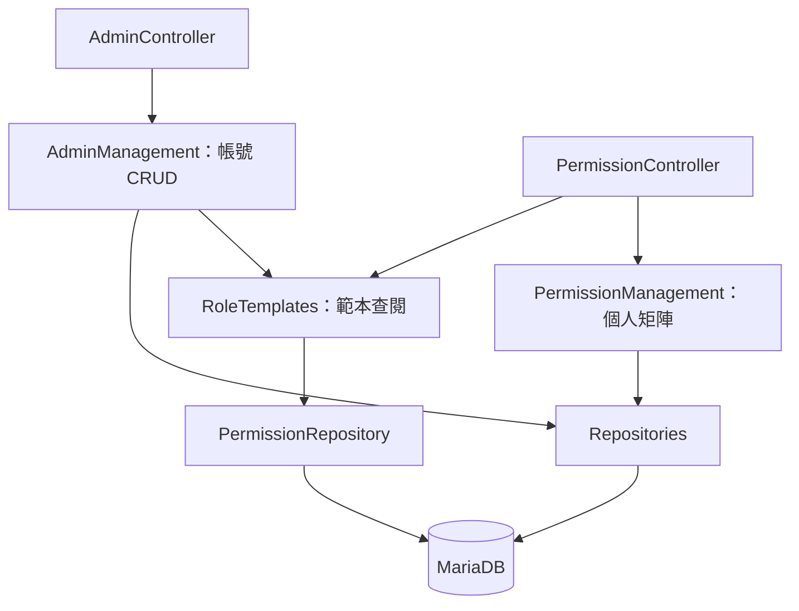

# PHP 分層閱讀指南

2026-10-17。U-02：使用者要求易讀、可重用的 API 架構，並指定可參考 Spring Boot。類別拆法、回應 DTO 與例外轉譯屬 E-01 工程設計；不是 Excel 新增的業務要求。

## 對照 Spring Boot 閱讀

| 常見角色 | 本案實作 | 職責 |
| --- | --- | --- |
| RestController | AdminController、PermissionController、AuthController | HTTP 輸入、呼叫服務、DTO → JSON；不查 SQL |
| Service | AdminManagement、PermissionManagement、RoleTemplates、Authentication | 使用案例、授權與交易；不依賴 Request、Cookie 或 PDO 驅動 |
| Repository | AccountRepository、PermissionRepository 等 | SQL、資料映射與已知儲存衝突轉譯；不自行提交交易 |
| Domain Model／Policy | Account、IdentityKind、PermissionPolicy | 帳號資料與純業務規則；含內部雜湊的 Account 不直接序列化 |
| Request／Response DTO | DTO/ 下的具名類別 | 輸入與輸出分開；安全摘要不持有密碼雜湊或完整 Account |
| 建構子 DI／設定 | Composition＋Composition\SharedServices | 組裝根（Composition Root）：`SharedServices` 建立同一請求共用的連線、權限、稽核與發布物件；帳號、景點與電影、消息優惠、會員、全站設定各有一個工廠方法回傳該區 Controller。業務不查全域容器 |
| Filter／統一錯誤處理 | Http/Kernel | 身分、CSRF、唯讀模擬、module/action 與 HTTP 錯誤碼 |

建構子注入參考 [Spring Boot 官方 DI 建議](https://docs.spring.io/spring-boot/reference/using/spring-beans-and-dependency-injection.html)；儲存例外轉譯參考 [Spring Framework DAO](https://docs.spring.io/spring-framework/reference/data-access/dao.html)。PHP 採明確組裝與 PDO，沒有 Spring 的註解掃描、JPA 或 AOP；角色職責相近，執行機制不同。

## 三個服務如何合作



- `AdminManagement` 負責新增／編輯／停用／刪除。換角色時向 `RoleTemplates.forAssignment` 取得合法起始值；帳號、個人權限與 audit 仍同交易保存。
- `PermissionManagement` 負責 catalog、讀取與保存個人矩陣，保留完整 40 格校驗、版本、鎖定、root 保護、防越級及本人保留管理權。
- `RoleTemplates` 負責查閱範本的授權、排除 root 範本及驗證可指派角色。不提交交易，也不把角色範本當成個人即時權限。

`Authorization`／`PermissionPolicy` 仍是共用規則。Kernel 檢查 HTTP 請求後，Service 在交易內重新讀取並鎖定操作者，防止請求途中停權或權限異動被忽略。沒有增加萬用 BaseService 或每類別一個空 interface。

## 實際資料流與回應

新增管理員：`POST /api/v1/admin/admins` → Kernel → `AdminController.create` → `AdminWriteInput` → `AdminManagement.create` → RoleTemplates／Policy → 同交易的帳號、權限、audit → `AccountSummary` → Controller `toArray()` → HTTP 201。

保存權限：`PUT /api/v1/admin/admins/{id}/permissions` → Kernel → `PermissionController.saveMatrix` → `PermissionMatrixInput` → `PermissionManagement.saveMatrix` → transaction／Authorization／Policy → PermissionRepository／EventRepository → HTTP 204。

| 輸出 DTO | 資料內容 |
| --- | --- |
| AccountSummary | 帳號欄位白名單；沒有 passwordHash、deletedAt 或內部 Account 參照 |
| AdminPage | 安全摘要列表、total、page、pageSize |
| RoleTemplate | id、name 與起始權限 |
| PermissionCatalog／PermissionMatrix | 最小選單摘要、矩陣欄位或對象／版本／權限 |
| IdentityResponse／PreviewStatus | member／admin、有效權限、可選的真正操作者摘要 |
| CaptchaResponse | challengeToken、期限與圖片或寄送提示；沒有答案 |

DTO 陣列集合有明確 PHPDoc 欄位型別，不為每格 module/action 額外建立類別。Controller 呼叫 `toArray()`；Cookie、status、CSRF、requestId 仍在 HTTP 邊界組合。API 路徑、JSON 欄位、可選欄位與 204 空內容保持相容。

## 重複資料與失敗

`AccountRepository.writeAccount` 只將 SQLSTATE 23000 **且 MariaDB code 1062** 轉成 `AccountConflict`。PdoTransactions 先回滾，Service 再於交易外重新查帳號／Email，轉成原有 409 欄位錯誤。外鍵、CHECK、連線及其他寫入失敗不冒充帳號衝突；Kernel 維持安全 500，不回 SQL 或內部訊息。死鎖重試仍由 PDO adapter 處理，SMTP 不放進可重試交易。

## 如何驗證

PHP 工具在 Docker 執行：

```powershell
docker compose exec -T app php /var/www/tools/vendor/bin/phpstan analyse --configuration=phpstan.neon --no-progress
docker compose exec -T app php /var/www/tools/vendor/bin/phpunit --configuration=phpunit.xml
docker compose exec -T app php /var/www/tools/vendor/bin/php-cs-fixer fix --config=.php-cs-fixer.dist.php --dry-run --diff
docker compose exec -T app php /var/www/tools/vendor/bin/rector process --config=rector.php --dry-run
docker compose exec -T app-test php tests/account_persistence.php
python backend/tests/api_integration.py
python backend/tests/admin_preview.py
python backend/tests/response_contract.py
```

整合測試需 test profile、yinghua_test 與 Mailpit；不能對 yinghua 執行。account_persistence.php 同樣檢查 APP_ENV／資料庫名稱，測試寫入最後回滾。HTTP 測試用隨機隔離帳號，憑證只留在被忽略的 artifacts，沒有 HTTP 測試後門。

PHPat 五條規則：Controller 不依賴 Repository／PDO；Repository 不依賴 Service／Controller／HTTP；Service 不依賴 HTTP／Controller；Service 不依賴 PDO／PDOException／PDOStatement；Model／DTO／Policy 不依賴 Repository／HTTP／PDO。相依檢查不能代替業務與越權測試。

實際結果見 [階段二驗收](../PHASE-2-ACCEPTANCE.md)。本次整理沒有修改 frontend/、website/、schema 或後續階段的業務功能。

E-01／E-13：Request.json() 不得丟棄 PHP 將 JSON 數字屬性名轉成的整數鍵；這類頂層鍵直接回 422，普通字串鍵繼續由 DTO 白名單驗證，巢狀 JSON 陣列不受影響。requestId 的契約固定為 32 位十六進位，JSON 與 X-Request-Id 一致。

## 共用的基礎工具（2026-11-03 整併）

同一件事只在一個地方實作，新程式請直接使用：

| 需要做的事 | 使用 | 說明 |
| --- | --- | --- |
| 回傳 API 錯誤 | `Exceptions\ErrorCode` enum + `ApplicationError` | 錯誤代碼與 HTTP 狀態集中在 enum，拼錯會在 PHPStan 被抓到 |
| 新增／修改資料列 | `Database::insert()`、`updateVersioned()` | 欄位名稱來自 DTO 白名單；修改時版本號自動加一 |
| 保留舊網址 | `Database::reserveAlias()` | 已屬於其他內容的網址丟出 `ContentConflict` |
| 下架軟刪除 | `Database::softDelete()` | 一併更新 `updated_at` 與版本號 |
| 「包含」搜尋、IN 清單 | `Database::contains()`、`inList()` | SQL 端寫 `LIKE :參數 ESCAPE '!'` |
| 判斷唯一鍵重複 | `Database::isDuplicateKey()` | MariaDB 錯誤 1062 |
| UTC 時間寫入 DATETIME | `Support\UtcDateTime::sql()` | |
| UUID 格式、JSON 編碼 | `Support\Uuid::isValid()`、`Support\Json::encode()` | |
| 未預期例外寫紀錄 | `Support\ErrorLog::exception()` | 只記類別、代碼、位置，不記訊息與參數 |
| 分頁參數、只帶版本號的請求、寫入回應 | `Request::page()`／`pageSize()`／`versionOnly()`、`Response::written()` | |
| 從公開快照找單筆 | `DTO\PublicCollection::find()` | |
| 常用設定 | `Config::csrfSeconds()`、`sessionSeconds()`、`idleSeconds()`、`mediaPath()`、`frontendSourcePath()` | |

電影、景點與推薦路線的後台儲存與刪除共用 `Services\ContentWriter`（發布鎖 → 交易 → 加鎖驗權 → 版本比對 → 寫入 → 稽核 → 重新發布），各服務只提供模組特有的檢查與寫入；網址識別衝突一律標在 `slug` 欄位，格式錯誤的編號一律回 404，稽核紀錄新增時「修改前版本」為空、狀態記實際儲存結果，資源名稱沿用既有紀錄的寫法。讀取單筆供編輯時，電影與景點改為「檢視或編輯」權限即可（使用者 2026-11-03 依功能規格 D20 確認），與消息、優惠、推薦路線一致。

消息與優惠的後台管理共用 `AdminContentManagement`／`AdminContentController`，在 `Composition` 依模組設定；兩者的資料存取與編輯分別實作 `Contracts\AdminContentRecords` 與 `Contracts\ContentEditor`。消息、優惠與店家的編輯服務由 `Composition::contentEditors()` 建立，後台 API 與 CLI 匯入共用。


## 設計模式對照

下列模式是為了讓職責單一、擴充時只改一處；名稱只是閱讀時的對照，不代表引入框架。

| 模式 | 位置 | 用途 |
| --- | --- | --- |
| 組裝根（Composition Root）＋工廠方法 | `Composition`、`Composition\SharedServices` | 唯一建立物件的地方；共用物件建一次，各區塊工廠方法只組自己的 Controller |
| 建構器（Builder） | `Services\PublicationSnapshotBuilder` | 從各資料表組出公開快照並算出 generation；`ContentPublication` 只負責發布流程、鎖定與記錄結果。`SECTIONS` 列出所有區段，發布延遲診斷依此比對，單元測試確認與實際快照一致 |
| 策略（Strategy，以 enum 實作） | `Models\PublicContentType` | 景點、電影、消息、優惠的快照鍵、正式網址（含博物館固定頁）、標題欄位、上一篇／下一篇分組與搜尋分類；網址轉向、上下篇、搜尋索引與 SEO 圖片檢查都以 `cases()` 逐一處理，不再各自維護字串清單 |
| 範本方法（Template Method） | `Services\ContentWriter`、`AdminContentManagement` | 共用的儲存／刪除順序（發布鎖、交易、權限、版本、稽核、重新發布），各模組只提供檢查與寫入 |
| 轉接器（Adapter） | `Adapters\*` 實作 `Contracts\*` | 外部服務（Node 產生器、SMTP、Google、檔案儲存、HTML 淨化）都藏在介面後，業務類別只依賴介面 |
| 介面隔離（ISP） | `Contracts\PublishedSnapshot`、`Contracts\ContentRenderer` | 只需讀已發布快照的服務（例如 `PublishedPolicies`）依賴 `PublishedSnapshot`；發布流程才需要完整的 `ContentRenderer`（產生頁面、版本與發布鎖） |
